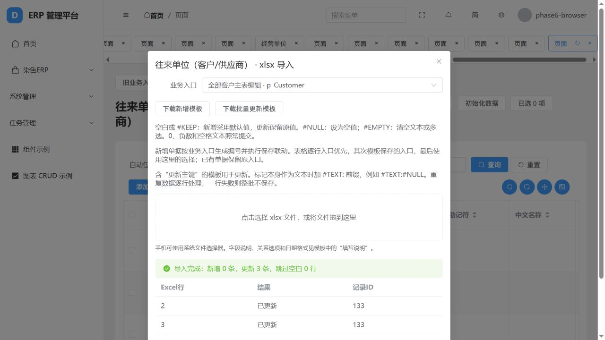

# Excel导入与手工录入验证清单

<!-- sales-production-current-20261022 -->
## 染整订单、报价及生产三模块（2026-10-22）

本轮开发及入口验证完成：主要销售入口为OrderMain染整订单、FixedPrice染整报价；其他原订单/报价及整理模型保留分组。生产相关入口按工艺设计、排产管理、生产管理整理；首页共九个业务模块，复用原模型、原主键、服务、地址和权限。176个资源归属登记，16条既有分类路径调整，没有新增旧erpID或数据库迁移。

染整报价补充包含23份xlsx：11份原资料、11份新增空白模板、1份目录；888条原行全部保留。独立库初验250项、最终入口/保存194项及既有Excel回归23/23通过，44,896原字段对照差异0，847报价明细主从关系完整；当前项目仅应用菜单配置，本轮正式业务导入0。浏览器验证主要入口、默认选择、独立库新增及三模块页面，前端构建/后台检查通过。

**开发完成：本轮限定范围。历史数据对账：本包独立试导已逐字段核对，正式库全量对账/采用未执行。现场验收：未执行。** 财务、打印、原35项查询继续暂缓，933项原盘点和其他已登记差异不因本轮关闭；对客报价/客确价/总单价分别保留，异常、重复及少用业务不跳过。

见[实施及全部归属明细](2026-10-22染整订单报价与生产三模块实施及验证.md)、[异常及后续](2026-10-22染整订单报价与生产导航异常及后续.md)。后续按新导航由用户核对已有资料并手工采用导入文件，再逐步录入真实订单、工艺、排产和执行单据，正式对账与现场验收分别记录。
<!-- /sales-production-current-20261022 -->

<!-- system-management-current-20261021 -->
## 系统管理当前进展（2026-10-21）

系统管理总览、六类分组及独立编号入口已整理，复用33个常规管理功能、3类设备通讯配置及原配置档案；117条分类资料归属修正，业务基础资料不转回平台字典。生产参数、质量数量来源留在业务模块。原菜单ID/地址/资源、原接口/字段/数据范围保留，补齐目录可见性，首次加载管理地址的权限重检已修复。

独立库18/18项通过，前端类型检查、构建及17项浏览器角色/入口/刷新直达/权限分页筛选验证通过，当前项目已应用菜单。**开发完成：本轮目录、入口及权限重检范围。历史全量对账、真实设备接入、现场岗位权限验收：未完成。** 系统通知实时消息尚缺可用Redis环境，见专项异常。没有正式导入旧资料、没有新增旧erpID，财务、打印和原35项查询继续暂缓；933项原盘点和原未完成差异不因本轮关闭。

见[系统管理实施与验证](2026-10-21系统管理实施与验证.md)、[全部入口与分类调整](2026-10-21系统管理菜单归属明细.md)、[异常与后续](2026-10-21系统管理异常与后续事项.md)。
<!-- /system-management-current-20261021 -->

<!-- numbering-current-20261021 -->
## 编号管理当前进展（2026-10-21）

编号管理模型、29条建议规则（11个原资料模型/既有编号字段）、管理页面、普通保存、Excel及公共自动建单取号已接入。编号专项45/45、既有回归45/45、浏览器11项通过；156模型既有独立资料批次109,083行、4,919,901字段复核差异0。当前项目仅安装0035迁移和29条配置，11个目标模型及原计数器安装前后行数/内容摘要一致，未正式导入旧资料。

**开发完成：** 上述范围及未引用基础资料改码。**仍缺开发：** 已引用基础资料专用改码、复杂单据已有单号变更。**正式历史全量对账、现场验收：均未完成。** 财务、打印、原35项查询继续暂缓，933项原盘点及原保存/事件差异不因本轮通过而关闭。

见[编号管理实施与验证](2026-10-21编号管理实施与验证.md)、[编号异常与后续](2026-10-21编号管理异常与后续事项.md)。下载的新增模板已增加编号规则说明，既有历史xlsx原文件保持不变。没有新增旧erpID，异常、停用及重复原行不去重、不跳过。
<!-- /numbering-current-20261021 -->

更新日期：2026-10-18。当前优先基础资料录入、业务单据和实际流程；全部打印、原35项查询、财务暂缓。额外旧erpID为0，旧表原有主键字段保留。

## 本轮交付与验证范围

|项目|开发验证|历史全量对账|现场验收|
|---|---|---|---|
|Excel业务入口、批次与逐行入口、主从继承|通路与专项样本通过|未完成|未完成|
|自动编号、默认日期、保存公式、原保存事件|所列样本通过，复用页面service|未完成|未完成|
|NULL、空文本、空白、0、负数、前导零与重复数据|专项通过|未完成|未完成|
|更新模板、同主键连续更新、业务失败整批回滚|专项及浏览器通过|未完成|未完成|
|全部业务入口的保存/审核/转单/逆向|部分完成，原逐绑定清单保留|未完成|未完成|
|打印、原35项查询、财务|按要求暂缓，原差异不删除|未完成|未完成|

本轮完成的是Excel录入通路及列明的业务样本，不等于全部业务入口已验收。原六组933个固定编号不变；5条保存来源差异、9条事件缺口继续登记，235条事件接线仍按绑定逐项验证。打印保留28份可校样、130份非财务差异及其余缺入口/缺XML记录。

## 开始录入的方法

1. 从对应旧业务入口打开原表，例如“全部客户主表编辑”“厨房采购单入库主表”。点击“xlsx 导入”，确认业务入口，下载**新增模板**。旧入口共用一个原表时，入口决定默认值、编号和保存事件。
2. 按模板填写“数据”页。新记录的入口优先使用该行“业务入口”，其次使用工作簿“导入设置”的入口，最后使用导入窗口的入口。要改变整份模板入口，修改“导入设置”对应值；逐行指定可覆盖该设置。已有记录更新保留原入口。
3. 自动编号字段留空会执行该入口已有编号规则；明确填入原编号、NULL或空文本则照输入提交，由原业务规则决定是否允许。不能把所有表都理解为同一种编号规则。
4. 按“先主单、后明细”的顺序录入。关联字段按模板“填写说明”和选项填写；明细提供明确父单关系后可继承入口。同号父单不擅自合并，关系存在歧义时先核对具体原记录。
5. 修改已有数据请下载**批量更新模板**，保留“更新主键”。它使用现有模型主键定位记录，不增加旧erpID。更新模板带出NULL/空串标记，已有值不变时不重复覆盖本次公式计算结果。
6. 提交后按Excel行号查看新增/更新结果与记录ID。重复内容会逐行新增；同一更新主键出现多次会按行顺序更新，不会跳过。再次提交新增文件会再次新增，界面不擅自把重复数据当成错误。

## 空值与特殊值

|Excel填写|实际含义|
|---|---|
|空白或 `#KEEP`|新增不提交该字段，采用模型/入口既有默认值；更新不改原值。必填字段仍按业务要求校验。|
|`#NULL`|明确提交NULL；不允许NULL的字段会报出行和字段，整批回滚。|
|`#EMPTY`|文本置为空串；多选置为空列表。数字不能用空串代替NULL。|
|`#TEXT:#NULL`|保存字面文本 `#NULL`；其他保留字同理。原文本以 `#TEXT:` 开头时再加此前缀。|
|`0`、负数、空格文本|照常提交，不当成空值或自动改成正数。|
|前导零编码|使用模板的文本格式填写，例如 `001801`，不转换为数值1801。|
|公式单元格|读取Excel已保存的计算结果；缓存结果0可导入。无缓存或公式错误则报错，不当空白跳过；先在Excel计算并保存，或粘贴为值。|

只有整行物理空白才计入“跳过空白”；含序号但其他字段空白的行仍作为录入行执行。未命名列中有内容会报错，避免漏字段。原表存在同名显示标题时，模板附加原字段名区分，各字段都保留。

## 业务事件与失败处理

Excel逐行使用与页面相同的序列化和service保存通路，执行现有默认值、编号、本行公式、父子汇总及保存事件。新增或更新发生错误时整批事务回滚，包括之前行的编号序列、关联回写及业务动作记录；不会悄悄导入正确行后丢弃错误行。

实际验证中，CustKindID=0的客户修改客户编码触发旧 `p_Customer_UPDATE` 禁止修改规则。第3行报错，第2行修改也回滚；改为允许修改的名称、备注和空值后，3次更新成功。这条规则保留，不能为了让导入通过而删除原规则。错误和重复记录不会跳过，需按报告处理后重新提交。

普通业务Excel导入会发生业务保存联动。旧历史数据原样承接应继续使用既有历史导入流程，避免把历史单据当作现在发生的业务再执行一次。已有历史来源的更新不会根据窗口默认入口补造新入口。本轮未批量导入旧ERP历史数据。

## 验证证据

- 自动验证：90项相关回归通过；最终17项专项通过，其中16项重叠、1项新增，共91项不同用例。覆盖客户/供应商同表不同入口、明确入口优先级、自动编号、显式空值、父单继承、明细汇总及库存账、错误事务回滚、重复字段标题和公式缓存。
- 浏览器：新增3条往来单位（2条相同客户编码均保留，另1条逐行指定供应商入口）；新增3张采购单，分别生成编号；3次更新中同一主键连续更新2次成功；错误入口和禁止修改客户编码两类失败均整批回滚。
- 保存联动：CookIn沿用原ArticleIn/ArticleInDetail→p_Article来源，2头×3明细的6个连接候选全部记录；3条同码材料保留，Price结果为-7、-7、9，LastPrice均-7。无序来源选取的既有替代说明见E249，未宣称全量历史等价。
- 额外8条来源样本＋6条浏览器新增，共14条合成原表记录留在独立浏览器验证库。测试库事务回滚；旧ERP历史数据本轮导入0，本轮未连接SQL Server。
- 前端类型检查、构建、Django检查及迁移检查通过。766个ERP模型、655个原表模型、12606个原字段，额外旧erpID为0，没有新增迁移。

[验证汇总](erp-excel-entry-verification-20261018.json) · [浏览器逐步结果](assets/phase6-excel-browser-20261018.json) · [数据库结果](assets/phase6-excel-database-20261018.json) · [异常与合理实现说明](旧ERP复刻异常与合理实现说明.md)

## 接下来的实际使用顺序

先录组织、单位、仓库、客户/供应商、物料，再录依赖这些资料的工序、机台等；具体字段关联按所选入口模板核对。基础资料就绪后，按实际业务从主单到明细录入，再执行审核、转单、收发和撤销，逐单核对数量、重量、单位、状态和关联记录。异常及重复行照常保留；无法保存的列入错误记录和异常说明，不能当作成功导入。

本轮可以开始上述基础资料和已验证入口的业务录入。尚未逐绑定验证的业务继续边录边核对；全量历史对账、现场岗位验收分别推进，不以合成测试通过代替。
