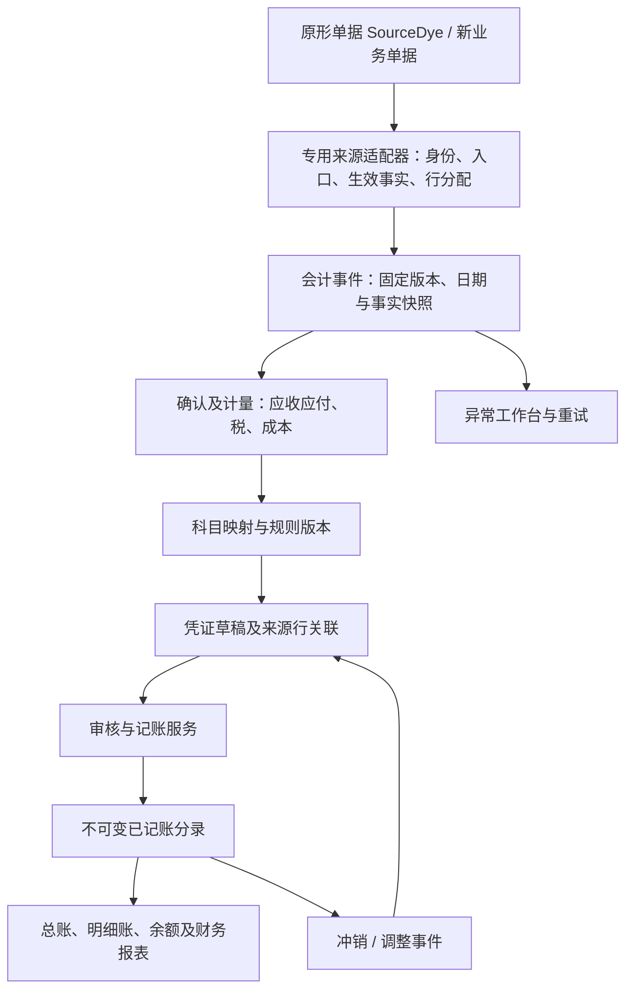

# 染色 ERP 财务模块：参考项目源码分析与开发方案

编写日期：2026-10-19。分析对象为本机三个目录的当前文件，不以 GitHub README 的功能描述代替源码事实。

| 对象 | 本机位置 | 本文用途 |
| --- | --- | --- |
| Django Ledger | `H:\Project_python\django-ledger-master` | 分析单据状态与账簿差额驱动的凭证生成 |
| NavAccounting | `H:\Project_python\NavAccounting-main` | 分析业务动作直接生成凭证及核销的流程 |
| 当前染色 ERP | `H:\Project_python\django-vue3-admin\djangovue3_dyeing` | 确定财务模块的数据来源、接入点及实施顺序 |

**建议：在当前项目内新增独立的 `erp_finance` 应用。采用“业务事实快照 → 会计事件 → 财务子账/成本计价 → 凭证草稿 → 审核记账”的方式，借鉴两个项目的思路，重新实现中国准则及染色业务规则，不直接整套引入任一参考项目。**

本次交付是源码分析与开发设计：没有启动参考项目，没有操作生产数据库，没有实施财务代码或迁移。文中“已存在”表示已在当前文件中定位；“建议/拟新增”均为待实施设计。当前仓库存在大量进行中的业务修改，本文按阅读时的文件分析，不把历史验收报告当作本次运行验证。现有文档中的“财务暂缓”继续作为实施状态；本文不把方案编写描述成财务模块已经启用。

## 1. 先明确三个概念

1. **业务单据生效**：例如出入库生效、客户签收、供应商结算确认、实际收付款。它说明业务发生，不自动等于会计确认条件已满足。
2. **生成财务凭证**：依据业务事实、会计政策、科目映射和金额规则产生借贷分录。建议默认生成可追溯的待审核凭证。
3. **凭证记账**：凭证通过期间、科目、金额、辅助核算和权限检查后进入正式账簿。只有已记账凭证进入正式总账和财务报表。

现有代码中的库存 `post()`、`StockBook`、`AccDate` 等词不能直接解释成财务总账已经记账。业务审核也不等于会计凭证审核。后续页面分别使用“库存生效”“生成凭证”“凭证审核”“凭证记账”。

## 2. Django Ledger 如何从业务单据生成凭证

### 2.1 数据结构

主要关系如下，其中 Invoice 是客户销售结算单据的语义，不应直接等同于中国增值税发票：

```text
EntityModel 企业/会计主体
  ├─ ChartOfAccountModel → AccountModel 科目
  └─ LedgerModel 账簿容器
       ├─ InvoiceModel 或 BillModel 关联的单据
       └─ JournalEntryModel 凭证头（可带 EntityUnit）
            └─ TransactionModel 借贷分录

Invoice/Bill → ItemTransactionModel 明细 → ItemModel 所配置的收入/费用/存货/成本科目
```

`AccrualMixIn` 包含 `ledger`、`cash_account`、`prepaid_account`、`unearned_account`，以及单据总额、付款额、应计标志和进度等。这里的字段命名是为销售/采购两端共用的抽象，不能只按中文直译确定科目含义；实际取决于单据方向及科目角色。

`InvoiceModel.configure()` 按企业的会计方法初始化 `accrue/progress`，创建并关联该单据的 Ledger；`BillModel` 采用类似方式。[Invoice 配置代码](H:/Project_python/django-ledger-master/django_ledger/models/invoice.py:417)、[共用应计模型](H:/Project_python/django-ledger-master/django_ledger/models/mixins.py:178)

### 2.2 触发链

| 业务动作 | 代码入口 | 主要行为 |
| --- | --- | --- |
| 单据配置 | `configure()` | 关联企业、单据账簿、基础科目及会计方法 |
| 销售单据批准 | `InvoiceModel.mark_as_approved()` | 保存批准状态；应计模式或要求迁移时调用 `migrate_state()`，再处理账簿发布 |
| 采购账单批准 | `BillModel.mark_as_approved()` | 与销售端类似，按账单状态迁移账务 |
| 部分收付款 | `make_payment()` | 增加累计已收/已付额，重新计算应有状态并迁移 |
| 全额付清 | `mark_as_paid()` | 调整进度和付款额，迁移分录后锁定单据账簿 |
| 单据作废 | `mark_as_void()` | 以零目标状态计算反向差额，保留已有分录并追加抵销 |

核心入口是 [Invoice 批准](H:/Project_python/django-ledger-master/django_ledger/models/invoice.py:1191)、[Invoice 部分收款](H:/Project_python/django-ledger-master/django_ledger/models/invoice.py:924)、[Bill 批准](H:/Project_python/django-ledger-master/django_ledger/models/bill.py:1293)、[Invoice 作废](H:/Project_python/django-ledger-master/django_ledger/models/invoice.py:1405)。这些入口的 `commit` 参数决定是否实际保存，不能把默认调用理解为必然记账。

### 2.3 核心算法：目标状态减去已有账簿状态

`AccrualMixIn.migrate_state()` 的真实步骤是：

1. 从单据行读取 `get_migration_data()`，整理金额、组织单元和物料科目。
2. Bill 优先选择明细物料的费用科目，否则使用存货科目；Invoice 使用收入科目，并在配置了成本/存货科目时计算销售成本调整。
3. 结合 `accrue`、`progress` 和付款额，计算当前应反映的现金、应收/预付、应付/预收、收入/费用等状态。
4. 按组织单元拆分金额，组合成目标科目余额集合。
5. 使用 `ledger.digest()` 汇总已经存在的账务状态。
6. 对相同的“科目、组织单元、余额方向”求差额。
7. 非零差额转换成借方或贷方 Transaction；每个组织单元对应一个 JournalEntry。
8. 校验分录及借贷平衡，写入分录，再验证凭证并标记发布和锁定。

概念公式为：

```text
本次应新增的分录 = 当前业务应有的累计会计状态 − 该单据已有的累计账务状态
```

关键实现见 [migrate_state](H:/Project_python/django-ledger-master/django_ledger/models/mixins.py:610)，目标与账簿差额的代码在同一方法内。这个方法是**账务状态迁移**，不是 Django 数据库结构迁移。

例如，不考虑税和成本，以应计模式确认销售 1,000 元，再收款 300 元：

| 时点 | 应有累计状态 | 本次新增分录 |
| --- | --- | --- |
| 确认销售 | 应收 1,000；收入 1,000 | 借应收 1,000；贷收入 1,000 |
| 收款 300 | 银行 300、应收 700；收入仍 1,000 | 借银行 300；贷应收 300 |
| 同一状态再次计算 | 目标与账簿余额相同 | 无新增金额分录 |

最后一种情况只说明差额算法能减少重复金额，不代表实现了完整的请求幂等：当前实现还会按参与状态的组织单元准备凭证头，零差额路径也不能直接视为“什么都不写”。并发请求、重复扣款、空凭证头和上游累计金额的重复更新仍需要独立控制。

### 2.4 科目、成本和校验

- 单据明细通过 ItemModel 的 `earnings_account`、`expense_account`、`inventory_account`、`cogs_account` 取科目；不是把单据文本交给 AI 判断科目。
- Invoice 成本分支使用物料的累计入库金额/数量计算平均单位成本，再乘本次数量及进度；这不是染色工卡/缸批的完整成本核算。
- `check_tx_balance(..., perform_correction=True)` 有差额修正逻辑；本项目不能无条件借用它掩盖金额错误，应明确舍入边界和容许的尾差。
- `JournalEntryModel.verify()` 校验借贷平衡及科目表归属；凭证编号另有序列与事务锁处理。这些机制值得参考，但需要连同服务调用边界一起核对，不能只复制模型。
- `migrate_state()` 本身没有包住整个业务操作的 `@transaction.atomic`；局部编号事务不等于“业务状态、凭证、子账”的完整原子事务。

参考：[凭证验证](H:/Project_python/django-ledger-master/django_ledger/models/journal_entry.py:1370)、[凭证编号](H:/Project_python/django-ledger-master/django_ledger/models/journal_entry.py:1335)、[平衡检查](H:/Project_python/django-ledger-master/django_ledger/io/io_core.py:195)。

### 2.5 另一个入口：收据和导入暂存交易

本机版本还存在 `ReceiptModel.migrate_receipt()`：它从 `staged_transaction_model.commit_dict()` 取得已整理分录，再调用 `ledger.commit_txs(..., je_posted=True)` 形成凭证，并回写暂存交易的关联。

这是与 Invoice/Bill 累计状态迁移不同的路径。接入银行回单时必须规定是驱动已有收款业务，还是导入独立费用/转账；不能两个入口各生成一次银行分录。[收据迁移](H:/Project_python/django-ledger-master/django_ledger/models/receipt.py:828)、[统一分录提交](H:/Project_python/django-ledger-master/django_ledger/io/io_core.py:1385)

### 2.6 值得借鉴与不宜直接照搬的部分

值得借鉴：单据与账务关联、统一分录模型、已记账数据锁定、追加调整、按组织维度归集、状态差额用于对账。

不宜照搬：以付款进度驱动收入的非应计模式、单据作废时把所有目标余额清零、使用物料全局平均成本替代缸批成本、把外国科目角色/报表直接当成中国准则、把账簿锁定等同于中国凭证和结账控制。尤其单据财务冲销不能被解释成银行已经实际退款。

## 3. NavAccounting 如何从业务单据生成凭证

### 3.1 数据结构和实现方式

它采用更直观的“业务动作 → 专用 service → 凭证”模式：

```text
Payment / Receipt / GoodsReceipt / COGSCalculation / 折旧等
  → 对应 services.py 读取金额和科目
  → JournalEntry（tenant、日期、期间、币种、来源、编号）
  → JournalEntryLine（account、debit、credit）
  → 回写业务单据 journal_entry
```

JournalEntry 有草稿、待审批、已批准、已过账等状态，JournalEntryLine 分列借贷金额；业务 service 大多直接以 `status='posted'` 创建。人工凭证审批与自动凭证创建不是同一条完整的统一记账服务。[总账模型](H:/Project_python/NavAccounting-main/apps/general_ledger/models.py:93)

### 3.2 主要业务链

| 业务 | service | 意图及关联 |
| --- | --- | --- |
| 供应商付款 | `create_payment_journal_entry()` | 借应付、贷银行；付款分配回写 Bill 已付额 |
| 客户收款 | `create_receipt_journal_entry()` | 借银行、贷应收；ReceiptAllocation 回写 Invoice 已收额 |
| 收付款作废 | `create_void_*_journal_entry()` | 新建反向凭证，回退相关核销金额 |
| 应收贷项通知 | `create_credit_memo_journal_entry()` | 生成销售退回/应收调整分录 |
| 坏账核销 | `create_write_off_journal_entry()` | 生成坏账费用与应收冲减分录 |
| 采购入库 | `post_goods_receipt()` | 更新采购收货量、CostLayer、物料数量、库存流水和凭证 |
| 成本结转 | `run_cogs_calculation()`、`post_cogs_calculation()` | 先计算成本，再借销售成本、贷存货 |
| 固定资产 | `fixed_assets/services.py` | 按资产类别配置的科目生成取得、折旧、处置等凭证 |

参考：[AP 服务](H:/Project_python/NavAccounting-main/apps/accounts_payable/services.py:11)、[AR 服务](H:/Project_python/NavAccounting-main/apps/accounts_receivable/services.py:11)、[入库服务](H:/Project_python/NavAccounting-main/apps/inventory/services.py:27)、[成本计算](H:/Project_python/NavAccounting-main/apps/inventory/services.py:254)、[成本过账](H:/Project_python/NavAccounting-main/apps/inventory/services.py:313)。

### 3.3 客户收款调用示例

`accounts_receivable.views.receipt_complete()`：

1. 取得当前租户下的 Receipt，检查状态。
2. 调用 `create_receipt_journal_entry(receipt, tenant, user)`。
3. service 创建凭证头和借贷行。
4. 把凭证写回 `receipt.journal_entry`，把收款状态改为 completed。
5. 遍历 allocations，增加对应 Invoice 的 `amount_paid` 并更新结清状态。

这说明“资金收取”“收款凭证”“分配到哪些应收单”是三个相关对象，而不是只改一个应收余额字段。[实际调用链](H:/Project_python/NavAccounting-main/apps/accounts_receivable/views.py:1000)

### 3.4 本机源码中已定位的问题

以下是静态阅读发现，不表示本次运行过相应页面；实现本项目时应避免这些问题。

| 问题 | 本机证据 | 对本项目的要求 |
| --- | --- | --- |
| AP 调用参数不一致 | `payment_complete` 第 791 行仅传 payment、user；service 签名要求 payment、tenant、user；作废调用同样少参数 | 入口和 service 契约必须有集成测试，不能只看 service 存在就宣称业务跑通 |
| 入库抵销科目是占位实现 | `post_goods_receipt` 借贷都使用 `category.gl_inventory_account`；注释才写“已收货未开票” | 明确配置暂估应付等科目，禁止借贷同一个存货科目造成账面净额为零 |
| 折扣错误占用银行科目 | AP 折扣贷方、AR 折扣借方仍使用 bank_account | 按选定准则及合同性质处理商业折扣、现金折扣、价款调整，不污染银行余额 |
| 库存凭证缺少必填期间 | JournalEntry.fiscal_period 为非空外键；`post_goods_receipt` 和 `post_cogs_calculation` 创建时未传该字段 | 统一按账簿和记账日解析会计期间，缺失时拒绝记账 |
| 自动凭证绕过批准流程 | service 创建时直接写 posted | 自动生成与正式记账分开，统一经过记账服务 |
| 模型 clean 不等于自动执行 | 总账模型有 clean/is_balanced，但上述 create/save 路径未形成统一 full_clean+平衡检查；journal_post 主要改状态 | 所有写入路径，含导入、后台任务和动作接口，共用校验和记账服务 |
| 原子性和并发保护不足 | 所阅收付款/入库 service、视图未见覆盖全链的 atomic/select_for_update；配置中未检出 ATOMIC_REQUESTS | 业务状态、核销和凭证必须采用明确事务边界及数据库唯一约束 |
| 编号读取最大值加一 | `generate_entry_number()` 按当前年、最大字符串编号加一 | 使用数据库序列行/锁和唯一约束，按记账期间取年度，不按服务器当前年推断 |
| 缺少完整应收应付确认链 | 所阅 `invoice_approve`、`bill_approve` 更新状态和审批记录，没有确认收入/费用/应收应付的分录调用 | 必须补齐债权债务初始确认，不能只实现“借银行贷应收”而没有应收来源 |
| 成本规则不适合直接移植 | COGS 含 LIFO；issue/scrap/write_off 一并参与销售数量归集 | 中国法定成本策略不提供后进先出；生产领用、销售、报废分别处理 |

参考：[AP 调用错误](H:/Project_python/NavAccounting-main/apps/accounts_payable/views.py:775)、[采购入库占位科目](H:/Project_python/NavAccounting-main/apps/inventory/services.py:90)、[人工凭证过账](H:/Project_python/NavAccounting-main/apps/general_ledger/views.py:454)、[发票批准](H:/Project_python/NavAccounting-main/apps/accounts_receivable/views.py:466)、[账单批准](H:/Project_python/NavAccounting-main/apps/accounts_payable/views.py:556)。

因此，这个项目适合参考业务拆分和可读性，不适合把“文档模块齐全”当成“财务链已完整可用”。

## 4. 两个参考项目的取舍

| 方面 | Django Ledger | NavAccounting | 当前项目建议 |
| --- | --- | --- | --- |
| 生成方式 | 目标累计状态与账簿差额 | 每类动作直接生成分录 | 明确事件生成；目标状态用于对账和受控调整 |
| 科目来源 | 物料科目、账户角色、单据基础科目 | 单据科目、物料类别/资产类别配置 | 账簿内的版本化科目规则，明确来源及优先级 |
| 凭证追溯 | 单据绑定 Ledger，Ledger 下多凭证 | 单据回写 journal_entry、source/reference | 事件、单据行、凭证行多对多关联，支持分批和汇总 |
| 成本 | 偏通用物料平均成本 | CostLayer、FIFO 等及 COGS 批处理 | 货权隔离的库存计价＋工卡/缸批成本对象 |
| 冲销 | 目标状态归零的差额 | 专门的反向凭证函数 | 引用原凭证/原行与原金额；业务退款另有事件 |
| 中国本地化 | 未见完整现成实现 | 未见完整现成实现 | 独立实现准则包、税务、凭证、报表和期间规则 |

选择显式事件还有一个原因：源单据金额变了，并不意味着可以立即按新旧差额改变法定账。必须先确认这是价格更正、退货、折让、进度调整还是前期差错，并有日期、原因、证据和适用规则。因此，借鉴 Django Ledger 的“应有状态”作为对账工具：发现差额后提出调整候选，批准调整事件后再生成凭证，不让对账任务自动覆盖或修复已记账数据。

本机 Django Ledger 为 GPLv3，NavAccounting 为 MIT。这里优先研究机制；若以后复制或嵌入源码，需要分别核对许可证及当前项目的分发方式，不能因为技术可嵌入就默认可按任意许可证发布。[Ledger 许可证](H:/Project_python/django-ledger-master/LICENSE)、[NavAccounting 许可证](H:/Project_python/NavAccounting-main/LICENSE)

## 5. 当前染色项目实际具备什么

### 5.1 已存在的能力

| 能力 | 已定位对象/代码 | 财务可复用的部分 |
| --- | --- | --- |
| 组织和往来主档 | `BusinessUnit`、`Factory`、`Party`、`PartyRole` | 经营单位、工厂、客户/供应商/外协方等辅助维度 |
| 报价和销售 | `CommercialPriceLine`、`SalesOrderLine`、`Delivery/DeliveryLine` | 确认价格、计价单位、采用原因及快照、订单和交付关联 |
| 采购 | `PurchaseOrderLine`、采购退货 | 来源订单、物料、数量、单价、计价单位 |
| 库存 | `InventoryLot`、`InventoryMovement`、`StockBalance`、出入库/调拨/盘点 | 实际数量、批次、货主、来源行及反向流水 |
| 生产 | `WorkCard`、`DyeBatch`、分配关系、计划、称量、执行 | 成本对象、工卡到订单分配、缸批到工卡分配及实际耗用候选 |
| 主从事务 | `document_services.save_document()` | 表头明细一起保存、源记录办理链锁定 |
| 业务留痕 | `BusinessAction`、`business.record()` | 动作前后快照、原因和操作者 |
| 旧入口办理 | `SourceRecord`、`SourceDocumentContext`、`source_services.advance/reopen()` | 入口身份、审核/反审核及派生来源 |
| 平台能力 | 动态资源、角色/字段/数据范围、xlsx、Celery | 账簿权限、草稿页面、导出与后台计算框架 |

当前 `application/plugins.py` 注册的是七个 ERP 应用，没有独立 `erp_finance`。`CoreModel.dept_belong` 是部门归属，不能代替法人或会计主体隔离。数据库配置支持 SQLite 与 PostgreSQL；SQLite 配置使用 IMMEDIATE 事务，但不能把它理解为 PostgreSQL 的行锁行为。

证据：[应用登记](H:/Project_python/django-vue3-admin/djangovue3_dyeing/backend/application/plugins.py:1)、[平台模型](H:/Project_python/django-vue3-admin/djangovue3_dyeing/backend/core/models.py:22)、[数据库配置](H:/Project_python/django-vue3-admin/djangovue3_dyeing/backend/application/database_config.py:17)、[整单保存](H:/Project_python/django-vue3-admin/djangovue3_dyeing/backend/plugins/erp_base/document_services.py:23)。

### 5.2 必须同时考虑两类业务模型

当前项目并非只有新设计的 `SalesOrder/StockReceipt`：还保留大量 `SourceDye*` 原表模型，具有旧字段、原入口规则、库存过程和派生上下文。

- 新模型路径：库存 `services.post()` 创建 InventoryMovement；`fulfillment_services.deliver()` 在实际库存生效后记录交付。
- 原形路径：`source_services.advance()` 办理确认/审核并执行库存、工作流和入口钩子；部分旧入口“保存即更新库存”，实际生效时机取决于入口配置，不能只监听 `approved`。
- 原形的 `source_delivery_flow.confirm_delivery()` 在上下文中保留签收结果、收货人、时间和来源；这可以作为财务确认的证据候选，但仍要判定签收结果和合同条件。
- 相同经济业务可能有旧原形记录、新模型、派生记录和查询投影；财务必须指定唯一记账来源，不能全部扫描生成凭证。

证据：[新库存生效](H:/Project_python/django-vue3-admin/djangovue3_dyeing/backend/plugins/erp_warehouse/services.py:318)、[新交付服务](H:/Project_python/django-vue3-admin/djangovue3_dyeing/backend/plugins/erp_sales/fulfillment_services.py:88)、[原形审核](H:/Project_python/django-vue3-admin/djangovue3_dyeing/backend/plugins/erp_base/source_services.py:443)、[原形库存入口](H:/Project_python/django-vue3-admin/djangovue3_dyeing/backend/plugins/erp_base/source_phase3_posting.py:1)、[原形交付确认](H:/Project_python/django-vue3-admin/djangovue3_dyeing/backend/plugins/erp_base/source_delivery_flow.py:116)。

### 5.3 已有财务名称不等于已有财务模块

- `erp_quality.SourceDyeFARMain/FARDetail/FARRecord` 已存在。当前承接用途涉及质量、数量及业务报表来源，不意味着应收审核、收入确认和总账闭环已实现。
- FARDetail 有 `old_armoney`、`old_amount`、`old_price_qty`、`old_process_price`、最低消费、分头金额、缸位金额及折扣等字段。新财务必须先核实这些金额的组合关系，不能简单全部相加。
- `erp_base.SourceDyeFMoneyInDetail` 有应收明细号、出库明细号、本次核销、未销金额等，但不能据此认定已有完整收款表头、银行账户和核销流程。
- `SourceDyeClothGetMoney` 的明细实际包含收到条数等字段，不能凭 GetMoney 名称直接识别成银行收款单。
- 已阅业务模型尚不足以提供统一的会计主体、账簿、科目、期间、税务发票、应收应付子账、货币计价流水和总账凭证。

证据：[FAR 原形](H:/Project_python/django-vue3-admin/djangovue3_dyeing/backend/plugins/erp_quality/source_models.py:409)、[核销明细原形](H:/Project_python/django-vue3-admin/djangovue3_dyeing/backend/plugins/erp_base/source_models.py:1883)、[ClothGetMoney 原形](H:/Project_python/django-vue3-admin/djangovue3_dyeing/backend/plugins/erp_sales/source_models.py:7)。

### 5.4 历史身份规则必须保留

遵守项目已有《原键字段与来源追溯规范》：不在每张业务表新增通用 `legacy_id`；内部 id 用于当前记录关联，原主键各列和业务编号保留原事实，`source_batch/source_row` 只定位一次抽取中的记录。无可靠原键的重复记录不能擅自去重。

财务可以新增专属的“经济业务来源映射表”，连接已经核实为同一业务的旧/新记录；它不替代既有来源映射、不覆盖旧原行，也不把内容摘要作为跨批次永久身份。历史批次导入默认不触发凭证。

证据：[原键规范](H:/Project_python/django-vue3-admin/djangovue3_dyeing/docs/原键字段与来源追溯规范.md:1)、[历史识别与来源展示](H:/Project_python/django-vue3-admin/djangovue3_dyeing/backend/plugins/erp_base/source_provenance.py:5)。

## 6. 会计口径：开发前要确定、系统内要固化

以下把准则要求、会计政策选择和软件设计分别表达；软件设计建议不等于法规逐条原文。资料核对截至 2026-10-19。

### 6.1 一个账簿选择一种准则体系

建议底层支持准则版本标识，但第一期只实现企业实际选定的一套：

- 执行企业会计准则时，收入按修订后的第14号准则判断履约义务及控制权；允许的时段确认需要相应合同和进度数据。
- 执行小企业会计准则时，采用其独立的确认、成本、差错处理和报表规则；加工劳务特别核对第62—63条的同年完成及跨年处理。
- 不能只切换科目名称就声称支持两套准则，也不能把企业准则的合同资产/合同负债和减值规则机械套到小企业准则账簿。
- 科目、报表、收入策略及变更规则打包管理；启用后变更按政策迁移办理，不允许任意切换历史账簿口径。

依据：[企业会计准则第14号——收入](https://kjs.mof.gov.cn/zt/kjzzss/kuaijizhunzeshishi/201709/t20170907_2694006.htm)、[小企业会计准则](https://kjs.mof.gov.cn/zhengcefabu/201111/P020111118325852319878.pdf)。

### 6.2 染色加工与自营销售首先分清货权

**客户送来的坯纱/坯布，在企业仅保管加工、未取得应确认资产的权利时，不能按客户材料价值记本企业原材料和应付账款。** 建立受托物资数量备查账，核算本企业发生的加工成本和加工收入。

自购材料、自有产品则按相应存货及成本规则处理。不能用“在我的仓库”推断为企业资产，也不能把 `InventoryLot.owner is None` 推断成自有货物。建议新增并确认：

| 拟新增财务属性 | 用途 |
| --- | --- |
| `legal_entity/accounting_book` 映射 | 明确交易归属及法定账簿 |
| `ownership_type` | 自有、客户受托、供应商寄售、其他受限状态 |
| `recognition_basis` | 合同、采购、受托证明等判断依据 |
| `business_mode` | 来料加工、自营销售、外协、返修等 |
| `cost_bearer/rework_responsibility` | 成本承担方及返工责任 |

货权和合同确认是财务事实，不应由每次凭证生成临时猜测。染色项目中，这一层比套用现成借贷模板更优先。

### 6.3 收入确认、开票、收款分别记录

订单确认、完工、发货、客户签收、取得无条件收款权、税务开票和实际收款不是一个时点。

第一期可先支持已明确属于“某一时点确认”的合同：取得适用合同要求的交付/验收证据后，生成收入确认记录。**如果合同满足时段履约条件，不能为了第一期方便强制推迟到发货才确认。** 需要实施进度确认策略，或把该合同列入人工按期确认范围并作为上线范围限制。

客户加工中的材料可能持续由客户控制，尤其需要按合同评估时段履约，不能因为项目是染色厂就默认全部按签收时点确认。只有无条件收款权成立的金额进入应收账款；仍附带履约条件的金额，在企业准则账簿中按适用规则区分合同资产。

税务另设纳税义务发生日、开票日、进项处理状态，不把“不开票”作为不确认收入的理由，也不在开票时重复确认已经记录的收入。上述判断对应收入准则第4条、第9—13条。[收入确认依据](https://kjs.mof.gov.cn/zt/kjzzss/kuaijizhunzeshishi/201709/t20170907_2694006.htm)

### 6.4 存货和生产成本

法定成本策略采用适用准则允许的方法，第一期建议在明确核算池后选择月末加权平均或移动加权平均；必要时按批次个别计价。**不提供 NavAccounting 的后进先出法作为中国法定账簿选项。**

染色成本按实际材料、人工及合理分配的间接成本归集。正常损耗与异常损失分别识别，不能把返工、损失全部摊给正常产品，也不能从物理批次的数量余额推导实际单位成本。[存货准则](https://www.mof.gov.cn/zhengwuxinxi/zhengcefabu/2006zcfb/200805/t20080519_23107.htm)、[产品成本核算制度](https://kjs.mof.gov.cn/zhengcefabu/201309/t20130906_986492.htm)

### 6.5 税务和会计软件要求

- 纳税人类型、税码、税率/征收率、生效期、含税方式、可抵扣条件独立配置。会计准则和税法不是同一组规则。
- 2026年已实施增值税法，不能把旧 ERP 税率或2016年规定中的历史性税务安排原样冻结为新系统当前规则。财会〔2016〕22号作为增值税会计科目与时点处理的依据之一，具体抵扣/纳税条件仍按交易当期有效规则适配。[增值税法](https://tianjin.chinatax.gov.cn/11200000000/0300/030004/03000418/p20241226144544917.shtml)、[增值税会计处理规定](https://www.mof.gov.cn/gp/xxgkml/hjs/201612/t20161214_2512803.htm)
- 凭证、电子原始凭证、账簿、报表、权限、修改留痕及数据输出，需要一起纳入财务软件范围。哈希留痕不能替代电子凭证的来源检查、验签及适用档案要求。
- 自动凭证默认待审核是本方案的内控选择。后续如支持自动审核/记账，应限定授权和规则范围，并具备同等校验、审计与异常阻断能力，不通过普通 CRUD 绕过。

依据：[会计信息化工作规范](https://www.mof.gov.cn/jrttts/202408/t20240809_3941452.htm)、[会计软件基本功能和服务规范](https://www.mof.gov.cn/jrttts/202408/t20240809_3941453.htm)、[电子凭证会计数据标准推广通知](https://www.mof.gov.cn/jrttts/202505/t20250521_3964264.htm)、[2026年应用验证系统说明](https://kjs.mof.gov.cn/zt/kuaijixinxihuajianshe/dzpzkjsjbzshsd/gjb/202602/t20260204_3983327.htm)。

## 7. 建议的模块架构



建议目录如下，均为拟新增，而不是声称当前已有：

```text
backend/plugins/erp_finance/
  apps.py
  models/                 账簿、期间、科目、事件、凭证、应收应付、成本、附件
  services/               capture、recognize、generate、review、post、reverse、close
  adapters/               原形/新模型各类单据适配器
  rules/                  事件规则、科目解析、准则策略、税和舍入规则
  api/                    账簿授权、来源查询、动作和报表接口
  resource_options.py     草稿和主档的资源配置
  tasks.py                重试、成本计算、对账及报表任务
  tests/                  真实业务链和并发/期间/反向验收

web/src/plugins/finance/  账簿选择、凭证、应收应付、成本、结账和追溯页面
```

沿用平台动态资源、用户和菜单体系；财务记账、冲销、结账使用专用动作接口。`application/plugins.py` 登记 AppConfig 和所需路由。现有基础业务策略按七模块显式分派，不能假定新应用注册后自动拥有正确的财务编辑规则，需要单独实现并接通资源动作校验。

## 8. 关键数据模型建议

### 8.1 核算基础

| 模型（拟新增） | 关键字段及规则 |
| --- | --- |
| `LegalEntity`、`AccountingBook` | 法定主体、账簿、准则及版本、本位币、启用日、会计政策；一个主体可有独立管理账，但不能重复计入法定报表 |
| `BookBusinessScope`、`BookUserRole` | 经营单位/工厂到主体账簿的有效期映射；用户可访问账簿和岗位角色 |
| `AccountingPeriod` | 账簿、年月、起止日、开放/关闭状态、关闭批次；同账簿期间不重叠 |
| `Account`、`AccountDimensionPolicy` | 账簿内科目编码、层级、方向、末级/启停、所需辅助维度、数量核算及外币要求 |
| `TaxCodeVersion`、`ExchangeRate` | 税务规则生效期、含税与抵扣条件、汇率来源及日期 |
| `PostingRuleVersion`、`AccountMapping` | 事件类型、准则包、有效期、物料/业务/工厂条件、科目、金额键及辅助维度；冲突或缺失拒绝生成 |

不硬编码一个全国通用科目编号。业务只请求 `AR_CONTROL/INVENTORY_CHEMICAL/PROCESSING_REVENUE` 等确定语义，规则解析到该账簿的具体末级科目。规则优先级固定，例如“特定合同/物料 → 类别 → 账簿默认”；同优先级多条匹配即异常。

### 8.2 事件和凭证

| 模型（拟新增） | 关键字段及规则 |
| --- | --- |
| `EconomicSource`、`EconomicSourceAlias` | 财务识别的一笔经济业务及已核实的旧/新模型别名；保存来源模型、内部 id、入口、原键证据，不修改原表身份体系 |
| `AccountingEvent` | 账簿、事件类型、经济来源、业务发生版本、业务日、确认日、记账日、事实快照及摘要、规则/税/成本版本、状态 |
| `EventSourceLine` | 事件对应的原业务行、采用数量/金额/单位、包装/工卡/缸批；支持一行多事件、一事件多行 |
| `EventDelivery` | 与事件同事务落库的待处理任务、尝试次数、错误、下次重试时间；采用事务 outbox 模式，避免漏发 |
| `Voucher` | 账簿、期间、凭证字、编号、日期、摘要、来源、审核/记账人和时间、状态；冲销凭证关联原凭证 |
| `VoucherLine` | 科目、辅助维度、原币、本币、借贷、数量单位、税额分类、成本对象及现金流项目 |
| `VoucherSourceAllocation` | 凭证行到事件/来源行的金额数量分配；支持汇总、拆分、部分红冲和对账 |
| `VoucherSequence` | 按账簿＋年度/月份＋凭证字分配编号；采用期初确定的编号政策和数据库唯一约束 |
| `AccountingAuditLog`、`OriginalEvidence` | 不可覆盖的动作记录、原附件、来源标识、文件哈希、签名验证结果及关联关系 |

事件唯一键建议为：

```text
(accounting_book, economic_source, event_type, occurrence_version, event_part)
```

`occurrence_version` 是明确的业务发生/更正版本，不是每次请求重新生成的随机数。规则版本、摘要和任务 id 都不能取代发生身份；同一业务也不能因更新规则版本就再次入账。

新增事件主键是财务领域身份，不是给全部旧业务模型重新添加 `legacy_id`。无可靠跨批次身份的历史记录先列待核实，不自动落法定账。

事件捕获时固定业务原始快照。等待成本、税务或会计政策确认时，新增带来源和版本的计量结果；首次正式生成采用的规则/税/成本版本随后冻结，不覆盖原捕获事实。补充计量依据与修改原业务事实分开办理。

### 8.3 子账及成本

| 模型（拟新增） | 关键作用 |
| --- | --- |
| `ReceivableDocument/Line`、`PayableDocument/Line` | 债权债务、确认依据、期限、原币本币、来源及记账事件；支持部分确认与部分退回 |
| `Receipt/Payment`、`SettlementAllocation` | 实际收付款及核销；一笔款对多单、多笔款对一单，保留撤销分配记录 |
| `TaxInvoice/Line`、`InvoiceAllocation` | 税务发票和业务确认的多对多匹配；红字、作废、认证/用途确认状态独立 |
| `InventoryValuationEntry`、`CostLayer` | 自有存货的数量金额、计价池、来源 movement/原形有效流水、估价版本及原冲销关系 |
| `CostObject`、`CostCollectionEntry` | 来料加工或自营业务的工卡、缸批、订单及生产阶段；归集本企业的实际成本 |
| `CostAllocationRun/Line`、`CostCloseRun` | 分摊依据、实际量、金额、尾差、版本、完工/在制/已结转分配和月结结果 |
| `ReportTemplateVersion`、`ReportMapping` | 选定准则的报表行、取数公式、重分类及现金流映射，不只按科目余额方向直接相加 |

应收余额、库存金额、月度余额可以有汇总缓存，但它们必须能够由不可变明细重建；不能只靠 `balance += amount` 作为唯一账务事实。

## 9. 业务单据到会计事件的映射

以下为建议规则；来源模型存在不代表该财务动作已经实现。原形单据还需按原入口和单据类别细分，不按表名统一入账。

| 来源/动作 | 会计事件 | 财务处理 |
| --- | --- | --- |
| 采购订单确认 | 无总账事件 | 记录采购承诺，不直接确认存货和应付 |
| 自有材料采购入库生效 | `OWN_MATERIAL_RECEIVED` | 满足确认条件且可可靠计量时，确认存货和应付/暂估 |
| 客户来料入库 | `CUSTOMER_MATERIAL_RECEIVED` | 受托数量备查，不按客户材料价形成企业资产及应付 |
| 染化料实际领用 | `MATERIAL_CONSUMED` | 按财务计价及成本对象，借生产/履约成本，贷原材料 |
| 配方、计划、称量记录产生 | 通常无直接总账事件 | 作为用量依据；未发生实际耗用不能重复记领料成本 |
| 工资、电、蒸汽、水等成本确认 | `LABOR/ENERGY_COST_RECOGNIZED` | 按直接成本/间接成本归集，后续合理分配 |
| 委外发料 | `SUBCONTRACT_MATERIAL_SENT` | 自有材料内部重分类或委托加工跟踪；不是销售收入 |
| 外协结算确认 | `SUBCONTRACT_COST_RECOGNIZED` | 确认外协成本、适用税额和应付，不等同于简单完工数量 |
| 自营产品完工并完成计价 | `OWN_PRODUCT_COMPLETED` | 从生产成本转入半成品/库存商品；物理完工和金额结算可分步 |
| 来料加工完工 | `PROCESSING_STAGE_COMPLETED` | 客户物料继续备查；本企业加工成本按选定准则和履约进度结转或保留 |
| 发货/客户签收 | 候选确认事实 | 先匹配合同、实际交付、数量及定价，不对所有签收一刀切确认收入 |
| 收入确认记录生效 | `REVENUE_RECOGNIZED` | 确认应收/合同资产、收入及适用税务部分；按确认量结转成本 |
| 月度对账单确认 | 可能仅证据，或触发约定确认事件 | 已确认收入不重复生成；价差通过调整事件处理 |
| 开具销售发票 | `OUTPUT_TAX_CONFIRMED` 或匹配事件 | 已入账收入仅关联或进行税额重分类，不再确认一遍收入 |
| 银行收款确认 | `CASH_RECEIVED` | 冲应收或确认预收/合同负债；不能再次确认原收入 |
| 付款及预付款 | `CASH_PAID` | 冲应付或形成预付；付钱不等于新增采购成本 |
| 退货、折让、赔偿、返工 | 对应独立更正/退回/补偿事件 | 区分实物退回、收入调整、成本恢复及实际资金退款 |
| 盘点及报废批准 | `INVENTORY_VARIANCE_APPROVED` | 先确认责任和适用处理；客户物料与自有物料分开 |
| 相同主体内同类库位调拨 | 通常仅数量/计价位置变化 | 不产生收入、应收、应付；跨主体调拨按真实交易另行处理 |

旧模型的 `SourceDyeStuffIn/StuffOut`、`SourceDyeProdOut`、`SourceDyeGrayIn`、`SourceDyeJobSheet` 等分别实现专用适配器。`SourceDyeFAR*` 若只是某笔交易的质量/数量投影，不得成为第二个收入确认来源。

## 10. 凭证生成及记账服务的控制点

### 10.1 业务事务内捕获事实，后台可恢复生成

推荐采用下列边界：

```text
业务事务：
  锁业务主单 → 校验当前状态及财务冻结 → 执行业务生效
  → 冻结来源行/数量/价格/合同/货权等快照
  → 同事务写 AccountingEvent 和 EventDelivery → 提交

生成事务：
  锁事件 → 确认未失效/未冲销/未生成
  → 解析归属、确认条件、计量、规则、期间
  → 校验快照 → 创建子账草稿/凭证草稿/行分配 → 标记事件已生成 → 提交

记账事务：
  锁期间 → 按固定顺序锁经济来源/事件、子账、凭证及编号
  → 再校验业务有效版本和未关账 → 确认正式子账及总账行
  → 分配凭证号、写记账人/时间和审计记录 → 提交
```

后台任务采用至少一次投递；靠事务、事件唯一键和凭证分配唯一键实现一次有效账务结果。`on_commit` 可以唤醒任务，但不能是唯一投递机制：若提交后进程退出，定时扫描仍须找回已落库的待处理事件。

生成与财务计量条件不足时进入异常工作台，例如 `waiting_price/waiting_ownership/waiting_acceptance/waiting_cost/error`。业务页面同时展示“业务已生效、财务待处理”。关账时必须处理截止日前未闭合事件，不能因为任务失败而静默漏账。

业务是有效发生但财务科目配置暂缺时，可以先保留事件；若缺失货权、主体等会改变业务合法归属的关键事实，则在对应业务动作前阻断。不要把所有财务异常一律回滚物理业务，也不要全部放行不跟踪。

### 10.2 统一生成规则

每次生成都必须明确：

1. **归属**：法定主体、账簿、经营单位、工厂、货权。
2. **时点**：业务发生日、收入/费用确认日、纳税义务日、记账日分别保存。
3. **数量**：库存数量、计费数量、成本分配数量不可混用；kg、米、粒/筒等换算有依据。
4. **价格**：采用确认快照、计价单位、另计费用、折让和最低收费；禁止回读最新报价覆盖历史。
5. **金额**：含税/未税、原币/本位币、适用汇率、税额和尾差规则。
6. **科目**：同账簿、有效且可记账的末级科目，以及需要的客户、供应商、成本对象等维度。
7. **来源**：每笔分录能解释“哪张单、哪一行、哪次动作、何种规则、多少数量金额”。

不开放任意 Python/SQL/eval 作为财务公式。模板使用白名单金额键和有限运算；规则版本发布后不可原地修改。规则变更仅影响未来事件；已有凭证需明确调整事件，不能重新跑全部单据隐式改账。

### 10.3 金额及数据库约束

- API 使用十进制字符串；后端用 Decimal，数量/单价保留足够精度，本位币入账按币种最小单位及确定的舍入策略处理。
- 普通分录借贷二选一、非负且非零；红字凭证另有受控行类型和负数规则，不能与普通分录约束混在一起。
- 凭证整体借贷相等、至少有有效借贷两方；逐行明细与税额/原币/子账合计一致。
- 尾差只在规定阈值和允许的分配规则内处理，保留分配记录；超阈值拒绝记账，禁止自动塞入银行/其他费用。
- 同账簿凭证号唯一；同业务发生版本不重复有效生成；同一原行累计退回、核销、结转量不得超出可用量。
- 凭证头和分录必须同事务写入；跨账簿的科目、期间、客户明细和原凭证引用全部拒绝。
- SQLite 上不依赖无效的行级 select_for_update 语义，使用现有 IMMEDIATE 事务、短事务及唯一约束；PostgreSQL 使用确定顺序的行锁。两个数据库都要执行并发验收。

### 10.4 应收应付和总账如何保持一致

已确认且应进入法定账的 AR/AP 子账事件与凭证记账在同一财务事务发布；尚待审核的结算单明确标为“业务待记账”，不冒充正式余额。报表可以展示业务应收候选和正式应收，但分别标识。

收款同时区分实际银行金额、冲应收金额、预收金额、折扣/汇兑差额。收款核销后不能再凭核销分配重复生成银行分录；仅当预收转应收等需要重分类时产生相应分录。

### 10.5 冲销和源单据重新办理

| 当前状态 | 允许的处理 |
| --- | --- |
| 业务未生效、事件未捕获 | 正常修改草稿 |
| 已捕获但未生成 | 同锁下使旧事件失效；更正后产生新的发生版本 |
| 已生成但未审核/记账 | 作废旧草稿、保留作废原因和快照，禁止悬空任务后续再记账 |
| 已审核未记账 | 由授权动作撤回审核，再处理草稿；留痕 |
| 已记账 | 不删除或直接改行；生成关联原凭证的冲销/调整凭证 |
| 所属期间已结账 | 不写入关闭期间；按适用差错处理和授权确定当前期调整，或走独立受控反结账流程 |

拟定状态分开保存：事件为 `captured → waiting/ready → generated → posted`，取消尚未入账事件使用 `cancelled`，已入账事件通过新的 reversal/adjustment 事件处理；凭证为 `draft → reviewed → posted`，草稿作废为 `void`，已记账原凭证仅追加“已冲销/部分冲销”关系与状态，不清除原分录。任务的 `retrying/failed` 是投递状态，不能代替会计状态。

业务反审核/删除/退货和财务冲销要协同。对已财务确认的源单据，旧入口钩子、新模型动作、xlsx 导入、批量接口均不得绕过冻结检查。财务直接冲销时，不自动伪造库存退回或银行退款，而应明确“会计更正”或“业务撤销”；需要同步撤销业务时，由组合服务执行并校验下游依赖。

红冲引用原币本币金额、税额、科目及行维度。部分退回按剩余可冲量分配原成本；不能用当前移动平均成本重算原销售退回。汇率和税务差额另用调整事件表达。

## 11. 染色计价和成本的专门设计

### 11.1 计费量不等于库存量

现有 DeliveryLine 有采用价格快照、计价单位和价格采用依据；旧 FARDetail 还有 `PriceQty/MinAmount/FenTouAmount/GangWeiAmount/DiscountMoney` 等。建议新增 `BillingSnapshot`：

```text
原交付/订单行 + 合同版本 + 计费数量来源 + 计费单位
  + 采用单价 + 基础收费 + 各另计项目 + 最低消费补差
  + 商业折扣/折让 + 税务分类 + 最终净额/税额/价税合计
```

须验证的例子包括：按公定重收费、按净重收费、按米收费、最低缸收费、另计工艺费、返工免收/另收。最低消费通常只补基础收费不足部分；不能把“最低消费全额”和已算基础费无依据地叠加。实际组合以核实的旧公式及财务确认的合同规则为准，未知规则挂起，不猜算。

原形重复行保留，但收入生成以经过核实的实际经济来源和行分配为准。FARMain 汇总、FARDetail 明细和 FARRecord 细码不能各记一遍收入。

### 11.2 实际耗用的唯一权威来源

配方计划、称量记录、领料出库、实际投料可能同时存在。第一期建议以经过业务确认的领用/耗用单据作为成本入口，明确“领到车间”与“实际消耗”的边界；需要时先转车间材料，再按实际投料进入成本。

`WeighingRecord` 用于验证实际量，不再单独重复计成本。补料、退料、作废称量、替代染料、返工用料各有独立来源版本；差异需要可解释。原形路径按已生效的库存/耗用事实适配，不把原 StockBook 生成和新 InventoryMovement 同时作为记账来源。

### 11.3 归集和分摊

- 直接材料：按已确认耗用、库存计价结果归到工卡/缸批成本对象。
- 直接人工：由批准的工时/计件工资成本单归集。报工记录是数量依据，不自动等于已确认应付工资。
- 水、电、蒸汽：有可信分表读数时直接归集；无直接归属时进入成本池，再按经批准的机器工时、标准能耗或其他合理动因分配。
- 间接制造费用：按工厂、车间、期间设成本池，明确与管理/销售费用的边界。
- 同缸多工卡/多订单：先用 `DyeBatchWorkCard/DyeBatchAllocation/WorkCardOrderAllocation` 确认对应关系，再用实际投入量、工时或政策确定的动因分配；保存分子分母和尾差。
- 正常损耗、异常事故、客户原因返工、工厂责任返工分别处理。赔偿可能影响交易价格或形成独立支出/债权，不能只凭“罚款”字段固定进某个科目。

### 11.4 在制、完工、交付和暂估

来料加工只分配本企业加工成本，客户材料价值不进入本企业加工成本和存货计价。成本保留/结转按选定准则及履约状态判断；不能把客户实物成品整批按客户原材料价值转入本企业库存商品。

自营业务按自有材料、加工成本、完工产品及销售成本形成链路。分批交付只结转对应部分，剩余分别保留为在制/完工未售成本；不能按整张订单金额一次结转。

成本尚不完整时，收入确认不能无依据等待到所有成本到齐；需要按批准政策作可靠估计，后续费用、采购价差分摊到期末存货和已结转成本。第一期未实现自动分摊时，应提供人工调整入口和待处理清单，不能用零成本静默完成月结。

## 12. 典型分录和端到端例子

以下使用科目语义，具体编号和报表归属由账簿准则包确定。假设人民币、一般纳税人、适用13%税率的交易、无折扣且满足相应确认/抵扣条件，仅用于验证程序；实际税务分类按有效税码确定。来料加工不应因日常称为“服务”而自动套6%。[税率条款依据](https://tianjin.chinatax.gov.cn/11200000000/0300/030004/03000418/p20241226144544917.shtml)

### 12.1 染化料采购：先收货暂估，后取得发票

收货估计净价10,000元，尚无可确认抵扣的税额：

```text
借：原材料——染化料               10,000
  贷：应付账款——暂估应付           10,000
```

取得并确认对应发票，净价10,000、税额1,300，并满足示例中的抵扣条件：

```text
借：应付账款——暂估应付           10,000
借：应交税费——进项税额            1,300
  贷：应付账款——供应商             11,300
```

这是本方案选用的暂估结清示例，亦可按批准政策使用红冲再确认；同一账簿保持一致。尚未达到抵扣条件的税额按适用规则进入待处理税额或成本，不直接入可抵扣进项。净价变化时，将价差追踪到剩余存货及已耗用部分，不能全部机械加到当前库存。

### 12.2 客户来料染色：只核算本企业加工收入和加工成本

客户送坯纱1,000kg：记受托数量备查，**不生成“借原材料、贷应付”**。

本企业耗用染料及人工能源共6,000元，且都已按所选成本政策确认：

```text
归集时：借生产/履约成本 6,000；贷原材料、应付职工薪酬、应付账款等 6,000。
```

假设该合同已被判定可按本例在交付验收时确认、全部履约完成并取得无条件收款权，未税加工费10,000元，税务义务同期发生，税额1,300元：

```text
借：应收账款——客户               11,300
  贷：主营业务收入——染色加工       10,000
  贷：应交税费——销项税额            1,300

借：主营业务成本——染色加工        6,000
  贷：生产/履约成本                 6,000
```

之后开具同额发票，只关联已经确认的收入和税额，不再记第二笔销售。若会计收入确认早于纳税义务发生，按适用规则使用待转销项税额并在义务发生时重分类；若纳税义务早于收入，也需独立税务事件，不能强制等到收入确认日。

随后客户付款5,000元：

```text
借：银行存款                       5,000
  贷：应收账款——客户                5,000
```

正式应收余额应为6,300元，已确认收入仍为10,000元。合同属于时段履约时，改用经批准的进度确认与对应成本结转，不能复用本例的确认时点。

### 12.3 先收款后交付

先收5,000元，在企业准则账簿中，按合同和税务事实分离合同负债及适用税额；不能一律把含税收款全额当收入。形成无条件应收后，用重分类冲抵既有预收/合同负债，**不再重复借银行5,000元**。小企业准则账簿采用其对应科目与规则。

### 12.4 自营销售与退回

自有产品销售确认时，收入凭证与销售成本凭证分别生成且关联同一交付分配。实物退回通过原出库来源和原计价结果恢复相应成本；收入、税额和应收冲减按适用退回/红字规则处理。只有实际退款才能冲减银行存款。

这些例子应转成自动化验收：采购暂估余额、存货金额、耗用成本、应收余额、税额、银行和收入分别与来源核对，而不只验证“借贷相等”。

## 13. 应收、应付和资金模块的边界

1. 结算单是金额与债权债务的确认依据，税务发票是税务及原始凭证对象，银行回单是收付款证据，三者分别建模。
2. 送货与结算允许多对多、部分确认；供应商发票与入库允许多对多、部分到票。数量、净额、税额和价差分配分别校验。
3. 核销支持同客户/供应商、同账簿、同币种下的一对多和多对一；跨币种必须显式汇率及差额，不静默相抵。
4. 收款可区分已分配和未分配；超额款按预收处理，不给应收写负余额掩盖预收。预付款同理。
5. 付款申请不等于银行付款；银行导入先匹配并确认已有付款/收款，不再生成第二份资金事件。
6. 应收应付账龄按确认的到期日及未结金额计算，保留历史时点口径；不能用当前状态拼接过去月份。
7. 现金折扣、商业折扣、销售折让和赔偿分开建类型，按准则包及实际合同处理；不照搬 NavAccounting 的银行占位科目。
8. 外币初始确认、收付款及期末折算分别保留汇率和本币差额。第一期可限定人民币，但数据结构预留币种；不能宣称未实现的外币业务已支持。

## 14. 凭证、账簿、报表和结账

### 14.1 凭证工作台

建议页面：来源待处理、凭证草稿、待审核、已记账、冲销/调整、生成失败。单据页显示事件状态及关联凭证，并支持反查。

凭证显示凭证字/号、日期、摘要、科目、辅助核算、借贷金额、币种汇率、附件及制单/审核/记账信息。每行展开显示来源行、金额公式、计费数量、成本对象和规则版本。

默认“生成凭证”生成草稿，审核通过再记账。凭证正式编号在批准的分配时点原子产生，草稿用内部业务号；作废号保留，不删除或复用历史号。编号按账簿选定的月/年和凭证字政策管理。

### 14.2 账簿与报表

第一期提供总账、明细账、科目余额、试算平衡、客户/供应商明细、银行日记账和库存金额对账。法定上线前还需实现企业选定准则要求的资产负债表、利润表、现金流量表及必要附注/明细输出；其他报表按主体适用要求排期。

报表取数版本、重分类、往来借贷重分类和比较期间必须可追溯。现金流量表不能仅按银行科目净发生额拼凑；资金行应关联现金流分类，内部转账不重复计经营现金流，非现金事项单独处理。

### 14.3 结账检查

结账服务锁定账簿期间，禁止新记账与关闭并发穿透，并检查：

- 截止日以前的有效业务事件均已有正式凭证，或已作明确不记账/调整处理；待处理异常不能被忽略。
- 无未审核、未记账的应入本期凭证；凭证借贷平衡，科目余额与明细一致。
- 应收/应付子账分别等于其控制科目的余额，预收/预付等重分类单独核对。
- 自有存货计价、在制/完工/已售成本与总账勾稽，客户来料从自有存货金额中排除。
- 暂估、价差、折旧、薪酬、能源分配、外币及其他当期必要调整均有处理结果。
- 收入与开票、税务义务、银行收付款差异列明；差异不要求业务数量都为零，但必须有可解释依据。
- 按批准政策结转损益，冻结成本版本、报表版本及关账清单，保留重建依据。

期间关闭不是只写一个布尔字段：财务写入、事件补录、反审核和后台重试都必须校验同一期间门禁。截止日业务晚到时进入明确的补录/调整流程，不悄悄写回已关闭期间。

## 15. 如何接进当前代码

| 现有位置 | 建议接入方式 |
| --- | --- |
| `erp_base/document_services.save_document` | 草稿保存仅完成业务公式及主从校验；不把通用保存变成所有单据自动记账 |
| `erp_warehouse/services.post/reverse` | 新模型库存生效/逆向后，按单据类型和货权捕获事件；库存金额由财务计价补充 |
| `erp_sales/fulfillment_services.deliver/undo_delivery` | 捕获实际交付或撤销事实，驱动确认候选及财务冻结检查 |
| `erp_base/source_services.advance/reopen` | 原形办理显式调用白名单财务适配器；反审核前查财务状态及依赖 |
| `source_stock_services/source_phase3_posting` 及入口钩子 | 识别原入口保存生效、审核生效和逆向的真实事实，避免只监听 approved 漏记 |
| `source_delivery_flow.confirm_delivery` | 采用有结果、收货人和日期的签收证据快照；结合合同确认策略 |
| `BusinessAction/SourceDocumentContext` | 保留已有追溯，不把可变上下文当唯一财务原始账；财务事件另存固定快照 |
| 平台 CRUD、xlsx 和批量写入 | 会计主档/草稿可复用；已确认财务数据禁止直接改状态、金额或删除，统一走 service |
| `web/src/plugins/erp` 的单据组件 | 展示待处理事件、生成/关联凭证、财务冻结原因；财务专业页面放独立插件目录 |

新增的生成脚本字段、元数据和权限若涉及现有生成型源码，须同步更新对应生成来源；不能只手工改一次生成文件，随后又被脚本覆盖。本次方案阶段不改这些业务文件。

所有 API、后台任务、查询、导出、来源选择及附件访问同时校验账簿权限。前端选中账簿和部门数据范围都不是服务端主体隔离的替代品。

## 16. 开发顺序与每阶段交付

### 阶段0：确定口径与实际来源

- 选定第一批法定主体、账簿准则、本位币、纳税人类型、启用日期和成本政策。
- 用真实业务样本核实来料/自营、部分发货、跨期加工、返工、最低收费、到票/未到票、预收等场景。
- 列出每类事件的唯一原形/新模型来源、入口类别、生效条件和逆向条件；验证一笔业务只有一个记账来源。
- 核实财务原表及原系统金额公式，但不把旧错误强行复制到新法定账。

交付：会计政策与事件映射清单、样单全链、金额公式清单、一期范围。政策未定的业务列待处理，不阻碍独立的模型设计。

### 阶段1：总账基础和可用的凭证闭环

实现账簿/期间/科目/辅助核算、手工凭证、审核记账、冲销、编号、权限、审计、总账/明细账/试算平衡。实现事件身份、outbox 和草稿生成最小链路。

验收：同账簿平衡、跨账簿访问拒绝、关闭期间拒绝、凭证不可直接改删、重复请求不重记、数据库并发安全。

### 阶段2：先打通染色收入、应收和收款

优先支持口径已确认的加工合同：实际交付/进度证据 → 结算/收入确认 → 凭证 → 收款核销 → 退回/折让。税务发票独立匹配，业务单据可回查凭证。

验收：分批交付不多计、计价单位准确、最低消费不叠加、开票不重复收入、部分收款余额正确、来料价值不入企业存货、撤销不漏冲不重冲。若时段履约业务在一期范围内，必须一并具备其确认和成本处理能力。

### 阶段3：采购、应付、付款和自有存货计价

实现入库暂估、到票结清、采购价差、退货、付款、预付核销，以及货权隔离的库存金额流水。

验收：物理库存与金额计价分清，采购暂估/正式应付不重复，耗用后到票差额有分配，自有与客户材料不混价。

### 阶段4：工卡/缸批成本及外协

实现材料耗用、人工、能源、制造费用、委外成本、返工责任、在制与完工分配、分批交付结转及成本月结。

验收：一缸多订单分配可复算、材料/人工/费用总额守恒、客户材料不入本企业成本、异常损失单列、暂估到实际有调整链。

### 阶段5：法定报表、税务凭证和完整月结

实现所选准则的法定报表及版本映射、电子原始凭证、银行和税务对账、关账检查、必要的固定资产/薪酬/外币等业务。初期未建设的辅助模块通过受控手工调整与外部资料导入纳入月结，不能不核算。

验收：业务事件—子账—总账—报表四级勾稽，连续跨月样本及历史切换演练通过。**完成阶段1或阶段2只表示局部业务闭环，不表示已经能够完整替代企业法定财务核算。**

## 17. 必须执行的验收场景

| 编号 | 场景 | 预期结果 |
| --- | --- | --- |
| T01 | 相同生成请求重复提交；worker 在提交成功但响应前崩溃再重试 | 一个有效发生版本仅有一套财务结果 |
| T02 | 两人同时记账、编号跨月/跨年；SQLite 与 PostgreSQL 分别执行 | 无重号、无重复分录、无丢失更新 |
| T03 | 子账已写、凭证行写到一半抛异常 | 整个财务事务回滚，可安全重试 |
| T04 | 关账与记账/后台重试同时发生 | 不能穿透期间锁；晚到事件进入异常/调整流程 |
| T05 | 财务生成后源单据被反审核；旧异步任务随后到达 | 旧版本不能记账，新版本不与旧草稿并存有效 |
| T06 | 原形、新模型、质量投影均引用同一交付 | 只能由已配置的权威经济来源产生一次收入 |
| T07 | 历史批次重复导入及无可靠原键的重复行 | 原事实保留，不自动补记或去重后入账 |
| T08 | 客户来料入库、耗用、加工完工、交付 | 客户材料只入备查；仅企业加工成本与收入进入本账 |
| T09 | 自有材料采购未到票、部分到票、已耗用后价差、退货 | 暂估、存货、成本与应付各自正确闭合 |
| T10 | kg库存、按米/公定重收费、最低收费、另计工艺费 | 采用数量和公式明确，金额及尾差可复算 |
| T11 | 部分交付、预收、部分收款、一次核销多单 | 余额与来源守恒，不重复确认收入/银行 |
| T12 | 会计确认与开票/税务义务不同期、红字发票 | 税与收入各按自身时点，关联后不重记 |
| T13 | 同缸多工卡、多订单、退料、补料、返工和异常损失 | 成本按实际与责任归集，计划/称量/出库不三次记账 |
| T14 | 部分退货及跨月冲销 | 按原行剩余额度和原计价恢复，关闭期间不被改写 |
| T15 | 科目缺失、映射冲突、跨账簿科目、无效汇率、超额核销 | 明确拒绝，保留异常，不以默认银行/零金额凑平 |
| T16 | 凭证生成后改报价、税率或规则 | 已有快照及记账结果不变；变更通过新调整办理 |
| T17 | 无权用户通过接口、导出、附件链接或后台任务指定其他账簿 | 服务端拒绝，不仅依赖页面隐藏 |
| T18 | 会计期末在制、未开票收入、暂估和未处理事件 | 四级对账可解释，必要调整完成前不能关账 |

验收数据以独立数据库及明确样本执行。除模型/接口测试，还要跑真实样单的业务办理、凭证生成、记账、逆向和跨期流程。本次没有执行这些未来模块测试。

## 18. 历史切换和上线策略

1. 确定财务启用日及原账最后关闭期间，冻结经过核对的科目余额、往来未结项、自有库存金额、在制成本、银行余额和税务余额。
2. 已在旧账确认的历史业务不因重新导入而再生成收入、成本或银行分录；历史凭证可只读归档，期初用独立、可追溯的迁移事件承接。
3. 期初应收应付子账合计必须与控制科目一致；库存数量金额与自有货权、在制成本及总账一致，客户材料单独备查。
4. 无可靠键或原始金额缺失的事项进入差异清单，不凭“借贷合计相等”认定迁移正确。
5. 先选择一个账簿和一类业务影子核算，与原账按日/月对照；停止影子期后明确哪套系统是正式财务账，防止双重入账。
6. 保存导入批次、来源文件、期间边界、规则版本和对账结果。回退策略区分应用版本回退与账务恢复，不能直接删已记账数据来回退功能。

## 19. 需要企业会计政策或业务样本确认的事项

这些事项不阻塞本次方案，但会决定后续正式规则；未确认前不在系统里编造默认结论。

| 事项 | 影响 |
| --- | --- |
| 法定主体、经营单位/工厂关系及实际采用的会计准则 | 账簿隔离、科目、报表及政策包 |
| 来料、自营、寄售及委外的真实占比和合同 | 是否确认材料资产、收入类别及成本归属 |
| 加工中客户是否持续控制在产品、验收和收款权条款 | 时段/时点确认、合同资产/应收、预收处理 |
| 当前纳税人类型、实际业务税务分类及抵扣管理 | 税率、税额及税务时点 |
| kg、米、公定重、净重、回潮及另计费用规则 | 计费量、单价单位及收费快照 |
| 染化料计价池、发出计价法、退料及车间余料管理 | 存货金额、实际耗用和成本真实性 |
| 人工/能源数据来源、同缸成本分摊、正常损耗与返工责任 | 成本池、分配动因、异常损失 |
| 旧 FAR/FMoney/发票/工资财务表的范围和未结项 | 历史承接，不把局部表当完整财务链 |
| 凭证编号、审核岗位、关账和差错处理制度 | 流程、权限及期间控制 |
| 先自建总账还是先输出到现用财务软件 | 第一阶段范围；即使先输出也保留事件、来源、幂等和回执 |

最后一项可作为实施选择：若企业已有稳定财务软件，可以先完成事件、结算/成本和凭证输出层，再实施自有总账。输出必须带唯一业务身份和接收回执；接收成功后不能重复输出入账。该选择不改变本文推荐的数据结构，也不是本次已经实施的对接。

## 20. 源码和政策依据索引

### 20.1 本机核心源码

| 编号 | 文件/入口 | 本文用途 |
| --- | --- | --- |
| DL01 | [models/mixins.py:178](H:/Project_python/django-ledger-master/django_ledger/models/mixins.py:178) | AccrualMixIn 状态与科目字段 |
| DL02 | [models/mixins.py:610](H:/Project_python/django-ledger-master/django_ledger/models/mixins.py:610) | 目标状态、账簿汇总、差额、凭证生成 |
| DL03 | [models/invoice.py:1191](H:/Project_python/django-ledger-master/django_ledger/models/invoice.py:1191) | 批准、收款、作废调用链 |
| DL04 | [models/bill.py:1293](H:/Project_python/django-ledger-master/django_ledger/models/bill.py:1293) | 采购账单批准与迁移 |
| DL05 | [models/journal_entry.py:1335](H:/Project_python/django-ledger-master/django_ledger/models/journal_entry.py:1335) | 编号、校验和发布 |
| DL06 | [models/receipt.py:828](H:/Project_python/django-ledger-master/django_ledger/models/receipt.py:828) | 收据暂存交易迁移 |
| NA01 | [AP services.py:11](H:/Project_python/NavAccounting-main/apps/accounts_payable/services.py:11) | 付款及反向凭证 |
| NA02 | [AR services.py:11](H:/Project_python/NavAccounting-main/apps/accounts_receivable/services.py:11) | 收款、折扣、坏账及反向凭证 |
| NA03 | [inventory/services.py:27](H:/Project_python/NavAccounting-main/apps/inventory/services.py:27) | 采购入库、成本层和占位科目 |
| NA04 | [general_ledger/models.py:93](H:/Project_python/NavAccounting-main/apps/general_ledger/models.py:93) | 凭证头行、期间校验、编号 |
| NA05 | [AP views.py:775](H:/Project_python/NavAccounting-main/apps/accounts_payable/views.py:775) | 实际调用参数差异及状态回写 |
| NA06 | [AR views.py:1000](H:/Project_python/NavAccounting-main/apps/accounts_receivable/views.py:1000) | 收款、凭证和核销调用链 |
| DY01 | [document_services.py:23](H:/Project_python/django-vue3-admin/djangovue3_dyeing/backend/plugins/erp_base/document_services.py:23) | 原形/新模型主从保存 |
| DY02 | [business.py:20](H:/Project_python/django-vue3-admin/djangovue3_dyeing/backend/plugins/erp_base/business.py:20) | 事实快照、full_clean、动作记录及锁 |
| DY03 | [source_services.py:443](H:/Project_python/django-vue3-admin/djangovue3_dyeing/backend/plugins/erp_base/source_services.py:443) | 原形审核及重新办理 |
| DY04 | [warehouse/services.py:318](H:/Project_python/django-vue3-admin/djangovue3_dyeing/backend/plugins/erp_warehouse/services.py:318) | 库存生效及反向流水 |
| DY05 | [sales/fulfillment_services.py:30](H:/Project_python/django-vue3-admin/djangovue3_dyeing/backend/plugins/erp_sales/fulfillment_services.py:30) | 交付价格采用、实际出库、客户交付 |
| DY06 | [warehouse/models.py:11](H:/Project_python/django-vue3-admin/djangovue3_dyeing/backend/plugins/erp_warehouse/models.py:11) | 货主批次、数量流水和来源关联 |
| DY07 | [production/models.py:52](H:/Project_python/django-vue3-admin/djangovue3_dyeing/backend/plugins/erp_production/models.py:52) | 工卡、缸批及生产成本来源 |
| DY08 | [quality/source_models.py:409](H:/Project_python/django-vue3-admin/djangovue3_dyeing/backend/plugins/erp_quality/source_models.py:409) | FAR 原形及金额/数量字段 |
| DY09 | [source_context.py:6](H:/Project_python/django-vue3-admin/djangovue3_dyeing/backend/plugins/erp_base/source_context.py:6) | 原入口身份及派生上下文 |
| DY10 | [原键字段与来源追溯规范](H:/Project_python/django-vue3-admin/djangovue3_dyeing/docs/原键字段与来源追溯规范.md) | 历史身份、原行完整承接与禁止新增通用旧ID |

### 20.2 官方依据

下列链接支持本文会计口径；具体业务规则仍需用企业合同、实际交易和所选准则包落实。本文分录和架构属于基于上述依据提出的开发设计，不表示参考项目或本方案已经取得完整合规验证。

1. [企业会计准则第14号——收入（2017年修订）](https://kjs.mof.gov.cn/zt/kjzzss/kuaijizhunzeshishi/201709/t20170907_2694006.htm)：收入时点/时段、履约义务及交易价格判断。
2. [企业会计准则第1号——存货](https://www.mof.gov.cn/zhengwuxinxi/zhengcefabu/2006zcfb/200805/t20080519_23107.htm)：存货确认、成本范围、计价与损失处理；引用时结合后续适用准则变更，不沿用旧建造合同指向处理新收入。
3. [小企业会计准则](https://kjs.mof.gov.cn/zhengcefabu/201111/P020111118325852319878.pdf)：独立准则口径，特别是加工劳务收入和成本处理。
4. [企业产品成本核算制度（试行）](https://kjs.mof.gov.cn/zhengcefabu/201309/t20130906_986492.htm)：制造企业成本对象、归集与分配的制度依据，适用范围按通知及企业情况确定。
5. [会计信息化工作规范，财会〔2024〕11号](https://www.mof.gov.cn/jrttts/202408/t20240809_3941452.htm)。
6. [会计软件基本功能和服务规范，财会〔2024〕12号](https://www.mof.gov.cn/jrttts/202408/t20240809_3941453.htm)。
7. [推广应用电子凭证会计数据标准，财会〔2025〕9号](https://www.mof.gov.cn/jrttts/202505/t20250521_3964264.htm)及[2026年验证系统说明](https://kjs.mof.gov.cn/zt/kuaijixinxihuajianshe/dzpzkjsjbzshsd/gjb/202602/t20260204_3983327.htm)。
8. [中华人民共和国增值税法](https://tianjin.chinatax.gov.cn/11200000000/0300/030004/03000418/p20241226144544917.shtml)：2026年交易税务适配基础。
9. [增值税会计处理规定，财会〔2016〕22号](https://www.mof.gov.cn/gp/xxgkml/hjs/201612/t20161214_2512803.htm)：会计科目和税务/会计时点差异处理；涉及具体税制条件时结合交易当期有效政策。
