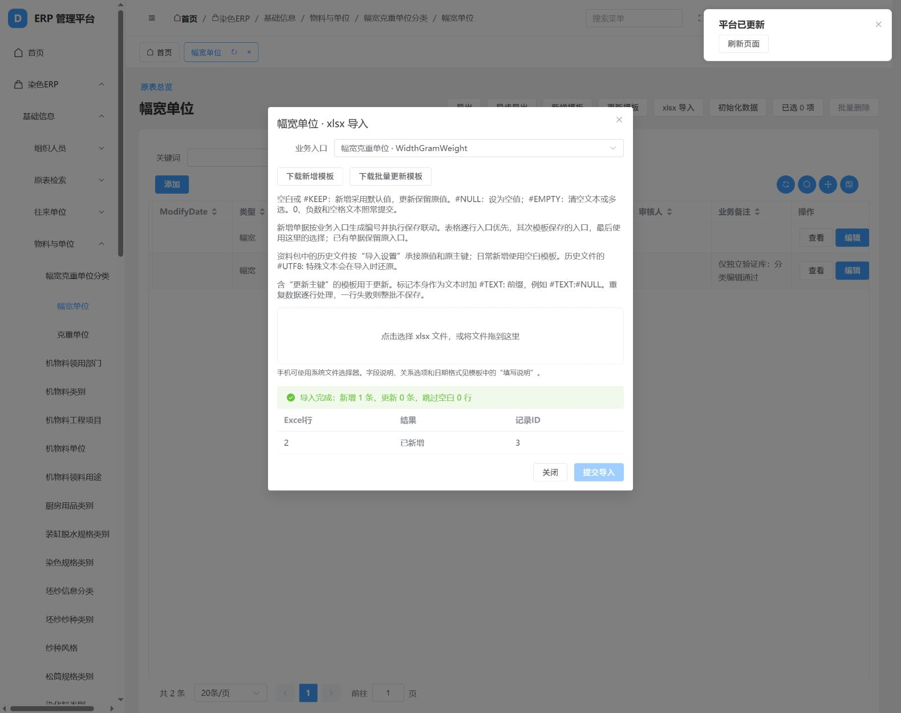
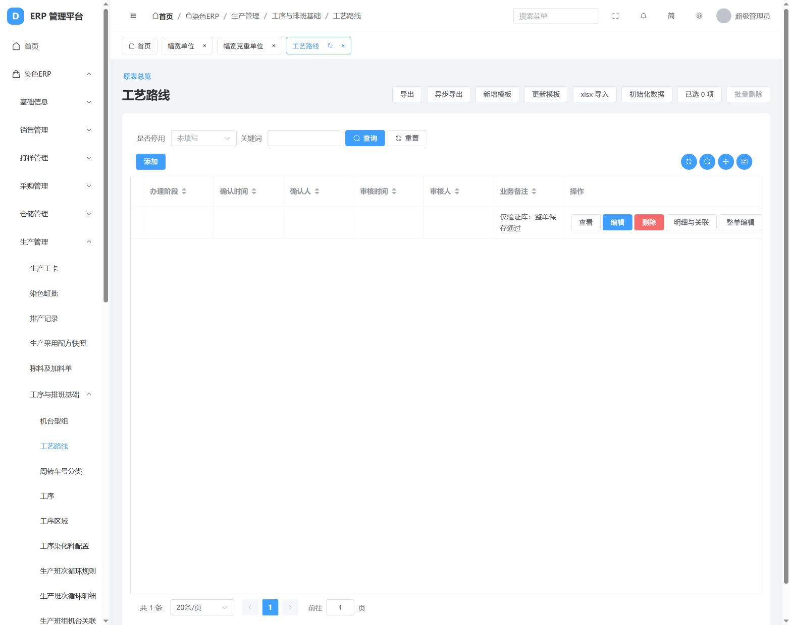

# 基础资料分类与菜单入口调整实施及验证

日期：2026-10-20。执行依据：[全部基础资料分类与菜单入口调整方案](2026-10-20全部基础资料分类与菜单入口调整方案.md)。

## 本轮结果

已落实 **499个资料、原配置或业务资料入口**，对应222张原表来源：222个原表/独立资料入口、151个业务分类、103个系统枚举分类、4个原未编码分类、2个幅宽/克重分类、2个客户/供应商分类、15个跨模块快捷入口。它们不是499张新业务表，也不是499项现场验收完成。

补齐既有0031～0034迁移中的65张缺失物理表及对应原表菜单。实际菜单从764个变为1152个，其中新增65个缺表入口、277个分类/快捷入口、46个目录。766个ERP模型均有物理表；655个原形来源模型保留原字段和原表主键，没有增加旧erpID。

调整前已有701张ERP表逐表计数，调整后全部行数一致；新建65表均0行，原页面地址改变0处。本轮正式业务导入0次。菜单与权限配置更新不等于旧资料正式导入，也不等于整理主档已采用。

## 分类与操作变化

| 对象 | 实现 |
| --- | --- |
| 幅宽、克重 | 独立表WidthGramWeight置于基础信息→物料与单位；各自分类页按原Kind取数。仍保存NameC原值，NumValue不补造换算因子；旧枚举Z001/Z002另列系统管理。 |
| 客户、供应商 | 基础信息分开；销售客户和采购供应商有快捷入口。共用p_Customer，分别固定CustKindID=0/1，各自旧保存入口和编号继续执行。 |
| 部门、人员、组织、设备 | p_Dept与考勤DEPARTMENTS、h_Employee与USERINFO、p_Machine与考勤Machines分别保留。branch、FactID、BusinessUnit分开，未猜测建立对应。 |
| 仓库、库位 | 实际仓库分类WareHouseID与空的p_WareHouse分别维护；白坯、成品、样品仓位和坯料/机物料/染化料库位保留来源，仓储提供快捷入口。 |
| 包装、纸筒 | 后纺/前纺包装、后纺/前纺纸筒4类独立页；皮重、长宽高保持原字段及精度，同名不同码分别保存。 |
| 工艺路线、加工要求、疵点 | 共表按FieldType分开；Production、AtteKind、DefectGroup、DefectKind、PrintStarchWaste配置对应父子明细及原保存入口，支持明细与整单维护。 |
| 缸位、设备方案 | GWName更名缸位字母与容量范围，放销售规则并提供生产快捷入口；BaseCase/Detail归设备基础保养方案，取消原错误质量检验方案定位。 |
| 色卡、改色风险、实际巡检保养项目、工艺文件 | 作为对应业务文档、执行项目或技术资料呈现，不再按普通字典维护；原行保留。 |
| 旧枚举、旧平台来源 | s_DBCombo原值与p_FieldValid共表分类分开；缺失65表中平台配置/日志只补原表承接能力，不自动运行旧SQL、设备通讯或打印。 |
| 整理主档 | 26个原有整理模型移至基础信息→整理主档（按需采用）；原表维护不会自动同步或导入整理主档。 |

## 空值、重复、原异常和导入

- 分类页固定原类别；新增缺省类别由明确入口填写。大小写和尾随空格按既有SQL Server比较语义匹配，保存时保留原字符串。未增加名称/编码去重或数据清洗。
- 不属于当前类别的行明确报错并整批回滚；从原表总览可完整承接混合类别、未登记类别、允许NULL的原字段和孤立明细，不覆盖类别，不静默跳过。旧表本身NOT NULL约束继续保留。
- 新下载的分类模板记录基础资料入口，上传时沿用分类及业务保存服务；旧版未带分类设置的313份历史文件仍可从对应原表总览承接。历史方式不触发新编号和新业务事件。
- 313对既有xlsx不重打包、不改原值；下方附录给出新的业务去向和原表地址。被更正为业务单据的文件依业务身份承接，保留在完整复刻范围，不能按初始化字典导入。新增补列来源可通过页面下载新增模板，本轮没有生成这些来源的历史数据文件。
- 原查询角色只获得同来源分类查询及入口信息，不增加写权限；已有来源办理权限沿用。财务分类仅查询，财务执行继续暂缓。

## 验证与完成口径

| 维度 | 状态与证据 |
| --- | --- |
| 开发验证 | 55项自动回归全部通过，含499个分类入口及其列表逐一访问；Django检查、迁移一致性检查、前端类型检查与构建通过。浏览器完成幅宽新增、编辑、分类xlsx导入、原表总览未分类记录核对，以及工艺路线表头/明细/整单保存；均在独立验证库 |
| 当前库调整前后核验 | 701张既有ERP表行数未变，65张新表0行；原地址全部保留。仅核验本次调整未改变业务行数，不是旧库与新库全字段对账。 |
| 历史数据对账 | 全ERP未完成。既有313份文件验证证据保留；本轮没有执行正式业务导入，未关闭原关联缺口、原JSONL专用对照适配缺口或整理主档采用事项。 |
| 现场验收 | 未完成。需由实际使用人按真实资料和单据使用新入口，核对实际业务含义与流程。 |

自动验证使用独立5440实例的test_erp_foundation_menu_verify_20261020库；浏览器另用同实例的erp_foundation_browser_20261020库，均与实际使用库分开。实际使用库5439只应用结构迁移和平台菜单配置。酒馆8000未停止，ERP仍使用后端8001、前端8080。

## 保留差异与后续顺序

1. 使用人刷新前端，以基础信息分类页准备正式资料；先组织/人员、往来单位、物料单位、仓库库位，再设备、工序路线、质量与包装等关联资料。财务、全部打印和原35项查询仍暂缓。
2. 对旧包中被更正为业务单据/执行项目的文件，在对应业务入口按单据与父子顺序承接；不要按原文件夹名称误认为全部是基础主档。正式导入由使用人操作。
3. 保留原5条保存来源差异、9条事件缺口、9处旧枚举绑定缺口、未编码分类及部分来源用途待核事项；取得来源证据后逐项补齐。见异常文档E259～E262。
4. 后续单独推进全ERP历史数据对账、原关系确认、整理主档采用和现场验收；本轮分类通过不改变它们的未完成状态。

维护命令：`python backend/manage.py rebuild_foundation_menus`。该命令仅登记平台菜单/权限配置，需先应用结构迁移；重复执行保留旧地址、现有密码与业务资料。

## 附录A：全部499个入口与分类

| 编号 | 模块与目录 | 入口 | 来源 | 原分类条件 | 类型 |
| --- | --- | --- | --- | --- | --- |
| 1 | 基础信息／组织人员 | 部门 | dye.p_Dept | 原表全部 | 原表入口 |
| 2 | 基础信息／组织人员 | 业务员工 | dye.h_Employee | 原表全部 | 原表入口 |
| 3 | 基础信息／组织人员 | 员工补充原表（保留独立来源） | dye.h_Employee2 | 原表全部 | 原表入口 |
| 4 | 基础信息／组织人员 | 生产班组 | dye.p_Shift | 原表全部 | 原表入口 |
| 5 | 基础信息／组织人员 | 生产班组员工明细 | dye.p_ShiftEmp | 原表全部 | 原表入口 |
| 6 | 基础信息／组织人员 | 部门岗位编制 | dye.StaffEstablishing | 原表全部 | 原表入口 |
| 7 | 基础信息／组织人员 | 人员宿舍配置 | dye.Emp_Room | 原表全部 | 原表入口 |
| 8 | 基础信息／原表检索 | 客户供应商原表总览 | dye.p_Customer | 原表全部 | 原表入口 |
| 9 | 基础信息／往来单位 | 往来单位地址 | dye.p_CustAddress | 原表全部 | 原表入口 |
| 10 | 基础信息／往来单位 | 往来单位分类关联 | dye.p_CustCategory | 原表全部 | 原表入口 |
| 11 | 基础信息／往来单位 | 往来单位联系信息 | dye.p_CustLinker | 原表全部 | 原表入口 |
| 12 | 基础信息／往来单位 | 往来单位联系人关系 | dye.p_CustRelation | 原表全部 | 原表入口 |
| 13 | 基础信息／物料与单位 | 坯纱坯料与本厂规格 | dye.p_Gray | 原表全部 | 原表入口 |
| 14 | 基础信息／物料与单位 | 坯料补充备份原表 | dye.p_GrayBak | 原表全部 | 原表入口 |
| 15 | 基础信息／物料与单位 | 面料原表 | dye.p_Fabric | 原表全部 | 原表入口 |
| 16 | 基础信息／物料与单位 | 成品规格 | dye.p_Product | 原表全部 | 原表入口 |
| 17 | 基础信息／物料与单位 | 机物料与辅料 | dye.p_Article | 原表全部 | 原表入口 |
| 18 | 基础信息／物料与单位 | 染化料 | dye.p_Stuff | 原表全部 | 原表入口 |
| 19 | 基础信息／物料与单位 | 厨房用品 | dye.p_Cook | 原表全部 | 原表入口 |
| 20 | 基础信息／物料与单位 | 物料客户品名与规格对照 | dye.p_Fabric_Cust | 原表全部 | 原表入口 |
| 21 | 基础信息／物料与单位 | 物料加工厂对照 | dye.p_Fabric_Fact | 原表全部 | 原表入口 |
| 22 | 基础信息／物料与单位 | 物料其他信息明细 | dye.p_Fabric_Other | 原表全部 | 原表入口 |
| 23 | 基础信息／物料与单位 | 成品手感编码 | dye.p_FeelCode | 原表全部 | 原表入口 |
| 24 | 基础信息／物料与单位 | 幅宽克重单位 | dye.WidthGramWeight | 原表全部 | 原表入口 |
| 25 | 基础信息／仓库库位 | 仓库独立旧表（与仓库分类分开） | dye.p_WareHouse | 原表全部 | 原表入口 |
| 26 | 基础信息／仓库库位 | 坯料成品库位 | dye.p_StorageUnitID | 原表全部 | 原表入口 |
| 27 | 基础信息／仓库库位 | 机物料货区库位 | dye.p_ArticleStorageUnitID | 原表全部 | 原表入口 |
| 28 | 基础信息／仓库库位 | 染化料货区库位 | dye.p_StuffStorageUnitID | 原表全部 | 原表入口 |
| 29 | 基础信息／包装标签 | 客户标签资料原表（p_Lable） | dye.p_Lable | 原表全部 | 原表入口 |
| 30 | 生产管理／工序与排班基础 | 工序 | dye.p_Process | 原表全部 | 原表入口 |
| 31 | 生产管理／工序与排班基础 | 工序区域 | dye.p_ProcessArea | 原表全部 | 原表入口 |
| 32 | 生产管理／工序与排班基础 | 工序染化料配置 | dye.p_ProcessChemical | 原表全部 | 原表入口 |
| 33 | 生产管理／工序与排班基础 | 周转车与皮重 | dye.p_Vehicle | 原表全部 | 原表入口 |
| 34 | 生产管理／工序与排班基础 | 生产班次循环规则 | dye.p_ShiftArrange | 原表全部 | 原表入口 |
| 35 | 生产管理／工序与排班基础 | 生产班次循环明细 | dye.p_ShiftArrangeDetail | 原表全部 | 原表入口 |
| 36 | 生产管理／工序与排班基础 | 生产班组机台关联 | dye.p_ShiftMachine | 原表全部 | 原表入口 |
| 37 | 生产管理／设备与通讯基础 | 生产机台 | dye.p_Machine | 原表全部 | 原表入口 |
| 38 | 生产管理／设备与通讯基础 | 机台适用色深 | dye.p_MachineColor | 原表全部 | 原表入口 |
| 39 | 生产管理／设备与通讯基础 | 设备故障分类 | dye.p_MachineFaultClass | 原表全部 | 原表入口 |
| 40 | 生产管理／设备与通讯基础 | 设备故障状态 | dye.p_MachineFaultStatus | 原表全部 | 原表入口 |
| 41 | 生产管理／设备与通讯基础 | 机台部件 | dye.p_MachinePart | 原表全部 | 原表入口 |
| 42 | 生产管理／设备与通讯基础 | 机台采集点 | dye.p_MachinePoint | 原表全部 | 原表入口 |
| 43 | 生产管理／设备与通讯基础 | 机台通讯端口 | dye.p_MachinePort | 原表全部 | 原表入口 |
| 44 | 生产管理／设备与通讯基础 | 机台适用工序 | dye.p_MachineProcess | 原表全部 | 原表入口 |
| 45 | 生产管理／设备与通讯基础 | 机台适用品类 | dye.p_MachineProd | 原表全部 | 原表入口 |
| 46 | 生产管理／设备与通讯基础 | 机台班组关联 | dye.p_MachineShift | 原表全部 | 原表入口 |
| 47 | 生产管理／设备与通讯基础 | 通讯方法 | dye.p_CommMethod | 原表全部 | 原表入口 |
| 48 | 生产管理／设备与通讯基础 | 通讯模块 | dye.p_CommModule | 原表全部 | 原表入口 |
| 49 | 生产管理／设备与通讯基础 | 通讯端口 | dye.p_CommPort | 原表全部 | 原表入口 |
| 50 | 生产管理／设备与通讯基础 | IT设备台账 | dye.ITMANAGE | 原表全部 | 原表入口 |
| 51 | 生产管理／设备与通讯基础 | 设备故障业务页签筛选配置 | dye.MachineFaultFilter | 原表全部 | 原表入口 |
| 52 | 生产管理／设备保养基础 | 设备基础保养方案 | dye.BaseCase | 原表全部 | 原表入口 |
| 53 | 生产管理／设备保养基础 | 设备基础方案项目 | dye.BaseCaseDetail | 原表全部 | 原表入口 |
| 54 | 生产管理／设备保养基础 | 机台保养方案 | dye.MachineCase | 原表全部 | 原表入口 |
| 55 | 生产管理／设备保养基础 | 方案适用机台明细 | dye.MachineCaseDetail | 原表全部 | 原表入口 |
| 56 | 生产管理／设备保养基础 | 机台方案项目 | dye.MachineCaseProject | 原表全部 | 原表入口 |
| 57 | 生产管理／能耗基础 | 能耗仪表 | dye.p_Meter | 原表全部 | 原表入口 |
| 58 | 生产管理／能耗基础 | 仪表告警配置 | dye.p_MeterAlarm | 原表全部 | 原表入口 |
| 59 | 生产管理／能耗基础 | 仪表机台分摊关联 | dye.p_MeterMachine | 原表全部 | 原表入口 |
| 60 | 打样管理／颜色工艺基础 | 色号档案 | dye.P_ColorNum | 原表全部 | 原表入口 |
| 61 | 打样管理／颜色工艺基础 | 染色流程曲线 | dye.p_DyeCurve | 原表全部 | 原表入口 |
| 62 | 打样管理／颜色工艺基础 | 染色流程曲线步骤 | dye.p_DyeCurveDetail | 原表全部 | 原表入口 |
| 63 | 打样管理／颜色工艺基础 | 染色程序 | dye.p_DyeProgram | 原表全部 | 原表入口 |
| 64 | 打样管理／颜色工艺基础 | 染色程序明细 | dye.p_DyeProgramDetail | 原表全部 | 原表入口 |
| 65 | 打样管理／颜色工艺基础 | 工艺参数项目 | dye.p_CraftParam | 原表全部 | 原表入口 |
| 66 | 打样管理／颜色工艺基础 | 前工艺参数项目原表 | dye.p_CraftPParam | 原表全部 | 原表入口 |
| 67 | 打样管理／颜色工艺基础 | 助剂用量规范 | dye.p_AuxRule | 原表全部 | 原表入口 |
| 68 | 打样管理／颜色工艺基础 | 助剂用量规范明细 | dye.p_AuxRuleDetail | 原表全部 | 原表入口 |
| 69 | 生产管理／工序工艺基础 | 工序工艺参数范围 | dye.p_ProcessCraft | 原表全部 | 原表入口 |
| 70 | 生产管理／工序工艺基础 | 工序工艺参数另一原表 | dye.p_ProcessCraft1 | 原表全部 | 原表入口 |
| 71 | 生产管理／工序工艺基础 | 工序前工艺参数范围 | dye.p_ProcessPCraft | 原表全部 | 原表入口 |
| 72 | 打样管理／印花基础 | 印花花号设计 | dye.p_PDesign | 原表全部 | 原表入口 |
| 73 | 打样管理／印花基础 | 印花花号组成明细 | dye.p_PDesignDetail | 原表全部 | 原表入口 |
| 74 | 打样管理／印花基础 | 印花花号配色套色 | dye.p_PDesignSet | 原表全部 | 原表入口 |
| 75 | 质量管理／质量基础 | 物理检验项目 | dye.p_TestItem | 原表全部 | 原表入口 |
| 76 | 质量管理／质量基础 | 工序疵点关联 | dye.p_ProcessDefect | 原表全部 | 原表入口 |
| 77 | 质量管理／质量基础 | 质检问题资料 | dye.zhijianwenti | 原表全部 | 原表入口 |
| 78 | 销售管理／业务价格与交付规则 | 小缸加工价格表 | dye.p_PriceList | 原表全部 | 原表入口 |
| 79 | 销售管理／业务价格与交付规则 | 加工价加工要求明细 | dye.p_PriceListAtte | 原表全部 | 原表入口 |
| 80 | 销售管理／业务价格与交付规则 | 加工价色深明细 | dye.p_PriceListColor | 原表全部 | 原表入口 |
| 81 | 销售管理／业务价格与交付规则 | 加工价工序明细 | dye.p_PriceListProcess | 原表全部 | 原表入口 |
| 82 | 销售管理／业务价格与交付规则 | 加工价缸量明细 | dye.p_PriceListVat | 原表全部 | 原表入口 |
| 83 | 销售管理／业务价格与交付规则 | 工序加工单价 | dye.p_ProcessPrice | 原表全部 | 原表入口 |
| 84 | 销售管理／业务价格与交付规则 | 运费标准 | dye.yunfeibiaozhun | 原表全部 | 原表入口 |
| 85 | 销售管理／业务价格与交付规则 | 等级发货额度规则 | dye.KindLimit | 原表全部 | 原表入口 |
| 86 | 销售管理／业务价格与交付规则 | 缸位字母与容量范围 | dye.GWName | 原表全部 | 原表入口 |
| 87 | 销售管理／业务价格与交付规则 | 往来结算类型原表 | dye.p_BalanceType | 原表全部 | 原表入口 |
| 88 | 销售管理／业务价格与交付规则 | 业务提成比例原表 | dye.p_CommissionRatio | 原表全部 | 原表入口 |
| 89 | 生产管理／称料基础 | 备料步骤（独立旧表） | dye.Stuff_Step | 原表全部 | 原表入口 |
| 90 | 生产管理／称料基础 | 称料工艺参数（来源关联待核） | dye.WeightTechInfo | 原表全部 | 原表入口 |
| 91 | 基础信息／人员考勤资料 | 考勤门禁分组 | dye.ACGroup | 原表全部 | 原表入口 |
| 92 | 基础信息／人员考勤资料 | 考勤门禁解锁组合 | dye.ACUnlockComb | 原表全部 | 原表入口 |
| 93 | 基础信息／人员考勤资料 | 考勤授权设备 | dye.AUTHDEVICE | 原表全部 | 原表入口 |
| 94 | 基础信息／人员考勤资料 | 考勤其他生物模板 | dye.Biotemplate | 原表全部 | 原表入口 |
| 95 | 基础信息／人员考勤资料 | 员工考勤班别分配 | dye.ClockShift | 原表全部 | 原表入口 |
| 96 | 基础信息／人员考勤资料 | 考勤部门（独立于业务部门） | dye.DEPARTMENTS | 原表全部 | 原表入口 |
| 97 | 基础信息／人员考勤资料 | 节假日 | dye.HOLIDAYS | 原表全部 | 原表入口 |
| 98 | 基础信息／人员考勤资料 | 考勤假别 | dye.LeaveClass | 原表全部 | 原表入口 |
| 99 | 基础信息／人员考勤资料 | 考勤其他假别 | dye.LeaveClass1 | 原表全部 | 原表入口 |
| 100 | 基础信息／人员考勤资料 | 考勤设备（独立于生产机台） | dye.Machines | 原表全部 | 原表入口 |
| 101 | 基础信息／人员考勤资料 | 考勤周期 | dye.NUM_RUN | 原表全部 | 原表入口 |
| 102 | 基础信息／人员考勤资料 | 考勤周期时段 | dye.NUM_RUN_DEIL | 原表全部 | 原表入口 |
| 103 | 基础信息／人员考勤资料 | 考勤统计项目 | dye.ReportItem | 原表全部 | 原表入口 |
| 104 | 基础信息／人员考勤资料 | 考勤班次 | dye.SHIFT | 原表全部 | 原表入口 |
| 105 | 基础信息／人员考勤资料 | 考勤时段 | dye.SchClass | 原表全部 | 原表入口 |
| 106 | 基础信息／人员考勤资料 | 考勤指纹模板 | dye.TEMPLATE | 原表全部 | 原表入口 |
| 107 | 基础信息／人员考勤资料 | 考勤人员（独立于业务员工） | dye.USERINFO | 原表全部 | 原表入口 |
| 108 | 基础信息／人员考勤资料 | 考勤节假日另一原表 | dye.acholiday | 原表全部 | 原表入口 |
| 109 | 基础信息／人员考勤资料 | 人员值班休息安排 | dye.p_ITOnRest | 原表全部 | 原表入口 |
| 110 | 基础信息／人员考勤资料 | 人员值班时间配置 | dye.p_ITWatch | 原表全部 | 原表入口 |
| 111 | 系统管理／旧权限来源 | 旧员工部门权限 | dye.h_EmpDeptPerm | 原表全部 | 原表入口 |
| 112 | 系统管理／旧权限来源 | 旧员工角色关联 | dye.h_EmpRole | 原表全部 | 原表入口 |
| 113 | 系统管理／旧权限来源 | 旧角色资料 | dye.s_Roles | 原表全部 | 原表入口 |
| 114 | 基础信息／原表检索 | 业务分类原表总览 | dye.p_FieldValid | 原表全部 | 原表入口 |
| 115 | 基础信息／业务分类维护 | 未编码基础资料（各分类保留） | dye.p_FieldMemo | 原表全部 | 原表入口 |
| 116 | 基础信息／原表检索 | 业务分类明细原表总览 | dye.p_FieldValidSub | 原表全部 | 原表入口 |
| 117 | 基础信息／原表检索 | 客户分类要求明细原表 | dye.p_FieldValidSubCust | 原表全部 | 原表入口 |
| 118 | 生产管理／加工要求基础 | 加工要求类型（独立旧表） | dye.p_AtteType | 原表全部 | 原表入口 |
| 119 | 生产管理／加工要求基础 | 加工要求值（独立旧表） | dye.p_AtteSub | 原表全部 | 原表入口 |
| 120 | 打样管理／色卡流转 | 色卡单 | dye.ColorCard | 原表全部 | 原表入口 |
| 121 | 打样管理／色卡流转 | 色卡单流转业务明细 | dye.ColorCardDetail | 原表全部 | 原表入口 |
| 122 | 生产管理／工卡业务 | 改色风险通知单 | dye.ColorChangeRisk | 原表全部 | 原表入口 |
| 123 | 生产管理／工卡业务 | 工卡染色投料项目原表（关联待核） | dye.DyeProduceItem | 原表全部 | 原表入口 |
| 124 | 生产管理／设备保养业务 | 保养计划执行项目 | dye.MachineCareProject | 原表全部 | 原表入口 |
| 125 | 生产管理／设备保养业务 | 设备巡检记录项目 | dye.InspectionProject | 原表全部 | 原表入口 |
| 126 | 生产管理／工艺技术资料 | 工序工艺单 | dye.ProcessCraft | 原表全部 | 原表入口 |
| 127 | 生产管理／工艺技术资料 | 工序工艺工卡关联 | dye.ProcessCraftJobNo | 原表全部 | 原表入口 |
| 128 | 生产管理／工艺技术资料 | 工序工艺订单关联 | dye.ProcessCraftOrderNo | 原表全部 | 原表入口 |
| 129 | 生产管理／工艺技术资料 | 标准工艺单 | dye.StandCraft | 原表全部 | 原表入口 |
| 130 | 生产管理／工艺技术资料 | 标准工艺前置明细 | dye.StandCraftBeforeDetail | 原表全部 | 原表入口 |
| 131 | 生产管理／工艺技术资料 | 标准工艺明细 | dye.StandCraftDetail | 原表全部 | 原表入口 |
| 132 | 生产管理／工艺技术资料 | 标准工艺工卡关联 | dye.StandCraftJobNo | 原表全部 | 原表入口 |
| 133 | 基础信息／历史基础资料 | 历史代码资料C | dbo.C | 原表全部 | 原表入口 |
| 134 | 基础信息／历史基础资料 | 染化料设备编码历史对照 | dbo.PS20221218 | 原表全部 | 原表入口 |
| 135 | 基础信息／历史基础资料 | 历史考勤班次dbo.SHIFT | dbo.SHIFT | 原表全部 | 原表入口 |
| 136 | 基础信息／历史基础资料 | 历史类型资料SHLEIXING | dbo.SHLEIXING | 原表全部 | 原表入口 |
| 137 | 基础信息／历史基础资料 | IT设备备份20221120 | dbo.itbak20221120 | 原表全部 | 原表入口 |
| 138 | 基础信息／历史基础资料 | IT设备备份20221121 | dbo.itbak20221121 | 原表全部 | 原表入口 |
| 139 | 基础信息／历史基础资料 | 历史色号档案shda | dbo.shda | 原表全部 | 原表入口 |
| 140 | 基础信息／往来单位 | 领用人资料（独立于员工） | dye.Human | 原表全部 | 原表入口 |
| 141 | 基础信息／人员考勤资料 | 考勤人脸模板 | dye.FaceTemp | 原表全部 | 原表入口 |
| 142 | 基础信息／人员考勤资料 | 考勤参数 | dye.AttParam | 原表全部 | 原表入口 |
| 143 | 基础信息／人员考勤资料 | 员工考勤周期分配 | dye.USER_OF_RUN | 原表全部 | 原表入口 |
| 144 | 基础信息／人员考勤资料 | 员工特殊日期安排 | dye.USER_SPEDAY | 原表全部 | 原表入口 |
| 145 | 基础信息／人员考勤资料 | 员工临时时段安排 | dye.USER_TEMP_SCH | 原表全部 | 原表入口 |
| 146 | 基础信息／人员考勤资料 | 部门考勤周期关联 | dye.DeptUsedSchs | 原表全部 | 原表入口 |
| 147 | 基础信息／人员考勤资料 | 员工考勤时段关联 | dye.UserUsedSClasses | 原表全部 | 原表入口 |
| 148 | 基础信息／人员考勤资料 | 员工门禁设备关联 | dye.UserACMachines | 原表全部 | 原表入口 |
| 149 | 基础信息／人员考勤资料 | 员工门禁时区权限 | dye.UserACPrivilege | 原表全部 | 原表入口 |
| 150 | 基础信息／人员考勤资料 | 员工设备关联另一原表 | dye.UsersMachines | 原表全部 | 原表入口 |
| 151 | 基础信息／组织人员 | 公司抬头原表 | dye.s_CorpTitle | 原表全部 | 原表入口 |
| 152 | 基础信息／人员考勤资料 | 门禁时区原表（原名ye.dye） | dye.ye.dye | 原表全部 | 原表入口 |
| 153 | 销售管理／业务价格与交付规则 | 个人发货额度规则（含审核） | dye.RequestLimit | 原表全部 | 原表入口 |
| 154 | 生产管理／历史计件基础规则 | 染色刷卡单价方案 | dye.DyeProcessPrice | 原表全部 | 原表入口 |
| 155 | 系统管理／旧配置来源 | 员工APP通知设备关联 | dye.h_EmpAppNotice | 原表全部 | 原表入口 |
| 156 | 系统管理／旧配置来源 | 旧编号键值原表（用途待核） | dye.TBKEY | 原表全部 | 原表入口 |
| 157 | 生产管理／工卡基础规则 | 坯料平账条件 | dye.BalancingConditions | 原表全部 | 原表入口 |
| 158 | 生产管理／工卡基础规则 | 一次二次放卡启用规则 | dye.EnableCard | 原表全部 | 原表入口 |
| 159 | 系统管理／旧平台来源 | 旧平台来源：s_TimerJob | dye.s_TimerJob | 原表全部 | 原表入口 |
| 160 | 系统管理／旧平台来源 | 旧平台来源：z_AccessLog | dye.z_AccessLog | 原表全部 | 原表入口 |
| 161 | 系统管理／旧平台来源 | 旧平台来源：s_AlertFormat | dye.s_AlertFormat | 原表全部 | 原表入口 |
| 162 | 系统管理／旧平台来源 | 旧平台来源：s_AlertItem | dye.s_AlertItem | 原表全部 | 原表入口 |
| 163 | 系统管理／旧平台来源 | 旧平台来源：s_AlertLog | dye.s_AlertLog | 原表全部 | 原表入口 |
| 164 | 系统管理／旧平台来源 | 旧平台来源：s_AlertParams | dye.s_AlertParams | 原表全部 | 原表入口 |
| 165 | 系统管理／旧平台来源 | 旧平台来源：s_AlertUser | dye.s_AlertUser | 原表全部 | 原表入口 |
| 166 | 系统管理／旧平台来源 | 旧平台来源：s_App | dye.s_App | 原表全部 | 原表入口 |
| 167 | 系统管理／旧平台来源 | 旧平台来源：s_AppFuncs | dye.s_AppFuncs | 原表全部 | 原表入口 |
| 168 | 系统管理／旧平台来源 | 旧平台来源：s_AppQuerys | dye.s_AppQuerys | 原表全部 | 原表入口 |
| 169 | 系统管理／旧平台来源 | 旧平台来源：s_AppTables | dye.s_AppTables | 原表全部 | 原表入口 |
| 170 | 系统管理／旧平台来源 | 旧平台来源：s_DataTableCopy | dye.s_DataTableCopy | 原表全部 | 原表入口 |
| 171 | 系统管理／旧平台来源 | 旧平台来源：s_DataTableFieldRely | dye.s_DataTableFieldRely | 原表全部 | 原表入口 |
| 172 | 系统管理／旧平台来源 | 旧平台来源：s_FormButton | dye.s_FormButton | 原表全部 | 原表入口 |
| 173 | 系统管理／旧平台来源 | 旧平台来源：s_GridCondition | dye.s_GridCondition | 原表全部 | 原表入口 |
| 174 | 系统管理／旧平台来源 | 旧平台来源：s_GridParamChart | dye.s_GridParamChart | 原表全部 | 原表入口 |
| 175 | 系统管理／旧平台来源 | 旧平台来源：s_GridUser | dye.s_GridUser | 原表全部 | 原表入口 |
| 176 | 系统管理／旧平台来源 | 旧平台来源：s_Language | dye.s_Language | 原表全部 | 原表入口 |
| 177 | 系统管理／旧平台来源 | 旧平台来源：s_LookupColumn | dye.s_LookupColumn | 原表全部 | 原表入口 |
| 178 | 系统管理／旧平台来源 | 旧平台来源：s_ManagerSQL | dye.s_ManagerSQL | 原表全部 | 原表入口 |
| 179 | 系统管理／旧平台来源 | 旧平台来源：s_Message | dye.s_Message | 原表全部 | 原表入口 |
| 180 | 系统管理／旧平台来源 | 旧平台来源：s_Notice | dye.s_Notice | 原表全部 | 原表入口 |
| 181 | 系统管理／旧平台来源 | 旧平台来源：s_PanelFieldParam | dye.s_PanelFieldParam | 原表全部 | 原表入口 |
| 182 | 系统管理／旧平台来源 | 旧平台来源：s_QueryParam | dye.s_QueryParam | 原表全部 | 原表入口 |
| 183 | 系统管理／旧平台来源 | 旧平台来源：s_RecordRight | dye.s_RecordRight | 原表全部 | 原表入口 |
| 184 | 系统管理／旧平台来源 | 旧平台来源：s_RptInfoDetail | dye.s_RptInfoDetail | 原表全部 | 原表入口 |
| 185 | 系统管理／旧平台来源 | 旧平台来源：s_RptInfoSub | dye.s_RptInfoSub | 原表全部 | 原表入口 |
| 186 | 系统管理／旧平台来源 | 旧平台来源：s_RptParam | dye.s_RptParam | 原表全部 | 原表入口 |
| 187 | 系统管理／旧平台来源 | 旧平台来源：s_SubscribePage | dye.s_SubscribePage | 原表全部 | 原表入口 |
| 188 | 系统管理／旧平台来源 | 旧平台来源：s_TimerJobField | dye.s_TimerJobField | 原表全部 | 原表入口 |
| 189 | 系统管理／旧平台来源 | 旧平台来源：s_TimerJobParams | dye.s_TimerJobParams | 原表全部 | 原表入口 |
| 190 | 系统管理／旧平台来源 | 旧平台来源：s_UIModule | dye.s_UIModule | 原表全部 | 原表入口 |
| 191 | 系统管理／旧平台来源 | 旧平台来源：s_UpgradeFile | dye.s_UpgradeFile | 原表全部 | 原表入口 |
| 192 | 系统管理／旧平台来源 | 旧平台来源：AlarmLog | dye.AlarmLog | 原表全部 | 原表入口 |
| 193 | 系统管理／旧平台来源 | 旧平台来源：EmOpLog | dye.EmOpLog | 原表全部 | 原表入口 |
| 194 | 系统管理／旧平台来源 | 旧平台来源：rp_Permission | dye.rp_Permission | 原表全部 | 原表入口 |
| 195 | 系统管理／旧平台来源 | 旧平台来源：s_AccessLog | dye.s_AccessLog | 原表全部 | 原表入口 |
| 196 | 系统管理／旧平台来源 | 旧平台来源：s_AlertEmp | dye.s_AlertEmp | 原表全部 | 原表入口 |
| 197 | 系统管理／旧平台来源 | 旧平台来源：s_AlertSender | dye.s_AlertSender | 原表全部 | 原表入口 |
| 198 | 系统管理／旧平台来源 | 旧平台来源：s_App_ApiLog | dye.s_App_ApiLog | 原表全部 | 原表入口 |
| 199 | 系统管理／旧平台来源 | 旧平台来源：s_ClientMacAddress | dye.s_ClientMacAddress | 原表全部 | 原表入口 |
| 200 | 系统管理／旧平台来源 | 旧平台来源：s_DataRelation | dye.s_DataRelation | 原表全部 | 原表入口 |
| 201 | 系统管理／旧平台来源 | 旧平台来源：s_DataTableRelation | dye.s_DataTableRelation | 原表全部 | 原表入口 |
| 202 | 系统管理／旧平台来源 | 旧平台来源：s_Exception | dye.s_Exception | 原表全部 | 原表入口 |
| 203 | 系统管理／旧平台来源 | 旧平台来源：s_FieldCopy | dye.s_FieldCopy | 原表全部 | 原表入口 |
| 204 | 系统管理／旧平台来源 | 旧平台来源：s_FormFormat | dye.s_FormFormat | 原表全部 | 原表入口 |
| 205 | 系统管理／旧平台来源 | 旧平台来源：s_FunDesktop | dye.s_FunDesktop | 原表全部 | 原表入口 |
| 206 | 系统管理／旧平台来源 | 旧平台来源：s_Language1 | dye.s_Language1 | 原表全部 | 原表入口 |
| 207 | 系统管理／旧平台来源 | 旧平台来源：s_LocalAdmins | dye.s_LocalAdmins | 原表全部 | 原表入口 |
| 208 | 系统管理／旧平台来源 | 旧平台来源：s_ManagerSetting | dye.s_ManagerSetting | 原表全部 | 原表入口 |
| 209 | 系统管理／旧平台来源 | 旧平台来源：s_ModuleDesktop | dye.s_ModuleDesktop | 原表全部 | 原表入口 |
| 210 | 系统管理／旧平台来源 | 旧平台来源：s_MonthEnd | dye.s_MonthEnd | 原表全部 | 原表入口 |
| 211 | 系统管理／旧平台来源 | 旧平台来源：s_PersonalDataRight | dye.s_PersonalDataRight | 原表全部 | 原表入口 |
| 212 | 系统管理／旧平台来源 | 旧平台来源：s_SecurityInfo | dye.s_SecurityInfo | 原表全部 | 原表入口 |
| 213 | 系统管理／旧平台来源 | 旧平台来源：s_SysAdmins | dye.s_SysAdmins | 原表全部 | 原表入口 |
| 214 | 系统管理／旧平台来源 | 旧平台来源：s_TVScreenReport | dye.s_TVScreenReport | 原表全部 | 原表入口 |
| 215 | 系统管理／旧平台来源 | 旧平台来源：s_TVScreenReportDetail | dye.s_TVScreenReportDetail | 原表全部 | 原表入口 |
| 216 | 系统管理／旧平台来源 | 旧平台来源：s_WeiXinAgent | dye.s_WeiXinAgent | 原表全部 | 原表入口 |
| 217 | 系统管理／旧平台来源 | 旧平台来源：s_WeiXinMenu | dye.s_WeiXinMenu | 原表全部 | 原表入口 |
| 218 | 系统管理／旧平台来源 | 旧平台来源：SECURITYDETAILS | dye.SECURITYDETAILS | 原表全部 | 原表入口 |
| 219 | 系统管理／旧平台来源 | 旧平台来源：ServerLog | dye.ServerLog | 原表全部 | 原表入口 |
| 220 | 系统管理／旧平台来源 | 旧平台来源：SystemLog | dye.SystemLog | 原表全部 | 原表入口 |
| 221 | 系统管理／旧平台来源 | 旧平台来源：UserUpdates | dye.UserUpdates | 原表全部 | 原表入口 |
| 222 | 系统管理／旧平台来源 | 旧平台来源：s_ManagerSQL- | dye.s_ManagerSQL- | 原表全部 | 原表入口 |
| 223 | 打样管理／颜色工艺基础 | 色版号字母 | dye.p_FieldValid | {"old_field_type": "A-Z"} | 分类入口 |
| 224 | 系统管理／旧基础选项（财务暂缓） | 账龄 | dye.p_FieldValid | {"old_field_type": "AccountAge"} | 分类入口 |
| 225 | 系统管理／旧基础选项（财务暂缓） | 应付类别 | dye.p_FieldValid | {"old_field_type": "APKind"} | 分类入口 |
| 226 | 销售管理／基础与交付选项 | 销售区域 | dye.p_FieldValid | {"old_field_type": "Area"} | 分类入口 |
| 227 | 系统管理／旧基础选项（财务暂缓） | 应收类别 | dye.p_FieldValid | {"old_field_type": "ARKind"} | 分类入口 |
| 228 | 基础信息／物料与单位 | 机物料领用部门 | dye.p_FieldValid | {"old_field_type": "ArticleDept"} | 分类入口 |
| 229 | 基础信息／物料与单位 | 机物料类别 | dye.p_FieldValid | {"old_field_type": "ArticleKind"} | 分类入口 |
| 230 | 基础信息／物料与单位 | 机物料工程项目 | dye.p_FieldValid | {"old_field_type": "ArticleProject"} | 分类入口 |
| 231 | 基础信息／物料与单位 | 机物料单位 | dye.p_FieldValid | {"old_field_type": "ArticleUnit"} | 分类入口 |
| 232 | 基础信息／物料与单位 | 机物料领料用途 | dye.p_FieldValid | {"old_field_type": "ArticleUse"} | 分类入口 |
| 233 | 生产管理／加工要求 | 加工要求类别 | dye.p_FieldValid | {"old_field_type": "AtteKind"} | 分类入口 |
| 234 | 系统管理／旧基础选项（财务暂缓） | 银行 | dye.p_FieldValid | {"old_field_type": "Bank"} | 分类入口 |
| 235 | 基础信息／包装标签 | 装箱箱型 | dye.p_FieldValid | {"old_field_type": "BoxType"} | 分类入口 |
| 236 | 基础信息／组织人员 | 分厂 | dye.p_FieldValid | {"old_field_type": "branch"} | 分类入口 |
| 237 | 基础信息／组织人员 | 企业类型 | dye.p_FieldValid | {"old_field_type": "BusinessKind"} | 分类入口 |
| 238 | 基础信息／组织人员 | 经营单位 | dye.p_FieldValid | {"old_field_type": "BusinessUnit"} | 分类入口 |
| 239 | 仓储管理／收发基础选项 | 搬运工 | dye.p_FieldValid | {"old_field_type": "Cargador"} | 分类入口 |
| 240 | 仓储管理／收发基础选项 | 叉车工 | dye.p_FieldValid | {"old_field_type": "CDriver"} | 分类入口 |
| 241 | 基础信息／人员考勤资料 | 考勤机类别设置 | dye.p_FieldValid | {"old_field_type": "CHECKSNTYPE"} | 分类入口 |
| 242 | 基础信息／组织人员 | 生产班别 | dye.p_FieldValid | {"old_field_type": "Class"} | 分类入口 |
| 243 | 基础信息／人员考勤资料 | 考勤班别分类 | dye.p_FieldValid | {"old_field_type": "ClockShift"} | 分类入口 |
| 244 | 打样管理／颜色工艺基础 | 颜色名称 | dye.p_FieldValid | {"old_field_type": "Color"} | 分类入口 |
| 245 | 打样管理／颜色工艺基础 | 颜色深浅 | dye.p_FieldValid | {"old_field_type": "ColorDepth"} | 分类入口 |
| 246 | 基础信息／原分类待核 | ColorName（原分类含义待核） | dye.p_FieldValid | {"old_field_type": "ColorName"} | 分类入口 |
| 247 | 打样管理／颜色工艺基础 | 色号类型 | dye.p_FieldValid | {"old_field_type": "ColorNumCode"} | 分类入口 |
| 248 | 打样管理／颜色工艺基础 | 色号等级 | dye.p_FieldValid | {"old_field_type": "ColorNumGradeID"} | 分类入口 |
| 249 | 打样管理／颜色工艺基础 | 颜色系列 | dye.p_FieldValid | {"old_field_type": "ColorSeries"} | 分类入口 |
| 250 | 打样管理／颜色工艺基础 | 对色面 | dye.p_FieldValid | {"old_field_type": "ConfirmSide"} | 分类入口 |
| 251 | 销售管理／基础与交付选项 | 合同类别 | dye.p_FieldValid | {"old_field_type": "ContractClass"} | 分类入口 |
| 252 | 基础信息／物料与单位 | 厨房用品类别 | dye.p_FieldValid | {"old_field_type": "Cook"} | 分类入口 |
| 253 | 基础信息／往来单位 | 公司类别 | dye.p_FieldValid | {"old_field_type": "CorpKind"} | 分类入口 |
| 254 | 基础信息／组织人员 | 国家 | dye.p_FieldValid | {"old_field_type": "Country"} | 分类入口 |
| 255 | 销售管理／基础与交付选项 | 币别（业务共用） | dye.p_FieldValid | {"old_field_type": "Currency"} | 分类入口 |
| 256 | 基础信息／往来单位 | 客户等级 | dye.p_FieldValid | {"old_field_type": "CustGrade"} | 分类入口 |
| 257 | 基础信息／往来单位 | 客户供应商类别 | dye.p_FieldValid | {"old_field_type": "CustKind"} | 分类入口 |
| 258 | 基础信息／往来单位 | 往来单位类型原分类 | dye.p_FieldValid | {"old_field_type": "CustTypeNo"} | 分类入口 |
| 259 | 仓储管理／收发基础选项 | 货车车牌资料 | dye.p_FieldValid | {"old_field_type": "CVehicle"} | 分类入口 |
| 260 | 质量管理／质量基础 | 疵点分组 | dye.p_FieldValid | {"old_field_type": "DefectGroup"} | 分类入口 |
| 261 | 质量管理／质量基础 | 疵点类别 | dye.p_FieldValid | {"old_field_type": "DefectKind"} | 分类入口 |
| 262 | 质量管理／质量基础 | 疵点名称 | dye.p_FieldValid | {"old_field_type": "DefectName"} | 分类入口 |
| 263 | 质量管理／质量基础 | 评审责任部门原分类 | dye.p_FieldValid | {"old_field_type": "Defects"} | 分类入口 |
| 264 | 基础信息／物料与单位 | 装缸脱水规格类别 | dye.p_FieldValid | {"old_field_type": "DehydrationClass"} | 分类入口 |
| 265 | 基础信息／组织人员 | 部门类型 | dye.p_FieldValid | {"old_field_type": "DeptKind"} | 分类入口 |
| 266 | 打样管理／颜色工艺基础 | 打样超时原因 | dye.p_FieldValid | {"old_field_type": "DipsOverReason"} | 分类入口 |
| 267 | 仓储管理／收发基础选项 | 装卸工 | dye.p_FieldValid | {"old_field_type": "Discharger"} | 分类入口 |
| 268 | 销售管理／基础与交付选项 | 交货方式 | dye.p_FieldValid | {"old_field_type": "DlvManner"} | 分类入口 |
| 269 | 销售管理／基础与交付选项 | 发货优先级 | dye.p_FieldValid | {"old_field_type": "DlvPriority"} | 分类入口 |
| 270 | 仓储管理／收发基础选项 | 司机 | dye.p_FieldValid | {"old_field_type": "Driver"} | 分类入口 |
| 271 | 打样管理／颜色工艺基础 | 染色工艺条件 | dye.p_FieldValid | {"old_field_type": "Dye"} | 分类入口 |
| 272 | 基础信息／物料与单位 | 染色规格类别 | dye.p_FieldValid | {"old_field_type": "DyeClass"} | 分类入口 |
| 273 | 打样管理／印花基础 | 料筒壁浪费量 | dye.p_FieldValid | {"old_field_type": "DyeingTubeWaste"} | 分类入口 |
| 274 | 系统管理／旧基础选项（财务暂缓） | dyeMode原支付方式分类 | dye.p_FieldValid | {"old_field_type": "dyeMode"} | 分类入口 |
| 275 | 打样管理／颜色工艺基础 | 染色流程阶段 | dye.p_FieldValid | {"old_field_type": "DyePhase"} | 分类入口 |
| 276 | 基础信息／组织人员 | 学历 | dye.p_FieldValid | {"old_field_type": "Education"} | 分类入口 |
| 277 | 基础信息／组织人员 | 员工岗位类别 | dye.p_FieldValid | {"old_field_type": "EmpKind"} | 分类入口 |
| 278 | 打样管理／样品基础 | 快递公司 | dye.p_FieldValid | {"old_field_type": "ExpressCompany"} | 分类入口 |
| 279 | 打样管理／样品基础 | 快递费用结算选项 | dye.p_FieldValid | {"old_field_type": "ExpressSettle"} | 分类入口 |
| 280 | 质量管理／质量基础 | 质量等级 | dye.p_FieldValid | {"old_field_type": "FabricGrade"} | 分类入口 |
| 281 | 基础信息／物料与单位 | 坯纱信息分类 | dye.p_FieldValid | {"old_field_type": "FabricInfoKind"} | 分类入口 |
| 282 | 基础信息／物料与单位 | 坯纱纱种类别 | dye.p_FieldValid | {"old_field_type": "FabricKind"} | 分类入口 |
| 283 | 基础信息／物料与单位 | 纱种风格 | dye.p_FieldValid | {"old_field_type": "FabricStyle"} | 分类入口 |
| 284 | 基础信息／组织人员 | 加工厂 | dye.p_FieldValid | {"old_field_type": "FactID"} | 分类入口 |
| 285 | 基础信息／原分类待核 | Fault（原分类含义待核） | dye.p_FieldValid | {"old_field_type": "Fault"} | 分类入口 |
| 286 | 基础信息／原分类待核 | FaultScore（原分类含义待核） | dye.p_FieldValid | {"old_field_type": "FaultScore"} | 分类入口 |
| 287 | 基础信息／原分类待核 | FlowKind（原分类含义待核） | dye.p_FieldValid | {"old_field_type": "FlowKind"} | 分类入口 |
| 288 | 打样管理／颜色工艺基础 | 荧光类别 | dye.p_FieldValid | {"old_field_type": "fluorescence"} | 分类入口 |
| 289 | 仓储管理／收发基础选项 | 坯料入库类别 | dye.p_FieldValid | {"old_field_type": "GrayKind"} | 分类入口 |
| 290 | 基础信息／仓库库位 | 白坯仓位分类 | dye.p_FieldValid | {"old_field_type": "GrayWareHouse"} | 分类入口 |
| 291 | 打样管理／颜色工艺基础 | 手感类别 | dye.p_FieldValid | {"old_field_type": "HandFeel"} | 分类入口 |
| 292 | 基础信息／人员考勤资料 | 保险种类（人事选项） | dye.p_FieldValid | {"old_field_type": "Insurance"} | 分类入口 |
| 293 | 销售管理／基础与交付选项 | 加工紧急程度原分类 | dye.p_FieldValid | {"old_field_type": "JiaGong"} | 分类入口 |
| 294 | 销售管理／基础与交付选项 | 加工单类别 | dye.p_FieldValid | {"old_field_type": "JobKind"} | 分类入口 |
| 295 | 仓储管理／收发基础选项 | 交坯人 | dye.p_FieldValid | {"old_field_type": "JPR"} | 分类入口 |
| 296 | 仓储管理／收发基础选项 | 仓管员 | dye.p_FieldValid | {"old_field_type": "Keeper"} | 分类入口 |
| 297 | 打样管理／颜色工艺基础 | 染色打样情况 | dye.p_FieldValid | {"old_field_type": "LabDipsThing"} | 分类入口 |
| 298 | 基础信息／包装标签 | 标签地址 | dye.p_FieldValid | {"old_field_type": "LabelAddress"} | 分类入口 |
| 299 | 基础信息／包装标签 | 标签用途 | dye.p_FieldValid | {"old_field_type": "LabelRemarks"} | 分类入口 |
| 300 | 基础信息／包装标签 | 标签仓库 | dye.p_FieldValid | {"old_field_type": "LabelWareHouse"} | 分类入口 |
| 301 | 仓储管理／收发基础选项 | 搬运配布计件类别 | dye.p_FieldValid | {"old_field_type": "LossKind"} | 分类入口 |
| 302 | 生产管理／工序与排班基础 | 机台型组 | dye.p_FieldValid | {"old_field_type": "MachineKind"} | 分类入口 |
| 303 | 打样管理／印花基础 | 印花机台浪费量 | dye.p_FieldValid | {"old_field_type": "MachinePaste"} | 分类入口 |
| 304 | 系统管理／旧基础选项（财务暂缓） | 收款类型 | dye.p_FieldValid | {"old_field_type": "MoneyInKind"} | 分类入口 |
| 305 | 系统管理／旧基础选项（财务暂缓） | 付款类型 | dye.p_FieldValid | {"old_field_type": "MoneyOutKind"} | 分类入口 |
| 306 | 基础信息／组织人员 | 籍贯 | dye.p_FieldValid | {"old_field_type": "Native"} | 分类入口 |
| 307 | 销售管理／基础与交付选项 | 订单费用种类 | dye.p_FieldValid | {"old_field_type": "OrderFree"} | 分类入口 |
| 308 | 销售管理／基础与交付选项 | 订单类别 | dye.p_FieldValid | {"old_field_type": "OrderKind"} | 分类入口 |
| 309 | 基础信息／包装标签 | 后纺包装 | dye.p_FieldValid | {"old_field_type": "PackBag"} | 分类入口 |
| 310 | 基础信息／包装标签 | 前纺包装 | dye.p_FieldValid | {"old_field_type": "PackBag_QF"} | 分类入口 |
| 311 | 基础信息／包装标签 | 包装单位原分类 | dye.p_FieldValid | {"old_field_type": "PackUnit"} | 分类入口 |
| 312 | 销售管理／基础与交付选项 | 付款条件等级 | dye.p_FieldValid | {"old_field_type": "PayGrade"} | 分类入口 |
| 313 | 销售管理／基础与交付选项 | 付款方式（业务共用） | dye.p_FieldValid | {"old_field_type": "Payment"} | 分类入口 |
| 314 | 质量管理／质量基础 | 物理测试项目分类 | dye.p_FieldValid | {"old_field_type": "PhysicalTestItem"} | 分类入口 |
| 315 | 基础信息／物料与单位 | 松筒规格类别 | dye.p_FieldValid | {"old_field_type": "PineClass"} | 分类入口 |
| 316 | 销售管理／基础与交付选项 | 港口 | dye.p_FieldValid | {"old_field_type": "Port"} | 分类入口 |
| 317 | 基础信息／组织人员 | 职位 | dye.p_FieldValid | {"old_field_type": "Position"} | 分类入口 |
| 318 | 打样管理／印花基础 | 印花做浆量进位 | dye.p_FieldValid | {"old_field_type": "PrintMortarCarry"} | 分类入口 |
| 319 | 打样管理／印花基础 | 印花吃浆量 | dye.p_FieldValid | {"old_field_type": "PrintStarchWaste"} | 分类入口 |
| 320 | 仓储管理／收发基础选项 | 成品入库类别 | dye.p_FieldValid | {"old_field_type": "ProdKind"} | 分类入口 |
| 321 | 生产管理／工序与排班基础 | 工艺路线 | dye.p_FieldValid | {"old_field_type": "Production"} | 分类入口 |
| 322 | 基础信息／仓库库位 | 成品仓位分类 | dye.p_FieldValid | {"old_field_type": "ProdWareHouse"} | 分类入口 |
| 323 | 生产管理／历史计件基础规则 | 打样计件基础规则（工资核算暂缓） | dye.p_FieldValid | {"old_field_type": "Proofing"} | 分类入口 |
| 324 | 采购管理／基础选项 | 申购类别 | dye.p_FieldValid | {"old_field_type": "PurApply"} | 分类入口 |
| 325 | 采购管理／基础选项 | 采购类别 | dye.p_FieldValid | {"old_field_type": "PurKind"} | 分类入口 |
| 326 | 质量管理／质量基础 | 异常分类 | dye.p_FieldValid | {"old_field_type": "QCCD"} | 分类入口 |
| 327 | 销售管理／基础与交付选项 | 报价类别 | dye.p_FieldValid | {"old_field_type": "QuoteKind"} | 分类入口 |
| 328 | 打样管理／颜色工艺基础 | 配方用途分类 | dye.p_FieldValid | {"old_field_type": "RecipeCategory"} | 分类入口 |
| 329 | 打样管理／颜色工艺基础 | 打样配方业务类别 | dye.p_FieldValid | {"old_field_type": "RecipeKind"} | 分类入口 |
| 330 | 质量管理／质量基础 | 疵点处理状态 | dye.p_FieldValid | {"old_field_type": "RecordDefectStatus"} | 分类入口 |
| 331 | 质量管理／质量基础 | 匹状态 | dye.p_FieldValid | {"old_field_type": "RecordStatus"} | 分类入口 |
| 332 | 质量管理／质量基础 | 回修原因 | dye.p_FieldValid | {"old_field_type": "RedoReason"} | 分类入口 |
| 333 | 系统管理／旧基础选项（财务暂缓） | 报销类别 | dye.p_FieldValid | {"old_field_type": "ReimBursement"} | 分类入口 |
| 334 | 基础信息／原分类待核 | Result（原分类含义待核） | dye.p_FieldValid | {"old_field_type": "Result"} | 分类入口 |
| 335 | 基础信息／往来单位 | 跟单分组 | dye.p_FieldValid | {"old_field_type": "SalerGroup"} | 分类入口 |
| 336 | 打样管理／样品基础 | 样品入库类型 | dye.p_FieldValid | {"old_field_type": "SampleInKind"} | 分类入口 |
| 337 | 打样管理／样品基础 | 样卡类别 | dye.p_FieldValid | {"old_field_type": "SampleKind"} | 分类入口 |
| 338 | 打样管理／样品基础 | 样品出库类型 | dye.p_FieldValid | {"old_field_type": "SampleOutKind"} | 分类入口 |
| 339 | 基础信息／仓库库位 | 样品仓位 | dye.p_FieldValid | {"old_field_type": "SampleStorage"} | 分类入口 |
| 340 | 基础信息／原分类待核 | SemiKind（原分类含义待核） | dye.p_FieldValid | {"old_field_type": "SemiKind"} | 分类入口 |
| 341 | 销售管理／基础与交付选项 | 结算方式（业务共用） | dye.p_FieldValid | {"old_field_type": "Settle"} | 分类入口 |
| 342 | 基础信息／原分类待核 | Severity（原分类含义待核） | dye.p_FieldValid | {"old_field_type": "Severity"} | 分类入口 |
| 343 | 基础信息／组织人员 | 班组名称 | dye.p_FieldValid | {"old_field_type": "ShiftName"} | 分类入口 |
| 344 | 仓储管理／收发基础选项 | 收坯人 | dye.p_FieldValid | {"old_field_type": "SHR"} | 分类入口 |
| 345 | 系统管理／业务常用选项 | 签核常用意见 | dye.p_FieldValid | {"old_field_type": "SignIdea"} | 分类入口 |
| 346 | 系统管理／业务常用选项 | 签核常用备注 | dye.p_FieldValid | {"old_field_type": "SignRemarks"} | 分类入口 |
| 347 | 生产管理／称料基础 | SL原分类（用途待核） | dye.p_FieldValid | {"old_field_type": "SL"} | 分类入口 |
| 348 | 基础信息／组织人员 | 加工站别 | dye.p_FieldValid | {"old_field_type": "Station"} | 分类入口 |
| 349 | 生产管理／称料基础 | 备料步骤分类 | dye.p_FieldValid | {"old_field_type": "Step"} | 分类入口 |
| 350 | 基础信息／仓库库位 | 货龄分类 | dye.p_FieldValid | {"old_field_type": "StockAge"} | 分类入口 |
| 351 | 基础信息／物料与单位 | 染化料类别 | dye.p_FieldValid | {"old_field_type": "StuffKind"} | 分类入口 |
| 352 | 基础信息／往来单位 | 客户类型原分类 | dye.p_FieldValid | {"old_field_type": "ToPlace"} | 分类入口 |
| 353 | 销售管理／基础与交付选项 | 交易方式 | dye.p_FieldValid | {"old_field_type": "TradeMode"} | 分类入口 |
| 354 | 销售管理／基础与交付选项 | 运输方式 | dye.p_FieldValid | {"old_field_type": "Transport"} | 分类入口 |
| 355 | 基础信息／物料与单位 | 紧筒规格类别 | dye.p_FieldValid | {"old_field_type": "tubeClass"} | 分类入口 |
| 356 | 基础信息／包装标签 | 后纺纸筒 | dye.p_FieldValid | {"old_field_type": "TubeWeight"} | 分类入口 |
| 357 | 基础信息／包装标签 | 前纺纸筒 | dye.p_FieldValid | {"old_field_type": "TubeWeight_QF"} | 分类入口 |
| 358 | 基础信息／物料与单位 | 加捻规格类别 | dye.p_FieldValid | {"old_field_type": "TwistClass"} | 分类入口 |
| 359 | 生产管理／工序与排班基础 | 周转车号分类 | dye.p_FieldValid | {"old_field_type": "Vehicle"} | 分类入口 |
| 360 | 打样管理／颜色工艺基础 | 对色光源 | dye.p_FieldValid | {"old_field_type": "VerLight"} | 分类入口 |
| 361 | 基础信息／仓库库位 | 仓库注册 | dye.p_FieldValid | {"old_field_type": "WareHouseID"} | 分类入口 |
| 362 | 基础信息／原分类待核 | WidthKind（原分类含义待核） | dye.p_FieldValid | {"old_field_type": "WidthKind"} | 分类入口 |
| 363 | 基础信息／组织人员 | 岗位工种 | dye.p_FieldValid | {"old_field_type": "WorkKind"} | 分类入口 |
| 364 | 基础信息／组织人员 | 生产车间 | dye.p_FieldValid | {"old_field_type": "WorkShop"} | 分类入口 |
| 365 | 系统管理／业务常用选项 | 是否选项 | dye.p_FieldValid | {"old_field_type": "YesOrNo"} | 分类入口 |
| 366 | 打样管理／印花基础 | 印花配色方案类别 | dye.p_FieldValid | {"old_field_type": "YHSys_ColorSchemes"} | 分类入口 |
| 367 | 打样管理／印花基础 | 印花用量单位 | dye.p_FieldValid | {"old_field_type": "YHSys_EveryUnit"} | 分类入口 |
| 368 | 打样管理／印花基础 | 印花对色面 | dye.p_FieldValid | {"old_field_type": "YHSys_MatchingColor"} | 分类入口 |
| 369 | 打样管理／印花基础 | 印花范围单位 | dye.p_FieldValid | {"old_field_type": "YHSys_RangeUnit"} | 分类入口 |
| 370 | 打样管理／印花基础 | 印花网型 | dye.p_FieldValid | {"old_field_type": "YHSys_ScreenName"} | 分类入口 |
| 371 | 打样管理／印花基础 | 印花样品形式 | dye.p_FieldValid | {"old_field_type": "YHSys_Specimen"} | 分类入口 |
| 372 | 打样管理／印花基础 | 印花标准类别 | dye.p_FieldValid | {"old_field_type": "YHSys_Standard"} | 分类入口 |
| 373 | 打样管理／印花基础 | 印花确认方式 | dye.p_FieldValid | {"old_field_type": "YHSys_VerifyMethod"} | 分类入口 |
| 374 | 基础信息／物料与单位／幅宽克重单位分类 | 幅宽单位 | dye.WidthGramWeight | {"old_kind": "幅宽"} | 分类入口 |
| 375 | 基础信息／物料与单位／幅宽克重单位分类 | 克重单位 | dye.WidthGramWeight | {"old_kind": "克重"} | 分类入口 |
| 376 | 基础信息／往来单位 | 客户资料 | dye.p_Customer | {"old_cust_kind_id": "0"} | 分类入口 |
| 377 | 基础信息／往来单位 | 供应商资料 | dye.p_Customer | {"old_cust_kind_id": "1"} | 分类入口 |
| 378 | 基础信息／未编码原分类 | 1原未编码资料 | dye.p_FieldMemo | {"old_field_type": "1"} | 分类入口 |
| 379 | 基础信息／未编码原分类 | 2原未编码资料 | dye.p_FieldMemo | {"old_field_type": "2"} | 分类入口 |
| 380 | 基础信息／未编码原分类 | BY1原未编码资料 | dye.p_FieldMemo | {"old_field_type": "BY1"} | 分类入口 |
| 381 | 基础信息／未编码原分类 | BY2原未编码资料 | dye.p_FieldMemo | {"old_field_type": "BY2"} | 分类入口 |
| 382 | 系统管理／旧业务枚举 | 数量单位（B001） | dye.s_DBComboValue | {"old_combo_id": "B001"} | 分类入口 |
| 383 | 系统管理／旧业务枚举 | 加工要求类型（B002） | dye.s_DBComboValue | {"old_combo_id": "B002"} | 分类入口 |
| 384 | 系统管理／旧业务枚举 | 库存单位（B003） | dye.s_DBComboValue | {"old_combo_id": "B003"} | 分类入口 |
| 385 | 系统管理／旧业务枚举 | 性别（B004） | dye.s_DBComboValue | {"old_combo_id": "B004"} | 分类入口 |
| 386 | 系统管理／旧业务枚举 | 订单类别（B005） | dye.s_DBComboValue | {"old_combo_id": "B005"} | 分类入口 |
| 387 | 系统管理／旧业务枚举 | 回执收费单位（B008） | dye.s_DBComboValue | {"old_combo_id": "B008"} | 分类入口 |
| 388 | 系统管理／旧业务枚举 | 收费类别（B009） | dye.s_DBComboValue | {"old_combo_id": "B009"} | 分类入口 |
| 389 | 系统管理／旧业务枚举 | 染机类型（B010） | dye.s_DBComboValue | {"old_combo_id": "B010"} | 分类入口 |
| 390 | 系统管理／旧业务枚举 | 仓库产量补录类别（B011） | dye.s_DBComboValue | {"old_combo_id": "B011"} | 分类入口 |
| 391 | 系统管理／旧业务枚举 | 供应端类型（B012） | dye.s_DBComboValue | {"old_combo_id": "B012"} | 分类入口 |
| 392 | 系统管理／旧业务枚举 | 复版分类（B013） | dye.s_DBComboValue | {"old_combo_id": "B013"} | 分类入口 |
| 393 | 系统管理／旧业务枚举 | 出货方式（B015） | dye.s_DBComboValue | {"old_combo_id": "B015"} | 分类入口 |
| 394 | 系统管理／旧业务枚举 | 流程卡类型（B016） | dye.s_DBComboValue | {"old_combo_id": "B016"} | 分类入口 |
| 395 | 系统管理／旧业务枚举 | 流程卡类型2（B017） | dye.s_DBComboValue | {"old_combo_id": "B017"} | 分类入口 |
| 396 | 系统管理／旧业务枚举 | IT设备类型（B018） | dye.s_DBComboValue | {"old_combo_id": "B018"} | 分类入口 |
| 397 | 系统管理／旧业务枚举 | 收发地点（B042） | dye.s_DBComboValue | {"old_combo_id": "B042"} | 分类入口 |
| 398 | 系统管理／旧业务枚举 | 车牌号（B043） | dye.s_DBComboValue | {"old_combo_id": "B043"} | 分类入口 |
| 399 | 系统管理／旧业务枚举 | 刷卡记录类别（B046） | dye.s_DBComboValue | {"old_combo_id": "B046"} | 分类入口 |
| 400 | 系统管理／旧业务枚举 | 长度单位（B1112） | dye.s_DBComboValue | {"old_combo_id": "B1112"} | 分类入口 |
| 401 | 系统管理／旧业务枚举 | 配送方式（C001） | dye.s_DBComboValue | {"old_combo_id": "C001"} | 分类入口 |
| 402 | 系统管理／旧业务枚举 | 染料属性（C006） | dye.s_DBComboValue | {"old_combo_id": "C006"} | 分类入口 |
| 403 | 系统管理／旧业务枚举 | 计价类别（C01） | dye.s_DBComboValue | {"old_combo_id": "C01"} | 分类入口 |
| 404 | 系统管理／旧业务枚举 | 单价单位（C010） | dye.s_DBComboValue | {"old_combo_id": "C010"} | 分类入口 |
| 405 | 系统管理／旧业务枚举 | 生产卡类别（C011） | dye.s_DBComboValue | {"old_combo_id": "C011"} | 分类入口 |
| 406 | 系统管理／旧业务枚举 | 异动类别（C012） | dye.s_DBComboValue | {"old_combo_id": "C012"} | 分类入口 |
| 407 | 系统管理／旧业务枚举 | 确认类型（C013） | dye.s_DBComboValue | {"old_combo_id": "C013"} | 分类入口 |
| 408 | 系统管理／旧业务枚举 | 是否预定（C014） | dye.s_DBComboValue | {"old_combo_id": "C014"} | 分类入口 |
| 409 | 系统管理／旧业务枚举 | 检验结果（C015） | dye.s_DBComboValue | {"old_combo_id": "C015"} | 分类入口 |
| 410 | 系统管理／旧业务枚举 | 评审单类型（C016） | dye.s_DBComboValue | {"old_combo_id": "C016"} | 分类入口 |
| 411 | 系统管理／旧业务枚举 | 婚姻状况（C017） | dye.s_DBComboValue | {"old_combo_id": "C017"} | 分类入口 |
| 412 | 系统管理／旧业务枚举 | 染色产量有效与否（C018） | dye.s_DBComboValue | {"old_combo_id": "C018"} | 分类入口 |
| 413 | 系统管理／旧业务枚举 | 手感类型（C024） | dye.s_DBComboValue | {"old_combo_id": "C024"} | 分类入口 |
| 414 | 系统管理／旧业务枚举 | 染化料停用标记（C025） | dye.s_DBComboValue | {"old_combo_id": "C025"} | 分类入口 |
| 415 | 系统管理／旧业务枚举 | 是否收费（C027） | dye.s_DBComboValue | {"old_combo_id": "C027"} | 分类入口 |
| 416 | 系统管理／旧业务枚举 | 考勤状态（C028） | dye.s_DBComboValue | {"old_combo_id": "C028"} | 分类入口 |
| 417 | 系统管理／旧业务枚举 | 考勤（C029） | dye.s_DBComboValue | {"old_combo_id": "C029"} | 分类入口 |
| 418 | 系统管理／旧业务枚举 | 工序状态（C030） | dye.s_DBComboValue | {"old_combo_id": "C030"} | 分类入口 |
| 419 | 系统管理／旧业务枚举 | 是否（C031） | dye.s_DBComboValue | {"old_combo_id": "C031"} | 分类入口 |
| 420 | 系统管理／旧业务枚举 | 原办选项（C032） | dye.s_DBComboValue | {"old_combo_id": "C032"} | 分类入口 |
| 421 | 系统管理／旧业务枚举 | 对落/批色（C033） | dye.s_DBComboValue | {"old_combo_id": "C033"} | 分类入口 |
| 422 | 系统管理／旧业务枚举 | 应收类型（C034） | dye.s_DBComboValue | {"old_combo_id": "C034"} | 分类入口 |
| 423 | 系统管理／旧业务枚举 | 结算方式（C035） | dye.s_DBComboValue | {"old_combo_id": "C035"} | 分类入口 |
| 424 | 系统管理／旧业务枚举 | 单双单色（C036） | dye.s_DBComboValue | {"old_combo_id": "C036"} | 分类入口 |
| 425 | 系统管理／旧业务枚举 | 单价类别（C037） | dye.s_DBComboValue | {"old_combo_id": "C037"} | 分类入口 |
| 426 | 系统管理／旧业务枚举 | 方案分类（C038） | dye.s_DBComboValue | {"old_combo_id": "C038"} | 分类入口 |
| 427 | 系统管理／旧业务枚举 | 备料步（C039） | dye.s_DBComboValue | {"old_combo_id": "C039"} | 分类入口 |
| 428 | 系统管理／旧业务枚举 | 订单号颜色包装（C040） | dye.s_DBComboValue | {"old_combo_id": "C040"} | 分类入口 |
| 429 | 系统管理／旧业务枚举 | 物流类型（C041） | dye.s_DBComboValue | {"old_combo_id": "C041"} | 分类入口 |
| 430 | 系统管理／旧业务枚举 | 落料桶（C042） | dye.s_DBComboValue | {"old_combo_id": "C042"} | 分类入口 |
| 431 | 系统管理／旧业务枚举 | 备料方式（C043） | dye.s_DBComboValue | {"old_combo_id": "C043"} | 分类入口 |
| 432 | 系统管理／旧业务枚举 | 货车收费标准（C044） | dye.s_DBComboValue | {"old_combo_id": "C044"} | 分类入口 |
| 433 | 系统管理／旧业务枚举 | 核销状态（C045） | dye.s_DBComboValue | {"old_combo_id": "C045"} | 分类入口 |
| 434 | 系统管理／旧业务枚举 | 上班时间（C046） | dye.s_DBComboValue | {"old_combo_id": "C046"} | 分类入口 |
| 435 | 系统管理／旧业务枚举 | 工卡类型（C047） | dye.s_DBComboValue | {"old_combo_id": "C047"} | 分类入口 |
| 436 | 系统管理／旧业务枚举 | 染色产量登记状态（C050） | dye.s_DBComboValue | {"old_combo_id": "C050"} | 分类入口 |
| 437 | 系统管理／旧业务枚举 | 计价单位（C099） | dye.s_DBComboValue | {"old_combo_id": "C099"} | 分类入口 |
| 438 | 系统管理／旧业务枚举 | 工卡锭重（C101） | dye.s_DBComboValue | {"old_combo_id": "C101"} | 分类入口 |
| 439 | 系统管理／旧业务枚举 | 时间（C102） | dye.s_DBComboValue | {"old_combo_id": "C102"} | 分类入口 |
| 440 | 系统管理／旧业务枚举 | 减值类型（K001） | dye.s_DBComboValue | {"old_combo_id": "K001"} | 分类入口 |
| 441 | 系统管理／旧业务枚举 | 员工分组（MF_EmpG） | dye.s_DBComboValue | {"old_combo_id": "MF_EmpG"} | 分类入口 |
| 442 | 系统管理／旧业务枚举 | 编码方案（S001） | dye.s_DBComboValue | {"old_combo_id": "S001"} | 分类入口 |
| 443 | 系统管理／旧业务枚举 | 网格编辑方法（S002） | dye.s_DBComboValue | {"old_combo_id": "S002"} | 分类入口 |
| 444 | 系统管理／旧业务枚举 | 数据集类别（S003） | dye.s_DBComboValue | {"old_combo_id": "S003"} | 分类入口 |
| 445 | 系统管理／旧业务枚举 | 系统数据类型（S004） | dye.s_DBComboValue | {"old_combo_id": "S004"} | 分类入口 |
| 446 | 系统管理／旧业务枚举 | 数据值类型（S005） | dye.s_DBComboValue | {"old_combo_id": "S005"} | 分类入口 |
| 447 | 系统管理／旧业务枚举 | 查询类型（S006） | dye.s_DBComboValue | {"old_combo_id": "S006"} | 分类入口 |
| 448 | 系统管理／旧业务枚举 | 窗体类型（S010） | dye.s_DBComboValue | {"old_combo_id": "S010"} | 分类入口 |
| 449 | 系统管理／旧业务枚举 | 流水产生时间（S011） | dye.s_DBComboValue | {"old_combo_id": "S011"} | 分类入口 |
| 450 | 系统管理／旧业务枚举 | 打印方式（S012） | dye.s_DBComboValue | {"old_combo_id": "S012"} | 分类入口 |
| 451 | 系统管理／旧业务枚举 | 周期类别（S013） | dye.s_DBComboValue | {"old_combo_id": "S013"} | 分类入口 |
| 452 | 系统管理／旧业务枚举 | 是否返打版（S014） | dye.s_DBComboValue | {"old_combo_id": "S014"} | 分类入口 |
| 453 | 系统管理／旧业务枚举 | 物理检测处理意见（S015） | dye.s_DBComboValue | {"old_combo_id": "S015"} | 分类入口 |
| 454 | 系统管理／旧业务枚举 | 物理测试处理（S016） | dye.s_DBComboValue | {"old_combo_id": "S016"} | 分类入口 |
| 455 | 系统管理／旧业务枚举 | 出库标记（S017） | dye.s_DBComboValue | {"old_combo_id": "S017"} | 分类入口 |
| 456 | 系统管理／旧业务枚举 | 责任类别（S018） | dye.s_DBComboValue | {"old_combo_id": "S018"} | 分类入口 |
| 457 | 系统管理／旧业务枚举 | 质量类型（S019） | dye.s_DBComboValue | {"old_combo_id": "S019"} | 分类入口 |
| 458 | 系统管理／旧业务枚举 | 定型类别（S020） | dye.s_DBComboValue | {"old_combo_id": "S020"} | 分类入口 |
| 459 | 系统管理／旧业务枚举 | 报修权限（S031） | dye.s_DBComboValue | {"old_combo_id": "S031"} | 分类入口 |
| 460 | 系统管理／旧业务枚举 | 完成状态（S037） | dye.s_DBComboValue | {"old_combo_id": "S037"} | 分类入口 |
| 461 | 系统管理／旧业务枚举 | 返修状态（S038） | dye.s_DBComboValue | {"old_combo_id": "S038"} | 分类入口 |
| 462 | 系统管理／旧业务枚举 | 提料状态（S039） | dye.s_DBComboValue | {"old_combo_id": "S039"} | 分类入口 |
| 463 | 系统管理／旧业务枚举 | 备货单（S042） | dye.s_DBComboValue | {"old_combo_id": "S042"} | 分类入口 |
| 464 | 系统管理／旧业务枚举 | 称料状态（S043） | dye.s_DBComboValue | {"old_combo_id": "S043"} | 分类入口 |
| 465 | 系统管理／旧业务枚举 | 库存类型（S044） | dye.s_DBComboValue | {"old_combo_id": "S044"} | 分类入口 |
| 466 | 系统管理／旧业务枚举 | 幅宽单位（Z001） | dye.s_DBComboValue | {"old_combo_id": "Z001"} | 分类入口 |
| 467 | 系统管理／旧业务枚举 | 克重单位（Z002） | dye.s_DBComboValue | {"old_combo_id": "Z002"} | 分类入口 |
| 468 | 系统管理／旧业务枚举 | 往返（Z003） | dye.s_DBComboValue | {"old_combo_id": "Z003"} | 分类入口 |
| 469 | 系统管理／旧业务枚举 | 冲销类别（Z004） | dye.s_DBComboValue | {"old_combo_id": "Z004"} | 分类入口 |
| 470 | 系统管理／旧业务枚举 | 工资变更类别（Z005） | dye.s_DBComboValue | {"old_combo_id": "Z005"} | 分类入口 |
| 471 | 系统管理／旧业务枚举 | 发货额度等级（Z006） | dye.s_DBComboValue | {"old_combo_id": "Z006"} | 分类入口 |
| 472 | 系统管理／旧业务枚举 | 收货状态（Z007） | dye.s_DBComboValue | {"old_combo_id": "Z007"} | 分类入口 |
| 473 | 系统管理／旧业务枚举 | 应收单据类型（Z008） | dye.s_DBComboValue | {"old_combo_id": "Z008"} | 分类入口 |
| 474 | 系统管理／旧业务枚举 | 纱类别（Z010） | dye.s_DBComboValue | {"old_combo_id": "Z010"} | 分类入口 |
| 475 | 系统管理／旧业务枚举 | 半成品分类（Z011） | dye.s_DBComboValue | {"old_combo_id": "Z011"} | 分类入口 |
| 476 | 系统管理／旧业务枚举 | 色号后缀（Z012） | dye.s_DBComboValue | {"old_combo_id": "Z012"} | 分类入口 |
| 477 | 系统管理／旧业务枚举 | 是否OK（Z013） | dye.s_DBComboValue | {"old_combo_id": "Z013"} | 分类入口 |
| 478 | 系统管理／旧业务枚举 | 规格加捻分类（Z014） | dye.s_DBComboValue | {"old_combo_id": "Z014"} | 分类入口 |
| 479 | 系统管理／旧业务枚举 | 规格松筒分类（Z015） | dye.s_DBComboValue | {"old_combo_id": "Z015"} | 分类入口 |
| 480 | 系统管理／旧业务枚举 | 规格装缸脱水分类（Z016） | dye.s_DBComboValue | {"old_combo_id": "Z016"} | 分类入口 |
| 481 | 系统管理／旧业务枚举 | 规格染色分类（Z017） | dye.s_DBComboValue | {"old_combo_id": "Z017"} | 分类入口 |
| 482 | 系统管理／旧业务枚举 | 规格紧筒分类（Z018） | dye.s_DBComboValue | {"old_combo_id": "Z018"} | 分类入口 |
| 483 | 系统管理／旧业务枚举 | 物料分类（Z019） | dye.s_DBComboValue | {"old_combo_id": "Z019"} | 分类入口 |
| 484 | 系统管理／旧业务枚举 | 机台分类（Z020） | dye.s_DBComboValue | {"old_combo_id": "Z020"} | 分类入口 |
| 485 | 销售管理／往来资料 | 客户资料 | dye.p_Customer | {"old_cust_kind_id": "0"} | 快捷入口 |
| 486 | 采购管理／往来资料 | 供应商资料 | dye.p_Customer | {"old_cust_kind_id": "1"} | 快捷入口 |
| 487 | 销售管理／客户物料对照 | 物料客户品名与规格对照 | dye.p_Fabric_Cust | 原表全部 | 快捷入口 |
| 488 | 生产管理／缸位与容量 | 缸位字母与容量范围 | dye.GWName | 原表全部 | 快捷入口 |
| 489 | 仓储管理／基础资料快捷入口 | 仓库注册 | dye.p_FieldValid | {"old_field_type": "WareHouseID"} | 快捷入口 |
| 490 | 仓储管理／基础资料快捷入口 | 白坯仓位分类 | dye.p_FieldValid | {"old_field_type": "GrayWareHouse"} | 快捷入口 |
| 491 | 仓储管理／基础资料快捷入口 | 成品仓位分类 | dye.p_FieldValid | {"old_field_type": "ProdWareHouse"} | 快捷入口 |
| 492 | 仓储管理／基础资料快捷入口 | 后纺包装 | dye.p_FieldValid | {"old_field_type": "PackBag"} | 快捷入口 |
| 493 | 仓储管理／基础资料快捷入口 | 前纺包装 | dye.p_FieldValid | {"old_field_type": "PackBag_QF"} | 快捷入口 |
| 494 | 仓储管理／基础资料快捷入口 | 后纺纸筒 | dye.p_FieldValid | {"old_field_type": "TubeWeight"} | 快捷入口 |
| 495 | 仓储管理／基础资料快捷入口 | 前纺纸筒 | dye.p_FieldValid | {"old_field_type": "TubeWeight_QF"} | 快捷入口 |
| 496 | 仓储管理／基础资料快捷入口 | 仓库独立旧表（与仓库分类分开） | dye.p_WareHouse | 原表全部 | 快捷入口 |
| 497 | 仓储管理／基础资料快捷入口 | 坯料成品库位 | dye.p_StorageUnitID | 原表全部 | 快捷入口 |
| 498 | 仓储管理／基础资料快捷入口 | 机物料货区库位 | dye.p_ArticleStorageUnitID | 原表全部 | 快捷入口 |
| 499 | 仓储管理／基础资料快捷入口 | 染化料货区库位 | dye.p_StuffStorageUnitID | 原表全部 | 快捷入口 |

全部实际地址、模型字段筛选和父子配置见[机器可读实施明细](erp-foundation-menu-implementation-20261020.json)。

## 附录B：313对既有导入文件的修正去向

原xlsx的历史内容和SHA256保留。一个文件可能包含多个类别，此时必须使用原表总览，不能猜测选一个分类页。日常新增可使用相应分类页下载的新模板。

| 文件编号 | 原文件名称 | 旧来源 | 修正业务身份 | 当前原表总览地址 |
| --- | --- | --- | --- | --- |
| 277 | 幅宽克重单位 | dye.WidthGramWeight / WidthGramWeight | 幅宽克重单位；独立主档及明细 | `/erp/warehouse/original/sourcedyewidthgramweight` |
| 82 | AccountAge字典 | dye.p_FieldValid / p_FieldValid | 业务分类原表总览；共表多业务入口 | `/erp/base/original/sourcedyepfieldvalid` |
| 83 | APKind字典 | dye.p_FieldValid / p_FieldValid | 业务分类原表总览；共表多业务入口 | `/erp/base/original/sourcedyepfieldvalid` |
| 84 | Area字典 | dye.p_FieldValid / p_FieldValid | 业务分类原表总览；共表多业务入口 | `/erp/base/original/sourcedyepfieldvalid` |
| 85 | ARKind字典 | dye.p_FieldValid / p_FieldValid | 业务分类原表总览；共表多业务入口 | `/erp/base/original/sourcedyepfieldvalid` |
| 86 | ArticleDept字典 | dye.p_FieldValid / p_FieldValid | 业务分类原表总览；共表多业务入口 | `/erp/base/original/sourcedyepfieldvalid` |
| 87 | ArticleKind字典 | dye.p_FieldValid / p_FieldValid | 业务分类原表总览；共表多业务入口 | `/erp/base/original/sourcedyepfieldvalid` |
| 88 | ArticleProject字典 | dye.p_FieldValid / p_FieldValid | 业务分类原表总览；共表多业务入口 | `/erp/base/original/sourcedyepfieldvalid` |
| 89 | 辅料单位字典 | dye.p_FieldValid / p_FieldValid | 业务分类原表总览；共表多业务入口 | `/erp/base/original/sourcedyepfieldvalid` |
| 90 | AtteKind字典 | dye.p_FieldValid / RequireClass | 业务分类原表总览；共表多业务入口 | `/erp/base/original/sourcedyepfieldvalid` |
| 91 | A-Z字典 | dye.p_FieldValid / p_FieldValid | 业务分类原表总览；共表多业务入口 | `/erp/base/original/sourcedyepfieldvalid` |
| 92 | Bank字典 | dye.p_FieldValid / p_FieldValid | 业务分类原表总览；共表多业务入口 | `/erp/base/original/sourcedyepfieldvalid` |
| 93 | BoxType字典 | dye.p_FieldValid / p_FieldValid | 业务分类原表总览；共表多业务入口 | `/erp/base/original/sourcedyepfieldvalid` |
| 94 | 分厂字典 | dye.p_FieldValid / p_FieldValid | 业务分类原表总览；共表多业务入口 | `/erp/base/original/sourcedyepfieldvalid` |
| 95 | BusinessKind字典 | dye.p_FieldValid / p_FieldValid | 业务分类原表总览；共表多业务入口 | `/erp/base/original/sourcedyepfieldvalid` |
| 96 | Class字典 | dye.p_FieldValid / p_FieldValid | 业务分类原表总览；共表多业务入口 | `/erp/base/original/sourcedyepfieldvalid` |
| 97 | ColorDepth字典 | dye.p_FieldValid / p_FieldValid | 业务分类原表总览；共表多业务入口 | `/erp/base/original/sourcedyepfieldvalid` |
| 98 | ColorNumCode字典 | dye.p_FieldValid / p_FieldValid | 业务分类原表总览；共表多业务入口 | `/erp/base/original/sourcedyepfieldvalid` |
| 99 | ColorNumGradeID字典 | dye.p_FieldValid / p_FieldValid | 业务分类原表总览；共表多业务入口 | `/erp/base/original/sourcedyepfieldvalid` |
| 100 | ColorSeries字典 | dye.p_FieldValid / p_FieldValid | 业务分类原表总览；共表多业务入口 | `/erp/base/original/sourcedyepfieldvalid` |
| 101 | ContractClass字典 | dye.p_FieldValid / p_FieldValid | 业务分类原表总览；共表多业务入口 | `/erp/base/original/sourcedyepfieldvalid` |
| 102 | Cook字典 | dye.p_FieldValid / p_FieldValid | 业务分类原表总览；共表多业务入口 | `/erp/base/original/sourcedyepfieldvalid` |
| 103 | CorpKind字典 | dye.p_FieldValid / p_FieldValid | 业务分类原表总览；共表多业务入口 | `/erp/base/original/sourcedyepfieldvalid` |
| 104 | Country字典 | dye.p_FieldValid / p_FieldValid | 业务分类原表总览；共表多业务入口 | `/erp/base/original/sourcedyepfieldvalid` |
| 105 | Currency字典 | dye.p_FieldValid / p_FieldValid | 业务分类原表总览；共表多业务入口 | `/erp/base/original/sourcedyepfieldvalid` |
| 106 | CustGrade字典 | dye.p_FieldValid / p_FieldValid | 业务分类原表总览；共表多业务入口 | `/erp/base/original/sourcedyepfieldvalid` |
| 107 | CustKind字典 | dye.p_FieldValid / p_FieldValid | 业务分类原表总览；共表多业务入口 | `/erp/base/original/sourcedyepfieldvalid` |
| 108 | CustTypeNo字典 | dye.p_FieldValid / p_FieldValid | 业务分类原表总览；共表多业务入口 | `/erp/base/original/sourcedyepfieldvalid` |
| 109 | CVehicle字典 | dye.p_FieldValid / HUOCHEZL | 业务分类原表总览；共表多业务入口 | `/erp/base/original/sourcedyepfieldvalid` |
| 110 | 疵点分组字典 | dye.p_FieldValid / DefectGroup | 业务分类原表总览；共表多业务入口 | `/erp/base/original/sourcedyepfieldvalid` |
| 111 | 疵点分类字典 | dye.p_FieldValid / DefectKind | 业务分类原表总览；共表多业务入口 | `/erp/base/original/sourcedyepfieldvalid` |
| 112 | 疵点字典 | dye.p_FieldValid / p_Defect | 业务分类原表总览；共表多业务入口 | `/erp/base/original/sourcedyepfieldvalid` |
| 113 | 质量疵点字典 | dye.p_FieldValid / p_FieldValid | 业务分类原表总览；共表多业务入口 | `/erp/base/original/sourcedyepfieldvalid` |
| 114 | DehydrationClass字典 | dye.p_FieldValid / p_FieldValid | 业务分类原表总览；共表多业务入口 | `/erp/base/original/sourcedyepfieldvalid` |
| 115 | DeptKind字典 | dye.p_FieldValid / p_FieldValid | 业务分类原表总览；共表多业务入口 | `/erp/base/original/sourcedyepfieldvalid` |
| 116 | DlvManner字典 | dye.p_FieldValid / p_FieldValid | 业务分类原表总览；共表多业务入口 | `/erp/base/original/sourcedyepfieldvalid` |
| 117 | DlvPriority字典 | dye.p_FieldValid / p_FieldValid | 业务分类原表总览；共表多业务入口 | `/erp/base/original/sourcedyepfieldvalid` |
| 118 | Dye字典 | dye.p_FieldValid / p_FieldValid | 业务分类原表总览；共表多业务入口 | `/erp/base/original/sourcedyepfieldvalid` |
| 119 | DyeClass字典 | dye.p_FieldValid / p_FieldValid | 业务分类原表总览；共表多业务入口 | `/erp/base/original/sourcedyepfieldvalid` |
| 120 | DyeingTubeWaste字典 | dye.p_FieldValid / DyeingTubeWaste | 业务分类原表总览；共表多业务入口 | `/erp/base/original/sourcedyepfieldvalid` |
| 121 | dyeMode字典 | dye.p_FieldValid / p_FieldValid | 业务分类原表总览；共表多业务入口 | `/erp/base/original/sourcedyepfieldvalid` |
| 122 | DyePhase字典 | dye.p_FieldValid / p_FieldValid | 业务分类原表总览；共表多业务入口 | `/erp/base/original/sourcedyepfieldvalid` |
| 123 | Education字典 | dye.p_FieldValid / p_FieldValid | 业务分类原表总览；共表多业务入口 | `/erp/base/original/sourcedyepfieldvalid` |
| 124 | EmpKind字典 | dye.p_FieldValid / p_FieldValid | 业务分类原表总览；共表多业务入口 | `/erp/base/original/sourcedyepfieldvalid` |
| 125 | ExpressCompany字典 | dye.p_FieldValid / p_FieldValid | 业务分类原表总览；共表多业务入口 | `/erp/base/original/sourcedyepfieldvalid` |
| 126 | ExpressSettle字典 | dye.p_FieldValid / p_FieldValid | 业务分类原表总览；共表多业务入口 | `/erp/base/original/sourcedyepfieldvalid` |
| 127 | FabricGrade字典 | dye.p_FieldValid / p_FieldValid | 业务分类原表总览；共表多业务入口 | `/erp/base/original/sourcedyepfieldvalid` |
| 128 | FabricInfoKind字典 | dye.p_FieldValid / p_FieldValid | 业务分类原表总览；共表多业务入口 | `/erp/base/original/sourcedyepfieldvalid` |
| 129 | FabricKind字典 | dye.p_FieldValid / p_FieldValid | 业务分类原表总览；共表多业务入口 | `/erp/base/original/sourcedyepfieldvalid` |
| 130 | fluorescence字典 | dye.p_FieldValid / p_FieldValid | 业务分类原表总览；共表多业务入口 | `/erp/base/original/sourcedyepfieldvalid` |
| 131 | GrayKind字典 | dye.p_FieldValid / p_FieldValid | 业务分类原表总览；共表多业务入口 | `/erp/base/original/sourcedyepfieldvalid` |
| 132 | 坯料仓库字典 | dye.p_FieldValid / p_FieldValid | 业务分类原表总览；共表多业务入口 | `/erp/base/original/sourcedyepfieldvalid` |
| 133 | HandFeel字典 | dye.p_FieldValid / p_FieldValid | 业务分类原表总览；共表多业务入口 | `/erp/base/original/sourcedyepfieldvalid` |
| 134 | Insurance字典 | dye.p_FieldValid / p_FieldValid | 业务分类原表总览；共表多业务入口 | `/erp/base/original/sourcedyepfieldvalid` |
| 135 | JiaGong字典 | dye.p_FieldValid / p_FieldValid | 业务分类原表总览；共表多业务入口 | `/erp/base/original/sourcedyepfieldvalid` |
| 136 | JobKind字典 | dye.p_FieldValid / p_FieldValid | 业务分类原表总览；共表多业务入口 | `/erp/base/original/sourcedyepfieldvalid` |
| 137 | JPR字典 | dye.p_FieldValid / p_FieldValid | 业务分类原表总览；共表多业务入口 | `/erp/base/original/sourcedyepfieldvalid` |
| 138 | LabelAddress字典 | dye.p_FieldValid / p_FieldValid | 业务分类原表总览；共表多业务入口 | `/erp/base/original/sourcedyepfieldvalid` |
| 139 | LabelRemarks字典 | dye.p_FieldValid / p_FieldValid | 业务分类原表总览；共表多业务入口 | `/erp/base/original/sourcedyepfieldvalid` |
| 140 | LabelWareHouse字典 | dye.p_FieldValid / p_FieldValid | 业务分类原表总览；共表多业务入口 | `/erp/base/original/sourcedyepfieldvalid` |
| 141 | LossKind字典 | dye.p_FieldValid / p_FieldValid | 业务分类原表总览；共表多业务入口 | `/erp/base/original/sourcedyepfieldvalid` |
| 142 | MachinePaste字典 | dye.p_FieldValid / MachinePaste | 业务分类原表总览；共表多业务入口 | `/erp/base/original/sourcedyepfieldvalid` |
| 143 | MoneyInKind字典 | dye.p_FieldValid / p_FieldValid | 业务分类原表总览；共表多业务入口 | `/erp/base/original/sourcedyepfieldvalid` |
| 144 | MoneyOutKind字典 | dye.p_FieldValid / p_FieldValid | 业务分类原表总览；共表多业务入口 | `/erp/base/original/sourcedyepfieldvalid` |
| 145 | Native字典 | dye.p_FieldValid / p_FieldValid | 业务分类原表总览；共表多业务入口 | `/erp/base/original/sourcedyepfieldvalid` |
| 146 | OrderFree字典 | dye.p_FieldValid / p_FieldValid | 业务分类原表总览；共表多业务入口 | `/erp/base/original/sourcedyepfieldvalid` |
| 147 | OrderKind字典 | dye.p_FieldValid / p_FieldValid | 业务分类原表总览；共表多业务入口 | `/erp/base/original/sourcedyepfieldvalid` |
| 148 | 后纺包装字典 | dye.p_FieldValid / PackBag | 业务分类原表总览；共表多业务入口 | `/erp/base/original/sourcedyepfieldvalid` |
| 149 | 前纺包装字典 | dye.p_FieldValid / PackBag_QF | 业务分类原表总览；共表多业务入口 | `/erp/base/original/sourcedyepfieldvalid` |
| 150 | PackUnit字典 | dye.p_FieldValid / p_FieldValid | 业务分类原表总览；共表多业务入口 | `/erp/base/original/sourcedyepfieldvalid` |
| 151 | PayGrade字典 | dye.p_FieldValid / p_FieldValid | 业务分类原表总览；共表多业务入口 | `/erp/base/original/sourcedyepfieldvalid` |
| 152 | Payment字典 | dye.p_FieldValid / p_FieldValid | 业务分类原表总览；共表多业务入口 | `/erp/base/original/sourcedyepfieldvalid` |
| 153 | PineClass字典 | dye.p_FieldValid / p_FieldValid | 业务分类原表总览；共表多业务入口 | `/erp/base/original/sourcedyepfieldvalid` |
| 154 | Port字典 | dye.p_FieldValid / p_FieldValid | 业务分类原表总览；共表多业务入口 | `/erp/base/original/sourcedyepfieldvalid` |
| 155 | 岗位字典 | dye.p_FieldValid / p_FieldValid | 业务分类原表总览；共表多业务入口 | `/erp/base/original/sourcedyepfieldvalid` |
| 156 | PrintMortarCarry字典 | dye.p_FieldValid / PrintMortarCarry | 业务分类原表总览；共表多业务入口 | `/erp/base/original/sourcedyepfieldvalid` |
| 157 | PrintStarchWaste字典 | dye.p_FieldValid / PrintStarchWaste | 业务分类原表总览；共表多业务入口 | `/erp/base/original/sourcedyepfieldvalid` |
| 158 | ProdKind字典 | dye.p_FieldValid / p_FieldValid | 业务分类原表总览；共表多业务入口 | `/erp/base/original/sourcedyepfieldvalid` |
| 159 | 工艺路线字典 | dye.p_FieldValid / p_Production | 业务分类原表总览；共表多业务入口 | `/erp/base/original/sourcedyepfieldvalid` |
| 160 | 成品仓库字典 | dye.p_FieldValid / p_FieldValid | 业务分类原表总览；共表多业务入口 | `/erp/base/original/sourcedyepfieldvalid` |
| 161 | Proofing字典 | dye.p_FieldValid / p_Proofing | 业务分类原表总览；共表多业务入口 | `/erp/base/original/sourcedyepfieldvalid` |
| 162 | PurApply字典 | dye.p_FieldValid / p_FieldValid | 业务分类原表总览；共表多业务入口 | `/erp/base/original/sourcedyepfieldvalid` |
| 163 | PurKind字典 | dye.p_FieldValid / p_FieldValid | 业务分类原表总览；共表多业务入口 | `/erp/base/original/sourcedyepfieldvalid` |
| 164 | QCCD字典 | dye.p_FieldValid / p_FieldValid | 业务分类原表总览；共表多业务入口 | `/erp/base/original/sourcedyepfieldvalid` |
| 165 | QuoteKind字典 | dye.p_FieldValid / p_FieldValid | 业务分类原表总览；共表多业务入口 | `/erp/base/original/sourcedyepfieldvalid` |
| 166 | RecipeKind字典 | dye.p_FieldValid / p_FieldValid | 业务分类原表总览；共表多业务入口 | `/erp/base/original/sourcedyepfieldvalid` |
| 167 | RecordDefectStatus字典 | dye.p_FieldValid / p_FieldValid | 业务分类原表总览；共表多业务入口 | `/erp/base/original/sourcedyepfieldvalid` |
| 168 | RedoReason字典 | dye.p_FieldValid / p_FieldValid | 业务分类原表总览；共表多业务入口 | `/erp/base/original/sourcedyepfieldvalid` |
| 169 | ReimBursement字典 | dye.p_FieldValid / p_FieldValid | 业务分类原表总览；共表多业务入口 | `/erp/base/original/sourcedyepfieldvalid` |
| 170 | SalerGroup字典 | dye.p_FieldValid / p_FieldValid | 业务分类原表总览；共表多业务入口 | `/erp/base/original/sourcedyepfieldvalid` |
| 171 | SampleInKind字典 | dye.p_FieldValid / p_FieldValid | 业务分类原表总览；共表多业务入口 | `/erp/base/original/sourcedyepfieldvalid` |
| 172 | SampleKind字典 | dye.p_FieldValid / p_FieldValid | 业务分类原表总览；共表多业务入口 | `/erp/base/original/sourcedyepfieldvalid` |
| 173 | SampleOutKind字典 | dye.p_FieldValid / p_FieldValid | 业务分类原表总览；共表多业务入口 | `/erp/base/original/sourcedyepfieldvalid` |
| 174 | SampleStorage字典 | dye.p_FieldValid / p_FieldValid | 业务分类原表总览；共表多业务入口 | `/erp/base/original/sourcedyepfieldvalid` |
| 175 | Settle字典 | dye.p_FieldValid / p_FieldValid | 业务分类原表总览；共表多业务入口 | `/erp/base/original/sourcedyepfieldvalid` |
| 176 | SHR字典 | dye.p_FieldValid / p_FieldValid | 业务分类原表总览；共表多业务入口 | `/erp/base/original/sourcedyepfieldvalid` |
| 177 | SignIdea字典 | dye.p_FieldValid / p_FieldValid | 业务分类原表总览；共表多业务入口 | `/erp/base/original/sourcedyepfieldvalid` |
| 178 | SignRemarks字典 | dye.p_FieldValid / p_FieldValid | 业务分类原表总览；共表多业务入口 | `/erp/base/original/sourcedyepfieldvalid` |
| 179 | SL字典 | dye.p_FieldValid / p_FieldValid | 业务分类原表总览；共表多业务入口 | `/erp/base/original/sourcedyepfieldvalid` |
| 180 | 工位字典 | dye.p_FieldValid / p_FieldValid | 业务分类原表总览；共表多业务入口 | `/erp/base/original/sourcedyepfieldvalid` |
| 181 | Step字典 | dye.p_FieldValid / p_FieldValid | 业务分类原表总览；共表多业务入口 | `/erp/base/original/sourcedyepfieldvalid` |
| 182 | 染化料类别字典 | dye.p_FieldValid / p_FieldValid | 业务分类原表总览；共表多业务入口 | `/erp/base/original/sourcedyepfieldvalid` |
| 183 | Transport字典 | dye.p_FieldValid / p_FieldValid | 业务分类原表总览；共表多业务入口 | `/erp/base/original/sourcedyepfieldvalid` |
| 184 | tubeClass字典 | dye.p_FieldValid / p_FieldValid | 业务分类原表总览；共表多业务入口 | `/erp/base/original/sourcedyepfieldvalid` |
| 185 | 后纺纸筒字典 | dye.p_FieldValid / TubeWeight | 业务分类原表总览；共表多业务入口 | `/erp/base/original/sourcedyepfieldvalid` |
| 186 | 前纺纸筒字典 | dye.p_FieldValid / TubeWeight_QF | 业务分类原表总览；共表多业务入口 | `/erp/base/original/sourcedyepfieldvalid` |
| 187 | TwistClass字典 | dye.p_FieldValid / p_FieldValid | 业务分类原表总览；共表多业务入口 | `/erp/base/original/sourcedyepfieldvalid` |
| 188 | VerLight字典 | dye.p_FieldValid / p_FieldValid | 业务分类原表总览；共表多业务入口 | `/erp/base/original/sourcedyepfieldvalid` |
| 189 | 仓库字典 | dye.p_FieldValid / p_FieldValid | 业务分类原表总览；共表多业务入口 | `/erp/base/original/sourcedyepfieldvalid` |
| 190 | WorkKind字典 | dye.p_FieldValid / p_FieldValid | 业务分类原表总览；共表多业务入口 | `/erp/base/original/sourcedyepfieldvalid` |
| 191 | 车间字典 | dye.p_FieldValid / p_FieldValid | 业务分类原表总览；共表多业务入口 | `/erp/base/original/sourcedyepfieldvalid` |
| 192 | YesOrNo字典 | dye.p_FieldValid / p_FieldValid | 业务分类原表总览；共表多业务入口 | `/erp/base/original/sourcedyepfieldvalid` |
| 193 | YHSys_ColorSchemes字典 | dye.p_FieldValid / p_FieldValid | 业务分类原表总览；共表多业务入口 | `/erp/base/original/sourcedyepfieldvalid` |
| 194 | YHSys_EveryUnit字典 | dye.p_FieldValid / p_FieldValid | 业务分类原表总览；共表多业务入口 | `/erp/base/original/sourcedyepfieldvalid` |
| 195 | YHSys_MatchingColor字典 | dye.p_FieldValid / p_FieldValid | 业务分类原表总览；共表多业务入口 | `/erp/base/original/sourcedyepfieldvalid` |
| 196 | YHSys_RangeUnit字典 | dye.p_FieldValid / p_FieldValid | 业务分类原表总览；共表多业务入口 | `/erp/base/original/sourcedyepfieldvalid` |
| 197 | YHSys_ScreenName字典 | dye.p_FieldValid / p_FieldValid | 业务分类原表总览；共表多业务入口 | `/erp/base/original/sourcedyepfieldvalid` |
| 198 | YHSys_Specimen字典 | dye.p_FieldValid / p_FieldValid | 业务分类原表总览；共表多业务入口 | `/erp/base/original/sourcedyepfieldvalid` |
| 199 | YHSys_Standard字典 | dye.p_FieldValid / p_FieldValid | 业务分类原表总览；共表多业务入口 | `/erp/base/original/sourcedyepfieldvalid` |
| 200 | YHSys_VerifyMethod字典 | dye.p_FieldValid / p_FieldValid | 业务分类原表总览；共表多业务入口 | `/erp/base/original/sourcedyepfieldvalid` |
| 201 | AtteKind子字典 | dye.p_FieldValidSub / RequireValue | 业务分类明细原表总览；父子资料（不单列万能字典） | `/erp/base/original/sourcedyepfieldvalidsub` |
| 202 | 疵点分组子字典 | dye.p_FieldValidSub / DefectGroupDetail | 业务分类明细原表总览；父子资料（不单列万能字典） | `/erp/base/original/sourcedyepfieldvalidsub` |
| 203 | 疵点分类子字典 | dye.p_FieldValidSub / DefectKindDetail | 业务分类明细原表总览；父子资料（不单列万能字典） | `/erp/base/original/sourcedyepfieldvalidsub` |
| 204 | FabricInfoKind子字典 | dye.p_FieldValidSub / p_FieldValidSub | 业务分类明细原表总览；父子资料（不单列万能字典） | `/erp/base/original/sourcedyepfieldvalidsub` |
| 205 | PrintStarchWaste子字典 | dye.p_FieldValidSub / PrintStarchWasteDetail | 业务分类明细原表总览；父子资料（不单列万能字典） | `/erp/base/original/sourcedyepfieldvalidsub` |
| 206 | 工艺路线子字典 | dye.p_FieldValidSub / p_ProductionDetail | 业务分类明细原表总览；父子资料（不单列万能字典） | `/erp/base/original/sourcedyepfieldvalidsub` |
| 9 | 考勤部门 | dye.DEPARTMENTS /  | 考勤部门（独立于业务部门）；考勤配置及人员关联 | `/erp/base/original/sourcedyedepartments` |
| 71 | 部门 | dye.p_Dept / p_Dept | 部门；独立主档 | `/erp/base/original/sourcedyepdept` |
| 258 | 旧系统角色资料 | dye.s_Roles /  | 旧角色资料；平台权限配置（不当业务字典） | `/erp/base/original/sourcedyesroles` |
| 267 | 考勤人员 | dye.USERINFO /  | 考勤人员（独立于业务员工）；考勤配置及人员关联 | `/erp/base/original/sourcedyeuserinfo` |
| 14 | 员工 | dye.h_Employee / h_EmployeeEdit | 业务员工；独立主档 | `/erp/base/original/sourcedyehemployee` |
| 67 | 客户 | dye.p_Customer / p_Customer | 客户供应商原表总览；独立主档及明细 | `/erp/base/original/sourcedyepcustomer` |
| 68 | 供应商 | dye.p_Customer / p_Supplier | 客户供应商原表总览；独立主档及明细 | `/erp/base/original/sourcedyepcustomer` |
| 1 | 考勤分组 | dye.ACGroup /  | 考勤门禁分组；考勤配置及人员关联 | `/erp/base/original/sourcedyeacgroup` |
| 270 | 考勤解锁组合 | dye.ACUnlockComb /  | 考勤门禁解锁组合；考勤配置及人员关联 | `/erp/base/original/sourcedyeacunlockcomb` |
| 3 | 考勤授权设备 | dye.AUTHDEVICE /  | 考勤授权设备；考勤配置及人员关联 | `/erp/base/original/sourcedyeauthdevice` |
| 4 | 检验方案 | dye.BaseCase / BaseCase | 设备基础保养方案；方案主档及明细 | `/erp/base/original/sourcedyebasecase` |
| 5 | 检验方案明细 | dye.BaseCaseDetail / BaseCaseDetail | 设备基础方案项目；方案主档及明细 | `/erp/base/original/sourcedyebasecasedetail` |
| 271 | 其他考勤生物模板 | dye.Biotemplate /  | 考勤其他生物模板；考勤配置及人员关联 | `/erp/base/original/sourcedyebiotemplate` |
| 272 | 员工考勤班别分类 | dye.ClockShift / ClockShiftClass | 员工考勤班别分配；考勤配置及人员关联 | `/erp/base/original/sourcedyeclockshift` |
| 6 | 色卡 | dye.ColorCard /  | 色卡单；业务单据及明细 | `/erp/sampling/original/sourcedyecolorcard` |
| 7 | 色卡明细 | dye.ColorCardDetail /  | 色卡单流转业务明细；业务单据及明细 | `/erp/sampling/original/sourcedyecolorcarddetail` |
| 8 | 换色风险规则 | dye.ColorChangeRisk / ColorChangeRisk | 改色风险通知单；业务单据及明细 | `/erp/sampling/original/sourcedyecolorchangerisk` |
| 10 | 染色项目字典 | dye.DyeProduceItem /  | 工卡染色投料项目原表（关联待核）；业务单据及明细 | `/erp/sampling/original/sourcedyedyeproduceitem` |
| 11 | 人员宿舍配置 | dye.Emp_Room / Emp_Room  | 人员宿舍配置；独立主档 | `/erp/base/original/sourcedyeemproom` |
| 12 | 岗位工位配置 | dye.GWName / GWNameZC | 缸位字母与容量范围；业务基础规则（不含财务记账） | `/erp/base/original/sourcedyegwname` |
| 17 | 节假日 | dye.HOLIDAYS /  | 节假日；考勤配置及人员关联 | `/erp/base/original/sourcedyeholidays` |
| 273 | IT设备台账 | dye.ITMANAGE / ITMANAGE | IT设备台账；独立配置及明细 | `/erp/base/original/sourcedyeitmanage` |
| 18 | 检验项目 | dye.InspectionProject /  | 设备巡检记录项目；业务单据项目 | `/erp/quality/original/sourcedyeinspectionproject` |
| 19 | 类别限额规则 | dye.KindLimit / KindLimit | 等级发货额度规则；业务基础规则（不含财务记账） | `/erp/base/original/sourcedyekindlimit` |
| 20 | 假别 | dye.LeaveClass /  | 考勤假别；考勤配置及人员关联 | `/erp/base/original/sourcedyeleaveclass` |
| 21 | 其他假别 | dye.LeaveClass1 /  | 考勤其他假别；考勤配置及人员关联 | `/erp/base/original/sourcedyeleaveclass1` |
| 22 | 设备保养项目 | dye.MachineCareProject /  | 保养计划执行项目；业务单据项目 | `/erp/production/original/sourcedyemachinecareproject` |
| 23 | 设备方案 | dye.MachineCase / MachineCase | 机台保养方案；方案主档及明细 | `/erp/production/original/sourcedyemachinecase` |
| 24 | 设备方案明细 | dye.MachineCaseDetail / MachineCaseDetail | 方案适用机台明细；方案主档及明细 | `/erp/production/original/sourcedyemachinecasedetail` |
| 25 | 设备方案项目 | dye.MachineCaseProject / MachineCaseProject | 机台方案项目；方案主档及明细 | `/erp/production/original/sourcedyemachinecaseproject` |
| 26 | 设备故障筛选配置 | dye.MachineFaultFilter /  | 设备故障业务页签筛选配置；独立配置及明细 | `/erp/production/original/sourcedyemachinefaultfilter` |
| 27 | 考勤设备 | dye.Machines /  | 考勤设备（独立于生产机台）；考勤配置及人员关联 | `/erp/production/original/sourcedyemachines` |
| 274 | 考勤周期 | dye.NUM_RUN /  | 考勤周期；考勤配置及人员关联 | `/erp/base/original/sourcedyenumrun` |
| 275 | 考勤周期时段 | dye.NUM_RUN_DEIL /  | 考勤周期时段；考勤配置及人员关联 | `/erp/base/original/sourcedyenumrundeil` |
| 35 | 色号第01批 | dye.P_ColorNum /  | 色号档案；独立主档及明细 | `/erp/base/original/sourcedyepcolornum` |
| 36 | 色号第02批 | dye.P_ColorNum /  | 色号档案；独立主档及明细 | `/erp/base/original/sourcedyepcolornum` |
| 37 | 色号第03批 | dye.P_ColorNum /  | 色号档案；独立主档及明细 | `/erp/base/original/sourcedyepcolornum` |
| 38 | 色号第04批 | dye.P_ColorNum /  | 色号档案；独立主档及明细 | `/erp/base/original/sourcedyepcolornum` |
| 39 | 色号第05批 | dye.P_ColorNum /  | 色号档案；独立主档及明细 | `/erp/base/original/sourcedyepcolornum` |
| 40 | 色号第06批 | dye.P_ColorNum /  | 色号档案；独立主档及明细 | `/erp/base/original/sourcedyepcolornum` |
| 41 | 色号第07批 | dye.P_ColorNum /  | 色号档案；独立主档及明细 | `/erp/base/original/sourcedyepcolornum` |
| 42 | 色号第08批 | dye.P_ColorNum /  | 色号档案；独立主档及明细 | `/erp/base/original/sourcedyepcolornum` |
| 43 | 色号第09批 | dye.P_ColorNum /  | 色号档案；独立主档及明细 | `/erp/base/original/sourcedyepcolornum` |
| 44 | 色号第10批 | dye.P_ColorNum /  | 色号档案；独立主档及明细 | `/erp/base/original/sourcedyepcolornum` |
| 45 | 色号第11批 | dye.P_ColorNum /  | 色号档案；独立主档及明细 | `/erp/base/original/sourcedyepcolornum` |
| 46 | 色号第12批 | dye.P_ColorNum /  | 色号档案；独立主档及明细 | `/erp/base/original/sourcedyepcolornum` |
| 47 | 色号第13批 | dye.P_ColorNum /  | 色号档案；独立主档及明细 | `/erp/base/original/sourcedyepcolornum` |
| 48 | 色号第14批 | dye.P_ColorNum /  | 色号档案；独立主档及明细 | `/erp/base/original/sourcedyepcolornum` |
| 49 | 色号第15批 | dye.P_ColorNum /  | 色号档案；独立主档及明细 | `/erp/base/original/sourcedyepcolornum` |
| 50 | 色号第16批 | dye.P_ColorNum /  | 色号档案；独立主档及明细 | `/erp/base/original/sourcedyepcolornum` |
| 51 | 色号第17批 | dye.P_ColorNum /  | 色号档案；独立主档及明细 | `/erp/base/original/sourcedyepcolornum` |
| 52 | 色号第18批 | dye.P_ColorNum /  | 色号档案；独立主档及明细 | `/erp/base/original/sourcedyepcolornum` |
| 53 | 色号第19批 | dye.P_ColorNum /  | 色号档案；独立主档及明细 | `/erp/base/original/sourcedyepcolornum` |
| 54 | 色号第20批 | dye.P_ColorNum /  | 色号档案；独立主档及明细 | `/erp/base/original/sourcedyepcolornum` |
| 55 | 色号第21批 | dye.P_ColorNum /  | 色号档案；独立主档及明细 | `/erp/base/original/sourcedyepcolornum` |
| 254 | 工艺模板 | dye.ProcessCraft / ProcessCraft | 工序工艺单；业务工艺文档及关联 | `/erp/production/original/sourcedyeprocesscraft` |
| 255 | 工艺模板工卡配置 | dye.ProcessCraftJobNo / ProcessCraftJobNo | 工序工艺工卡关联；业务工艺文档及关联 | `/erp/production/original/sourcedyeprocesscraftjobno` |
| 256 | 工艺模板订单配置 | dye.ProcessCraftOrderNo / ProcessCraftOrderNo | 工序工艺订单关联；业务工艺文档及关联 | `/erp/production/original/sourcedyeprocesscraftorderno` |
| 257 | 考勤统计项目 | dye.ReportItem /  | 考勤统计项目；考勤配置及人员关联 | `/erp/base/original/sourcedyereportitem` |
| 260 | 考勤班次 | dye.SHIFT /  | 考勤班次；考勤配置及人员关联 | `/erp/base/original/sourcedyeshift` |
| 259 | 考勤时段 | dye.SchClass /  | 考勤时段；考勤配置及人员关联 | `/erp/base/original/sourcedyeschclass` |
| 261 | 人员编制 | dye.StaffEstablishing /  | 部门岗位编制；独立主档 | `/erp/base/original/sourcedyestaffestablishing` |
| 262 | 标准工艺 | dye.StandCraft / StandCraft | 标准工艺单；业务工艺文档及关联 | `/erp/production/original/sourcedyestandcraft` |
| 263 | 标准工艺前置明细 | dye.StandCraftBeforeDetail /  | 标准工艺前置明细；业务工艺文档及关联 | `/erp/production/original/sourcedyestandcraftbeforedetail` |
| 264 | 标准工艺明细 | dye.StandCraftDetail / StandCraftDetail | 标准工艺明细；业务工艺文档及关联 | `/erp/production/original/sourcedyestandcraftdetail` |
| 265 | 标准工艺关联配置 | dye.StandCraftJobNo / StandCraftJobNo | 标准工艺工卡关联；业务工艺文档及关联 | `/erp/production/original/sourcedyestandcraftjobno` |
| 266 | 染料步骤字典 | dye.Stuff_Step / Stuff_Step | 备料步骤（独立旧表）；工艺配套资料 | `/erp/warehouse/original/sourcedyestuffstep` |
| 276 | 考勤指纹模板 | dye.TEMPLATE /  | 考勤指纹模板；考勤配置及人员关联 | `/erp/base/original/sourcedyetemplate` |
| 2 | 考勤节假日 | dye.acholiday /  | 考勤节假日另一原表；考勤配置及人员关联 | `/erp/base/original/sourcedyeacholiday` |
| 13 | 员工部门权限资料 | dye.h_EmpDeptPerm /  | 旧员工部门权限；平台权限配置（不当业务字典） | `/erp/base/original/sourcedyehempdeptperm` |
| 16 | 旧员工角色关系 | dye.h_EmpRole / h_EmpRole | 旧员工角色关联；平台权限配置（不当业务字典） | `/erp/base/original/sourcedyehemprole` |
| 15 | 其他员工资料 | dye.h_Employee2 /  | 员工补充原表（保留独立来源）；独立主档 | `/erp/base/original/sourcedyehemployee2` |
| 28 | 辅料 | dye.p_Article / p_Article | 机物料与辅料；独立主档及明细 | `/erp/base/original/sourcedyeparticle` |
| 29 | p_ArticleStorageUnitID | dye.p_ArticleStorageUnitID / p_ArticleStorageUnitID | 机物料货区库位；独立主档及明细 | `/erp/base/original/sourcedyeparticlestorageunitid` |
| 30 | p_AtteSub | dye.p_AtteSub /  | 加工要求值（独立旧表）；独立主档及明细 | `/erp/base/original/sourcedyepattesub` |
| 31 | p_AtteType | dye.p_AtteType /  | 加工要求类型（独立旧表）；独立主档及明细 | `/erp/base/original/sourcedyepattetype` |
| 32 | p_AuxRule | dye.p_AuxRule /  | 助剂用量规范；独立主档及明细 | `/erp/base/original/sourcedyepauxrule` |
| 33 | p_AuxRuleDetail | dye.p_AuxRuleDetail /  | 助剂用量规范明细；独立主档及明细 | `/erp/base/original/sourcedyepauxruledetail` |
| 34 | p_BalanceType | dye.p_BalanceType /  | 往来结算类型原表；业务基础规则（不含财务记账） | `/erp/base/original/sourcedyepbalancetype` |
| 57 | p_CommMethod | dye.p_CommMethod / p_CommMethod | 通讯方法；独立配置及明细 | `/erp/base/original/sourcedyepcommmethod` |
| 58 | p_CommModule | dye.p_CommModule / p_CommModule | 通讯模块；独立配置及明细 | `/erp/base/original/sourcedyepcommmodule` |
| 59 | p_CommPort | dye.p_CommPort / p_CommPort | 通讯端口；独立配置及明细 | `/erp/base/original/sourcedyepcommport` |
| 56 | p_CommissionRatio | dye.p_CommissionRatio /  | 业务提成比例原表；业务基础规则（不含财务记账） | `/erp/base/original/sourcedyepcommissionratio` |
| 60 | 厨房物料 | dye.p_Cook / p_Cook | 厨房用品；独立主档及明细 | `/erp/base/original/sourcedyepcook` |
| 62 | p_CraftPParam | dye.p_CraftPParam /  | 前工艺参数项目原表；独立主档及明细 | `/erp/base/original/sourcedyepcraftpparam` |
| 61 | p_CraftParam | dye.p_CraftParam / p_CraftParam | 工艺参数项目；独立主档及明细 | `/erp/base/original/sourcedyepcraftparam` |
| 63 | p_CustAddress | dye.p_CustAddress / p_CustAddress | 往来单位地址；独立主档及明细 | `/erp/base/original/sourcedyepcustaddress` |
| 64 | p_CustCategory | dye.p_CustCategory / p_CustCategory | 往来单位分类关联；独立主档及明细 | `/erp/base/original/sourcedyepcustcategory` |
| 65 | 客户联系信息 | dye.p_CustLinker / p_CustLinker | 往来单位联系信息；独立主档及明细 | `/erp/base/original/sourcedyepcustlinker` |
| 66 | 供应商联系信息 | dye.p_CustLinker / p_CustLinker_Supplier | 往来单位联系信息；独立主档及明细 | `/erp/base/original/sourcedyepcustlinker` |
| 69 | 客户联系人 | dye.p_CustRelation / p_CustRelation | 往来单位联系人关系；独立主档及明细 | `/erp/base/original/sourcedyepcustrelation` |
| 70 | 供应商联系人 | dye.p_CustRelation / p_CustRelation_Supplier | 往来单位联系人关系；独立主档及明细 | `/erp/base/original/sourcedyepcustrelation` |
| 72 | p_DyeCurve | dye.p_DyeCurve / p_DyeCurve | 染色流程曲线；独立主档及明细 | `/erp/base/original/sourcedyepdyecurve` |
| 73 | p_DyeCurveDetail | dye.p_DyeCurveDetail / p_DyeCurveDetail | 染色流程曲线步骤；独立主档及明细 | `/erp/base/original/sourcedyepdyecurvedetail` |
| 74 | p_DyeProgram | dye.p_DyeProgram /  | 染色程序；独立主档及明细 | `/erp/base/original/sourcedyepdyeprogram` |
| 75 | p_DyeProgramDetail | dye.p_DyeProgramDetail /  | 染色程序明细；独立主档及明细 | `/erp/base/original/sourcedyepdyeprogramdetail` |
| 76 | 面料 | dye.p_Fabric / s_Fabric | 面料原表；独立主档及明细 | `/erp/base/original/sourcedyepfabric` |
| 81 | p_FieldMemo | dye.p_FieldMemo / p_FieldMemo | 未编码基础资料（各分类保留）；共表多业务入口 | `/erp/base/original/sourcedyepfieldmemo` |
| 207 | p_FieldValidSubCust | dye.p_FieldValidSubCust / p_FieldValidSubCust | 客户分类要求明细原表；父子资料（不单列万能字典） | `/erp/base/original/sourcedyepfieldvalidsubcust` |
| 208 | 坯纱坯料 | dye.p_Gray / p_Gray | 坯纱坯料与本厂规格；独立主档及明细 | `/erp/base/original/sourcedyepgray` |
| 77 | p_Fabric_Cust | dye.p_Fabric_Cust / p_Product_Cust | 物料客户品名与规格对照；独立主档及明细 | `/erp/base/original/sourcedyepfabriccust` |
| 78 | p_Fabric_Fact | dye.p_Fabric_Fact / p_Product_Fact | 物料加工厂对照；独立主档及明细 | `/erp/base/original/sourcedyepfabricfact` |
| 79 | p_Fabric_Other | dye.p_Fabric_Other / p_Product_Other | 物料其他信息明细；独立主档及明细 | `/erp/base/original/sourcedyepfabricother` |
| 209 | p_GrayBak | dye.p_GrayBak /  | 坯料补充备份原表；独立主档及明细 | `/erp/base/original/sourcedyepgraybak` |
| 210 | p_ITOnRest | dye.p_ITOnRest /  | 人员值班休息安排；考勤配置及人员关联 | `/erp/base/original/sourcedyepitonrest` |
| 211 | p_ITWatch | dye.p_ITWatch /  | 人员值班时间配置；考勤配置及人员关联 | `/erp/base/original/sourcedyepitwatch` |
| 212 | p_Lable | dye.p_Lable /  | 客户标签资料原表（p_Lable）；标签资料（打印执行暂缓） | `/erp/base/original/sourcedyeplable` |
| 213 | 生产机台 | dye.p_Machine / p_Machine | 生产机台；独立配置及明细 | `/erp/base/original/sourcedyepmachine` |
| 214 | p_MachineColor | dye.p_MachineColor / p_MachineColor | 机台适用色深；独立配置及明细 | `/erp/base/original/sourcedyepmachinecolor` |
| 215 | p_MachineFaultClass | dye.p_MachineFaultClass / p_MachineFaultClass | 设备故障分类；独立配置及明细 | `/erp/base/original/sourcedyepmachinefaultclass` |
| 216 | p_MachineFaultStatus | dye.p_MachineFaultStatus /  | 设备故障状态；独立配置及明细 | `/erp/base/original/sourcedyepmachinefaultstatus` |
| 217 | p_MachinePart | dye.p_MachinePart / p_MachinePart | 机台部件；独立配置及明细 | `/erp/base/original/sourcedyepmachinepart` |
| 218 | p_MachinePoint | dye.p_MachinePoint / p_MachinePoint | 机台采集点；独立配置及明细 | `/erp/base/original/sourcedyepmachinepoint` |
| 219 | p_MachinePort | dye.p_MachinePort /  | 机台通讯端口；独立配置及明细 | `/erp/base/original/sourcedyepmachineport` |
| 220 | p_MachineProcess | dye.p_MachineProcess / p_MachineProcess | 机台适用工序；独立配置及明细 | `/erp/base/original/sourcedyepmachineprocess` |
| 221 | p_MachineProd | dye.p_MachineProd / p_MachineProd | 机台适用品类；独立配置及明细 | `/erp/base/original/sourcedyepmachineprod` |
| 222 | p_MachineShift | dye.p_MachineShift /  | 机台班组关联；独立配置及明细 | `/erp/base/original/sourcedyepmachineshift` |
| 223 | p_Meter | dye.p_Meter / p_Meter | 能耗仪表；独立配置及明细 | `/erp/base/original/sourcedyepmeter` |
| 224 | p_MeterAlarm | dye.p_MeterAlarm /  | 仪表告警配置；独立配置及明细 | `/erp/base/original/sourcedyepmeteralarm` |
| 225 | p_MeterMachine | dye.p_MeterMachine / p_MeterMachine | 仪表机台分摊关联；独立配置及明细 | `/erp/base/original/sourcedyepmetermachine` |
| 226 | p_PDesign | dye.p_PDesign /  | 印花花号设计；独立主档及明细（旧启停状态保留） | `/erp/base/original/sourcedyeppdesign` |
| 227 | p_PDesignDetail | dye.p_PDesignDetail /  | 印花花号组成明细；独立主档及明细（旧启停状态保留） | `/erp/base/original/sourcedyeppdesigndetail` |
| 228 | p_PDesignSet | dye.p_PDesignSet /  | 印花花号配色套色；独立主档及明细（旧启停状态保留） | `/erp/base/original/sourcedyeppdesignset` |
| 229 | p_PriceList | dye.p_PriceList / p_PriceList | 小缸加工价格表；业务基础规则（不含财务记账） | `/erp/base/original/sourcedyeppricelist` |
| 230 | p_PriceListAtte | dye.p_PriceListAtte /  | 加工价加工要求明细；业务基础规则（不含财务记账） | `/erp/base/original/sourcedyeppricelistatte` |
| 231 | p_PriceListColor | dye.p_PriceListColor / p_PriceListColor | 加工价色深明细；业务基础规则（不含财务记账） | `/erp/base/original/sourcedyeppricelistcolor` |
| 232 | p_PriceListProcess | dye.p_PriceListProcess / p_PriceListProcess | 加工价工序明细；业务基础规则（不含财务记账） | `/erp/base/original/sourcedyeppricelistprocess` |
| 233 | p_PriceListVat | dye.p_PriceListVat / p_PriceListVat | 加工价缸量明细；业务基础规则（不含财务记账） | `/erp/base/original/sourcedyeppricelistvat` |
| 234 | 工序 | dye.p_Process / p_Process | 工序；独立配置及明细 | `/erp/base/original/sourcedyepprocess` |
| 235 | p_ProcessArea | dye.p_ProcessArea / p_ProcessArea | 工序区域；独立配置及明细 | `/erp/base/original/sourcedyepprocessarea` |
| 236 | p_ProcessChemical | dye.p_ProcessChemical / p_ProcessChemical | 工序染化料配置；独立配置及明细 | `/erp/base/original/sourcedyepprocesschemical` |
| 237 | p_ProcessCraft | dye.p_ProcessCraft / p_ProcessCraft | 工序工艺参数范围；独立配置及明细 | `/erp/base/original/sourcedyepprocesscraft` |
| 238 | p_ProcessCraft1 | dye.p_ProcessCraft1 /  | 工序工艺参数另一原表；独立配置及明细 | `/erp/base/original/sourcedyepprocesscraft1` |
| 239 | p_ProcessDefect | dye.p_ProcessDefect / p_ProcessDefect | 工序疵点关联；独立主档及明细 | `/erp/base/original/sourcedyepprocessdefect` |
| 240 | p_ProcessPCraft | dye.p_ProcessPCraft / p_ProcessPCraft | 工序前工艺参数范围；独立配置及明细 | `/erp/base/original/sourcedyepprocesspcraft` |
| 241 | p_ProcessPrice | dye.p_ProcessPrice / p_ProcessPrice | 工序加工单价；业务基础规则（不含财务记账） | `/erp/base/original/sourcedyepprocessprice` |
| 242 | 产品 | dye.p_Product / p_Product | 成品规格；独立主档及明细 | `/erp/base/original/sourcedyepproduct` |
| 80 | p_FeelCode | dye.p_FeelCode / p_FeelCode | 成品手感编码；独立主档及明细 | `/erp/base/original/sourcedyepfeelcode` |
| 243 | 生产班组 | dye.p_Shift / p_Shift | 生产班组；独立主档 | `/erp/base/original/sourcedyepshift` |
| 244 | p_ShiftArrange | dye.p_ShiftArrange /  | 生产班次循环规则；独立配置及明细 | `/erp/base/original/sourcedyepshiftarrange` |
| 245 | p_ShiftArrangeDetail | dye.p_ShiftArrangeDetail /  | 生产班次循环明细；独立配置及明细 | `/erp/base/original/sourcedyepshiftarrangedetail` |
| 246 | 班组人员 | dye.p_ShiftEmp / p_ShiftEmp | 生产班组员工明细；独立主档 | `/erp/base/original/sourcedyepshiftemp` |
| 247 | p_ShiftMachine | dye.p_ShiftMachine /  | 生产班组机台关联；独立配置及明细 | `/erp/base/original/sourcedyepshiftmachine` |
| 248 | 库区库位 | dye.p_StorageUnitID / p_StorageUnitID | 坯料成品库位；独立主档及明细 | `/erp/base/original/sourcedyepstorageunitid` |
| 249 | 染化料 | dye.p_Stuff / p_Stuff | 染化料；独立主档及明细 | `/erp/base/original/sourcedyepstuff` |
| 250 | p_StuffStorageUnitID | dye.p_StuffStorageUnitID / p_StuffStorageUnitID | 染化料货区库位；独立主档及明细 | `/erp/base/original/sourcedyepstuffstorageunitid` |
| 251 | p_TestItem | dye.p_TestItem /  | 物理检验项目；独立主档及明细 | `/erp/quality/original/sourcedyeptestitem` |
| 252 | p_Vehicle | dye.p_Vehicle /  | 周转车与皮重；独立配置及明细 | `/erp/base/original/sourcedyepvehicle` |
| 253 | 仓库 | dye.p_WareHouse /  | 仓库独立旧表（与仓库分类分开）；独立主档及明细 | `/erp/base/original/sourcedyepwarehouse` |
| 268 | 运费标准 | dye.yunfeibiaozhun /  | 运费标准；业务基础规则（不含财务记账） | `/erp/base/original/sourcedyeyunfeibiaozhun` |
| 269 | 质检问题字典 | dye.zhijianwenti / zhijianwenti | 质检问题资料；独立主档及明细 | `/erp/quality/original/sourcedyezhijianwenti` |
| 278 | 历史代码字典C | dbo.C /  | 历史代码资料C；历史来源（独立保留） | `/erp/base/original/sourcedboc` |
| 281 | 染化料设备编码历史对照 | dbo.PS20221218 /  | 染化料设备编码历史对照；历史来源（独立保留） | `/erp/base/original/sourcedbops20221218` |
| 312 | 历史考勤班次 | dbo.SHIFT /  | 历史考勤班次dbo.SHIFT；历史来源（独立保留） | `/erp/base/original/sourcedboshift` |
| 313 | 历史类型字典 | dbo.SHLEIXING /  | 历史类型资料SHLEIXING；历史来源（独立保留） | `/erp/base/original/sourcedboshleixing` |
| 279 | IT设备历史备份20221120 | dbo.itbak20221120 /  | IT设备备份20221120；历史来源（独立保留） | `/erp/base/original/sourcedboitbak20221120` |
| 280 | IT设备历史备份20221121 | dbo.itbak20221121 /  | IT设备备份20221121；历史来源（独立保留） | `/erp/base/original/sourcedboitbak20221121` |
| 282 | 历史色号档案第01批 | dbo.shda /  | 历史色号档案shda；历史来源（独立保留） | `/erp/base/original/sourcedboshda` |
| 283 | 历史色号档案第02批 | dbo.shda /  | 历史色号档案shda；历史来源（独立保留） | `/erp/base/original/sourcedboshda` |
| 284 | 历史色号档案第03批 | dbo.shda /  | 历史色号档案shda；历史来源（独立保留） | `/erp/base/original/sourcedboshda` |
| 285 | 历史色号档案第04批 | dbo.shda /  | 历史色号档案shda；历史来源（独立保留） | `/erp/base/original/sourcedboshda` |
| 286 | 历史色号档案第05批 | dbo.shda /  | 历史色号档案shda；历史来源（独立保留） | `/erp/base/original/sourcedboshda` |
| 287 | 历史色号档案第06批 | dbo.shda /  | 历史色号档案shda；历史来源（独立保留） | `/erp/base/original/sourcedboshda` |
| 288 | 历史色号档案第07批 | dbo.shda /  | 历史色号档案shda；历史来源（独立保留） | `/erp/base/original/sourcedboshda` |
| 289 | 历史色号档案第08批 | dbo.shda /  | 历史色号档案shda；历史来源（独立保留） | `/erp/base/original/sourcedboshda` |
| 290 | 历史色号档案第09批 | dbo.shda /  | 历史色号档案shda；历史来源（独立保留） | `/erp/base/original/sourcedboshda` |
| 291 | 历史色号档案第10批 | dbo.shda /  | 历史色号档案shda；历史来源（独立保留） | `/erp/base/original/sourcedboshda` |
| 292 | 历史色号档案第11批 | dbo.shda /  | 历史色号档案shda；历史来源（独立保留） | `/erp/base/original/sourcedboshda` |
| 293 | 历史色号档案第12批 | dbo.shda /  | 历史色号档案shda；历史来源（独立保留） | `/erp/base/original/sourcedboshda` |
| 294 | 历史色号档案第13批 | dbo.shda /  | 历史色号档案shda；历史来源（独立保留） | `/erp/base/original/sourcedboshda` |
| 295 | 历史色号档案第14批 | dbo.shda /  | 历史色号档案shda；历史来源（独立保留） | `/erp/base/original/sourcedboshda` |
| 296 | 历史色号档案第15批 | dbo.shda /  | 历史色号档案shda；历史来源（独立保留） | `/erp/base/original/sourcedboshda` |
| 297 | 历史色号档案第16批 | dbo.shda /  | 历史色号档案shda；历史来源（独立保留） | `/erp/base/original/sourcedboshda` |
| 298 | 历史色号档案第17批 | dbo.shda /  | 历史色号档案shda；历史来源（独立保留） | `/erp/base/original/sourcedboshda` |
| 299 | 历史色号档案第18批 | dbo.shda /  | 历史色号档案shda；历史来源（独立保留） | `/erp/base/original/sourcedboshda` |
| 300 | 历史色号档案第19批 | dbo.shda /  | 历史色号档案shda；历史来源（独立保留） | `/erp/base/original/sourcedboshda` |
| 301 | 历史色号档案第20批 | dbo.shda /  | 历史色号档案shda；历史来源（独立保留） | `/erp/base/original/sourcedboshda` |
| 302 | 历史色号档案第21批 | dbo.shda /  | 历史色号档案shda；历史来源（独立保留） | `/erp/base/original/sourcedboshda` |
| 303 | 历史色号档案第22批 | dbo.shda /  | 历史色号档案shda；历史来源（独立保留） | `/erp/base/original/sourcedboshda` |
| 304 | 历史色号档案第23批 | dbo.shda /  | 历史色号档案shda；历史来源（独立保留） | `/erp/base/original/sourcedboshda` |
| 305 | 历史色号档案第24批 | dbo.shda /  | 历史色号档案shda；历史来源（独立保留） | `/erp/base/original/sourcedboshda` |
| 306 | 历史色号档案第25批 | dbo.shda /  | 历史色号档案shda；历史来源（独立保留） | `/erp/base/original/sourcedboshda` |
| 307 | 历史色号档案第26批 | dbo.shda /  | 历史色号档案shda；历史来源（独立保留） | `/erp/base/original/sourcedboshda` |
| 308 | 历史色号档案第27批 | dbo.shda /  | 历史色号档案shda；历史来源（独立保留） | `/erp/base/original/sourcedboshda` |
| 309 | 历史色号档案第28批 | dbo.shda /  | 历史色号档案shda；历史来源（独立保留） | `/erp/base/original/sourcedboshda` |
| 310 | 历史色号档案第29批 | dbo.shda /  | 历史色号档案shda；历史来源（独立保留） | `/erp/base/original/sourcedboshda` |
| 311 | 历史色号档案第30批 | dbo.shda /  | 历史色号档案shda；历史来源（独立保留） | `/erp/base/original/sourcedboshda` |

## 浏览器验证截图

以下均来自独立验证库，包含合成资料，不是正式业务导入。

