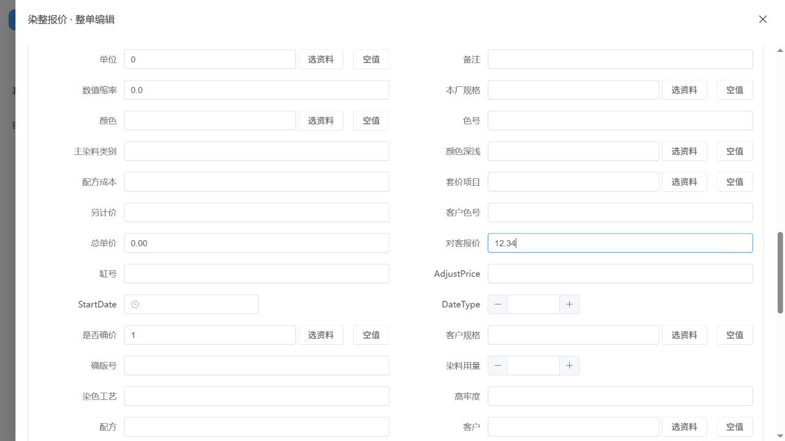

# 业务表单与整单联动实施及验证

日期：2026-10-22。承接染整订单、报价及工艺设计、排产管理、生产管理的入口调整，本轮完成[固定清单](2026-10-22业务表单与整单联动固定清单.md)中的八项限定交付。没有新增模型字段、旧erpID或迁移，没有正式导入数据。财务、打印、原35项查询继续暂缓。

## 实际修改

1. 15个主要原模型明确普通新增入口；订单颜色、报价明细、配方阶段及材料、工卡工序等在表单和Excel窗口使用相同规则。全部既有变体仍可选择，不根据使用频率删掉类型。
2. 明细新增优先继承实际父记录的业务类型。例如试样配方继承试样染程，加捻工卡继承加捻工序；普通配方的多个候选采用已明确配置的标准入口。无法唯一确定且没有标准入口时，要求在本行选择类型，不取第一条候选。既有行保存保留原entry_name。
3. 整单编辑与列表编辑共用原字段标题、资料选择上下文、只读和必填规则。现有异常空值未改动时，不因另一个字段的编辑而强制补齐整条历史行；新行和本次修改字段按实际规则检查。
4. 非入口生成的表级常量按原模型类型展示，496个常量转换已核验；与业务入口默认值重叠的字段不预填表级值，避免0覆盖类别34、价格单位1或当前日期等入口规则。编号、动态日期和UUID仍在保存服务生成。明确输入的NULL、零、负数和空文本分别保留；只有选择“使用表单默认值”时，空的生成字段才不提交以便由服务生成。
5. 已选择所属父记录时，原关联流水及阶段号由既有service承接，不要求用户在隐藏字段重复输入。独立录入仍要求原必填关联码；显式原码与父记录冲突时明确失败，不覆盖冲突值。
6. 整单保存先验证表头与各行，后端保留既有事务。第二行失败时，第一行和表头修改均不采用。重复业务号和条码不去重，各行独立保存。
7. 计算和回写继续复用service：订单客户回写关联工卡、配方主从原码承接、称料阶段浴比承接、报价价格分别保存等；没有在Vue复制公式。保存后才生效的逻辑没有标成输入时即时计算，也没有制造缺失来源的报价转单。
8. 普通资料选择窗口显示业务名称；原SQL、查询编号和来源诊断只在维护模式显示。选择结果与重复行数量没有因此改变。

## 默认入口

|模块用途|模型|普通入口|
|---|---|---|
|染整订单|OrderMain / OrderColor|OrderMain / OrderColor|
|染整报价|FixedPrice / FixedPriceDetail|Quote / QuoteDetail|
|工艺配方|DyeRecipe / DyeRecipePhase / DyeRecipeDetail|DyeRecipe / DyeRecipePhase / DyeRecipeDetail|
|工艺设计|ProcessCraft / StandCraft|ProcessCraft / StandCraft|
|工卡及工序|JobSheet / JobProcess|JobSheet / JobProcess|
|排产|ProcessSchedule|ProcessSchedule，已有ProcessScheduleRS仍按该变体编辑|
|生产报工|WProcess|WProcessEdit|
|染料称料|StuffWeight|StuffWeight；从NormalStuffWeight单据新增阶段继承NormalStuffWeightPhaseDetail|
|生产产量|RecordYield|RecordYield|

这里是15个模型的默认值，不是只保留15个业务入口。11种配方入口以及试样、加捻等已有变体均保留。

## 独立验证

数据库端口5440，验证库erp_master_xlsx_verify_20261021；自动化测试使用独立test_erp_numbering_regression_20261021。浏览器使用8081前端、8002后端。没有把验证库切换成当前项目默认数据库。

|验证|结果|证据范围|
|---|---|---|
|后端自动化|70项通过，其中本轮新增11项|普通/少用入口、主从保存、失败回滚、重复明细、负数、NULL、订单回写、历史与新增Excel及既有保存规则回归|
|前端规则|29项通过|直接运行共享表单规则，核验15个默认值、父类型继承、全部配方变体、上下文及数值保留；最终重新读取元数据验证|
|常量默认值|496个转换检查，无错误|不修改模型字段；CHECKEXACT.CHECKTIME的SQL datetime默认0只读核实为1900-01-01|
|浏览器保存后数据库回查|13项通过|以下八个实际业务页面；14条独立头/行记录没有历史导入批次|
|前端与后端检查|构建、类型检查、Django check通过；无待生成迁移|未运行正式数据导入|

浏览器实际完成：染整订单整单、染整报价整单、配方头→染程→材料、工卡新增正式工序、染色排产编辑、报工整单、普通称料新增染程、产量记录编辑。

- 订单客户000→001，关联工卡同时回写001；颜色成品数量-2原值保留，没有冒充重算工卡计划。
- 报价明细幅宽/克重默认0，对客报价12.34，明确清空客确价后仍为NULL，总单价仍独立保存0。
- 配方阶段1与材料明细正确继承同一配方流水和阶段号，分别保留DyeRecipePhase、DyeRecipeDetail入口。
- 工卡正式工序采用JobProcess；染色排产顺序改为2后仍为ProcessScheduleRS，没有覆盖成普通入口。
- 报工仍为WProcessEdit；普通称料阶段继承NormalStuffWeightPhaseDetail，浴比5从表头承接。
- 产量保存未更换FORM-REPEAT条码或原GUID。另有独立自动化验证重复条码、重复明细号均保留多行。

证据：[浏览器回查](erp-form-browser-verification-20261022.json)、[前端规则](erp-form-helper-verification-20261022.json)、[默认值核验](erp-form-literal-defaults-verification-20261022.json)。自动化用例在backend/plugins/erp_base/tests/test_source_business_forms.py；执行时也包含六组既有回归。69、29、13、496是不同范围，不合并成业务完成数量。

初次浏览器验证暴露报价默认值缺失和配方隐藏父字段仍必填的问题，修复后重新保存、重新查库通过；早期400及Vue提示没有被当作通过。浏览器仍有既有fast-crud/Vue组件属性警告，系统实时通知Redis6389也不可用，详见[异常及后续](2026-10-22业务表单与整单联动异常及后续.md)。

## 当前项目与完成口径

当前项目8080/8001已应用代码，开发数据库仍为5439的erp_full_trial_20261014。以只读事务核对：OrderMain 17,032行、FixedPrice 20行、FixedPriceDetail 847行，和上轮记录一致；八个测试主表均无FL20261022测试标记。这是本轮隔离检查，不是逐字段全量历史对账，亦不表示本轮正式导入过这批旧资料。见[只读核验](erp-form-current-readonly-verification-20261022.json)。

**开发完成：本轮固定八项及上述必要验证。历史数据对账：本轮验证记录已核对，正式库全量对账未执行。现场验收：未执行。** 原933项盘点、5条保存来源差异、9条事件缺口、235条待逐入口证据及其他专项未完成项均不因本轮关闭；不宣称全部旧业务链已完成。

后续顺序：用户自行核对并采用基础资料→用实际染整订单、报价及工艺工卡逐单录入→逐岗位确认业务类型、单位与责任工序→按原全量清单逐项核实剩余来源/事件→分别开展正式历史全量对账与现场验收。已暂停的财务、打印和35项查询仍保持暂停；异常、重复和少用业务不删除。
