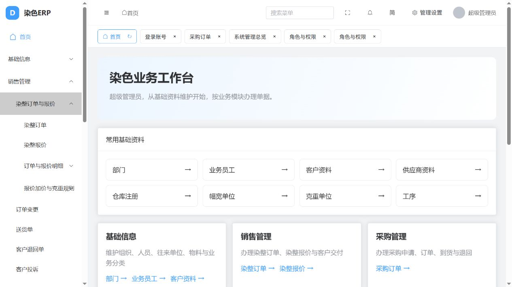
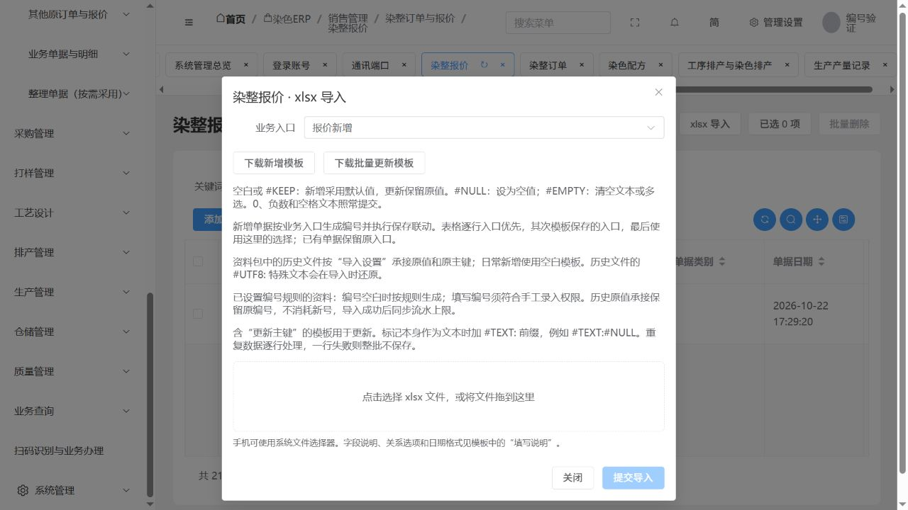

# 染整订单、报价与生产三模块实施及验证

更新日期：2026-10-22。依据《2026-10-22订单报价与生产模块只读核查》实施。本轮调整入口、业务默认选择和资料文件，复用已有模型、原主键、服务与关系；没有新建业务模型、数据库迁移或旧erpID。

## 当前可以在哪里办理

|模块|主要入口|说明|
|---|---|---|
|销售管理|染整订单与报价 → 染整订单|对应OrderMain，默认采用原OrderMain入口；颜色、要求、工序仍使用原模型|
|销售管理|染整订单与报价 → 染整报价|逻辑Quote入口实际对应FixedPrice；明细实际对应FixedPriceDetail|
|销售管理|订单与报价明细 / 报价加价与克重规则|保留明细、加价、要求、工序价格及克重规则，单独展开|
|销售管理|其他原订单与报价|保留物理Quote/QuoteDetail/QuoteAtte及OrderInfo/OrderInfoProcess，包含空表|
|销售管理|整理单据（按需采用）|现有SalesOrder、CommercialPrice整理模型保留；不当作另一个有旧库依据的加工订单类别|
|工艺设计|工艺单、标准工艺、染色配方、工艺参数、流程曲线|技术编制及配方，不复制原模型|
|排产管理|生产工卡、分合卡/分配、计划、工序排产、班次计划|ProcessSchedule和ProcessScheduleRS复用同一个原物理模型，保留入口变体|
|生产管理|实际工序执行、染料称料、生产产量记录、外协执行、设备保养、能耗|RecordYield等虽仍使用原仓储/打样应用地址，实际导航归属生产管理|

首页现为九个业务模块：基础信息、销售管理、采购管理、打样管理、工艺设计、排产管理、生产管理、仓储管理、质量管理；另保留系统管理、业务查询及扫码办理。界面按业务名称展示。

菜单保持原ID、地址、资源和显隐状态，已有权限的角色补齐对应新目录可见性；没有增加业务接口、字段或数据范围权限。业务基础资料不转回平台字典。考勤设备及员工设备关联仍属基础信息，不因原应用名是生产就归为生产机台。

## 默认业务入口及保存

新增染整订单默认选择OrderMain；新增染整报价默认选择Quote。表单及Excel模板/导入窗口使用一致的默认入口；其余原入口可选，已有记录沿用保存的来源入口。后台继续调用现有编号、默认值、公式、主从关联和保存服务，不在前端另写一套价格计算。

独立库浏览器新增报价生成BJ261022001，新增订单生成原规则K261022001/K#261022001；这些是独立验证单据，没有写入当前项目业务库。日常报价明细验证CusPrice=123.45、Price=NULL、Pricesum=0分别保存，明细继承表头流水。历史承接不执行日常保存事件或生成新号。

## 导入文件及顺序

文件包：`outputs/染整报价导入包_20261022`，另提供同名zip。共23份xlsx：11份已有资料、11份新增空白模板、1份导入目录。业务报价和配套选项分文件夹；并非把报价明细塞入基础信息字典。

|原表或分类|原记录数|用途|
|---|---:|---|
|FixedPrice|20|染整报价表头|
|FixedPriceDetail|847|染整报价明细，含原对客价|
|FixedPriceAtte|0|报价要求，提供空模板并保留原表|
|FixedPriceProcess|0|报价工序，提供空模板并保留原表|
|QuoteItemPrice|1|报价加价项目|
|QuotePriceAtte|2|报价要求价格|
|QuotePriceProcess|0|报价工序价格，提供空模板并保留原表|
|FixedCanRecord / FixedCanDetail|5 / 5|克重报价规则及明细|
|s_DBComboValue.C010 / Z010|6 / 2|计价单位和供纱服务方式选项|
|合计|888|原行全部保留，含空值与零值|

先准备原基础资料包中的客户、物料和报价所需分类，再按目录：C010/Z010选项 → 报价表头 → 报价明细及要求/工序 → 加价、克重规则及其明细。已有文件采用“历史基础资料原值承接”这一既有通用模式；名称虽含基础资料，本次同样用于报价原值承接。新增业务采用“新增空白模板”，执行日常编号和保存规则。两者不得互换用途。

C010当前页面叫“单价单位（C010）”；Z010当前页面叫“纱类别（Z010）”，其原保存值为“本厂采购、客户来纱”，对应显示含义“包工包料、来料加工”。文件以“服务方式_Z010”说明其报价用途，原保存值不改写。

历史文件保留原键、原提取序号、前导零、精度、NULL和空文本；含特殊换行/控制字符的原文本使用#UTF8:表示，导入会还原。各文件包含导入设置、字段说明、原行对照，报价明细另有价格核对页。空白新增模板不嵌入验证库关联ID；新增关联从实际使用库选择。

## 验证结果与边界

- 初验250项通过：独立库实际接口试导888行，对照44,896个原字段值，差异0；847条报价明细的报价表头关联完整；11份新增空白模板均可识别。
- 最终入口与日常保存专项194项通过，包含176个资源归属及订单/报价保存、编号、主从联动；该专项新增单据已事务回滚。
- 最终23份xlsx逐份检查原表头、行数、导入设置、菜单路径、单元格类型，并生成预览核查；无公式或错误单元格。价格核对页保留837个非零CusPrice和10个NULL，847个Price=NULL、Pricesum=0。
- 同批同原提取行重复提交：明确报错并整批回滚；没有覆盖或跳过原行。不同原行即使内容重复仍按各自序号保留。
- 既有历史Excel及日常入口回归23/23通过，包含同值不同原行保留、空值与特殊文本、错误行整批回滚和入口保存规则；使用独立预建测试结构，不计作重新验证历史迁移回放。后台check、模型迁移一致性检查通过；前端类型检查及构建通过（保留既有包体积提示）。
- 当前项目只应用菜单配置。写入审计仅出现system_menu及system_rolemenupermission；接口、字段、数据范围授权摘要及订单/报价/编号规则摘要保持一致。本轮正式业务导入为0。
- 当前开发历史库原先已有OrderMain 17,032行、FixedPrice 20行、FixedPriceDetail 847行，本轮应用前后保持一致；它们不是本轮文件试导新增的数据。正式采用文件前，应由用户核对目标库已有批次，避免跨批重复采用。

浏览器验证：九模块首页、主销售入口及目录展开、报价默认入口、独立库新增报价与订单、报价整单明细、报价导入窗口、工艺配方、工序排产、生产产量页、刷新直达。界面服务保持8001/8080，独立验证使用8002/8081；本轮没有操作酒馆项目。

**开发完成**指本轮入口整理、默认选择、报价文件及上述必要验证。**历史数据对账**：本包在独立库的逐字段对照已通过，正式库全量对账/采用尚未执行。**现场验收**：岗位权限、实际报价口径、全业务链真实单据及设备回传尚未执行。本轮不关闭933项原盘点中的其余差异。

财务、打印和原35项查询继续暂缓，具体边界见[专项异常及后续](2026-10-22染整订单报价与生产导航异常及后续.md)。

验证证据：`erp-sales-production-verification-20261022.json`、`erp-sales-production-entries-verification-20261022.json`、`erp-quote-xlsx-final-verification-20261022.json`、`erp-sales-production-menu-apply-20261022.json`。浏览器证据见本页所附截图及专项浏览器结果。

## 全部归属明细

本轮明确登记176个资源：工艺设计32、排产管理32、生产管理88、销售21、基础信息3。这里是本轮涉及范围，不是全系统资源总数。生产应用中的全部资源均纳入清单；其他来源跨应用归属在此登记。原未涉及入口继续保留。

|模型|原表（无则为整理模型）|当前模块|显示名称|
|---|---|---|---|
|erp_base.SourceDyePCraftParam|p_CraftParam|工艺设计|工艺参数项目|
|erp_base.SourceDyePCraftPParam|p_CraftPParam|工艺设计|前工艺参数项目原表|
|erp_base.SourceDyePDyeCurve|p_DyeCurve|工艺设计|染色流程曲线|
|erp_base.SourceDyePDyeCurveDetail|p_DyeCurveDetail|工艺设计|染色流程曲线步骤|
|erp_base.SourceDyePProcessChemical|p_ProcessChemical|工艺设计|工序染化料配置|
|erp_base.SourceDyePProcessCraft|p_ProcessCraft|工艺设计|工序工艺参数范围|
|erp_base.SourceDyePProcessCraft1|p_ProcessCraft1|工艺设计|工序工艺参数另一原表|
|erp_base.SourceDyePProcessPCraft|p_ProcessPCraft|工艺设计|工序前工艺参数范围|
|erp_sampling.Recipe|整理模型|工艺设计|共用配方主体（含试样与生产）|
|erp_sampling.RecipeVersion|整理模型|工艺设计|配方版本|
|erp_sampling.RecipeStage|整理模型|工艺设计|配方染程阶段|
|erp_sampling.RecipeIngredient|整理模型|工艺设计|配方物料明细|
|erp_sampling.ProcessCurveVersion|整理模型|工艺设计|染色工艺曲线版本|
|erp_sampling.ProcessCurveStep|整理模型|工艺设计|工艺曲线步骤|
|erp_sampling.SourceDyeAddDyeWProcessStep|AddDyeWProcessStep|生产管理|染色产量补录|
|erp_sampling.SourceDyeDyeProduceItem|DyeProduceItem|生产管理|工卡染色投料项目|
|erp_sampling.SourceDyeDyeRecipe|DyeRecipe|工艺设计|染色配方|
|erp_sampling.SourceDyeDyeRecipeDetail|DyeRecipeDetail|工艺设计|染色配方明细表|
|erp_sampling.SourceDyeDyeRecipeJob|DyeRecipeJob|工艺设计|染色配方工卡表|
|erp_sampling.SourceDyeDyeRecipePhase|DyeRecipePhase|工艺设计|染色配方染程表|
|erp_sampling.SourceDyeDyeStartDateTime|DyeStartDateTime|生产管理|资料（DyeStartDateTime）|
|erp_sampling.SourceDyePrintRecipe|PrintRecipe|工艺设计|资料（PrintRecipe）|
|erp_sampling.SourceDyePrintRecipeColor|PrintRecipeColor|工艺设计|资料（PrintRecipeColor）|
|erp_sampling.SourceDyePrintRecipeDetail|PrintRecipeDetail|工艺设计|资料（PrintRecipeDetail）|
|erp_production.PhysicalBatchExecution|整理模型|生产管理|同缸物理执行|
|erp_production.PhysicalExecutionCorrection|整理模型|生产管理|整缸执行更正|
|erp_production.WorkCard|整理模型|排产管理|生产工卡|
|erp_production.WorkCardOrderAllocation|整理模型|排产管理|订单工卡数量分配|
|erp_production.DyeBatch|整理模型|排产管理|染色缸批|
|erp_production.DyeBatchWorkCard|整理模型|排产管理|缸批与工卡关联|
|erp_production.DyeBatchAllocation|整理模型|排产管理|工卡分配到缸批的数量|
|erp_production.WorkCardOperation|整理模型|排产管理|工卡计划工序|
|erp_production.OperationParameter|整理模型|工艺设计|工卡工艺参数快照|
|erp_production.WorkCardRequirement|整理模型|排产管理|工卡附加技术与包装要求|
|erp_production.ScheduleAssignment|整理模型|排产管理|排产记录|
|erp_production.OperationExecution|整理模型|生产管理|实际工序执行|
|erp_production.ExecutionWorker|整理模型|生产管理|执行人员|
|erp_production.ExecutionMeasurement|整理模型|生产管理|执行实际参数|
|erp_production.ExecutionCorrection|整理模型|生产管理|报工更正|
|erp_production.ProductionRecipe|整理模型|工艺设计|生产采用配方快照|
|erp_production.MaterialPlanStage|整理模型|生产管理|生产用料阶段|
|erp_production.MaterialPlanLine|整理模型|生产管理|生产用料计划|
|erp_production.WeighingOrder|整理模型|生产管理|称料及加料单|
|erp_production.WeighingStage|整理模型|生产管理|料单染程阶段|
|erp_production.WeighingLine|整理模型|生产管理|称料明细|
|erp_production.WeighingRecord|整理模型|生产管理|一次实际称量|
|erp_production.ReworkOrder|整理模型|生产管理|返修任务|
|erp_production.SourceDyeColorShiftEmp|ColorShiftEmp|生产管理|资料（ColorShiftEmp）|
|erp_production.SourceDyeDPWorkQty|DP_WorkQty|生产管理|资料（DP_WorkQty）|
|erp_production.SourceDyeEEnergyDay|e_Energy_day|生产管理|资料（e_Energy_day）|
|erp_production.SourceDyeEYardMeterGether|e_YardMeterGether|生产管理|刷卡-码表数据选择应用|
|erp_production.SourceDyeEmpShiftClock|EmpShiftClock|生产管理|资料（EmpShiftClock）|
|erp_production.SourceDyeEnergyConsumption|EnergyConsumption|生产管理|能耗记录|
|erp_production.SourceDyeEnergyConsumptionDetail|EnergyConsumptionDetail|生产管理|能耗记录明细|
|erp_production.SourceDyeEnergyRecords|EnergyRecords|生产管理|能耗记录录入|
|erp_production.SourceDyeGetClothNotice|GetClothNotice|生产管理|收坯通知单|
|erp_production.SourceDyeGetClothNoticeDetail|GetClothNoticeDetail|生产管理|收坯通知单明细|
|erp_production.SourceDyeGrayReturnApply|GrayReturnApply|生产管理|坯布退货申请单|
|erp_production.SourceDyeGrayReturnApplyDetail|GrayReturnApplyDetail|生产管理|坯布退货申请单明细|
|erp_production.SourceDyeHSalaryWorkQty|h_SalaryWorkQty|生产管理|员工工序产量原始汇总（h_SalaryWorkQty）|
|erp_production.SourceDyeHSalaryWorkShift|h_SalaryWorkShift|生产管理|班组工序产量原始汇总（h_SalaryWorkShift）|
|erp_production.SourceDyeHSJobsheetNo|HS_JobsheetNo|生产管理|商业发票单价录入|
|erp_production.SourceDyeJingShaRegister|JingShaRegister|生产管理|井纱信息登记|
|erp_production.SourceDyeJingShaRegisterDetail|JingShaRegisterDetail|生产管理|井纱信息登记明细|
|erp_production.SourceDyeJobAssign|JobAssign|排产管理|工卡预配信息|
|erp_production.SourceDyeJobAtte|JobAtte|排产管理|加工要求表|
|erp_production.SourceDyeJobColor|JobColor|排产管理|资料（JobColor）|
|erp_production.SourceDyeJobCombine|JobCombine|排产管理|工卡并缸表|
|erp_production.SourceDyeJobCombineOrder|JobCombineOrder|排产管理|工卡合染订单|
|erp_production.SourceDyeJobExceptions|JobExceptions|生产管理|工卡流程异常表|
|erp_production.SourceDyeJobGrayRecord|JobGrayRecord|生产管理|码单明细|
|erp_production.SourceDyeJobInWareEdit|JobInWareEdit|生产管理|工卡进仓登记|
|erp_production.SourceDyeJobMain|JobMain|排产管理|资料（JobMain）|
|erp_production.SourceDyeJobOutWareEdit|JobOutWareEdit|生产管理|工卡出仓登记|
|erp_production.SourceDyeJobPreRegist|JobPreRegist|排产管理|工序前处理工卡登记|
|erp_production.SourceDyeJobProcess|JobProcess|排产管理|工卡工序表|
|erp_production.SourceDyeJobProcessPre|JobProcessPre|排产管理|工卡工序表|
|erp_production.SourceDyeJobSheet|JobSheet|排产管理|生产工卡|
|erp_production.SourceDyeJobSheetMasrkCar|JobSheetMasrkCar|生产管理|码卡打印|
|erp_production.SourceDyeJobSheetNoRushOrder|JobSheetNoRushOrder|排产管理|急单信息|
|erp_production.SourceDyeJobSheetOther|JobSheetOther|排产管理|缸号信息|
|erp_production.SourceDyeJobSheetReceive|JobSheetReceive|生产管理|染色出缸登记|
|erp_production.SourceDyeJobSheetRegister|JobSheetRegister|生产管理|染色登记|
|erp_production.SourceDyeJobSheetSchedule|JobSheetSchedule|排产管理|流程卡生产计划表|
|erp_production.SourceDyeJobShiftEmp|JobShiftEmp|生产管理|工卡班组员工表|
|erp_production.SourceDyeJobShiftEmpBak|JobShiftEmpBak|生产管理|资料（JobShiftEmpBak）|
|erp_production.SourceDyeJobStartRollNo|JobStartRollNo|生产管理|资料（JobStartRollNo）|
|erp_production.SourceDyeMachineCarePlan|MachineCarePlan|生产管理|设备保养计划|
|erp_production.SourceDyeMachineCarePlanDetail|MachineCarePlanDetail|生产管理|设备保养计划明细|
|erp_production.SourceDyeMachineCareProject|MachineCareProject|生产管理|保养计划执行项目|
|erp_production.SourceDyeMachineCareRecords|MachineCareRecords|生产管理|设备保养记录|
|erp_production.SourceDyeMachineCase|MachineCase|生产管理|机台保养方案|
|erp_production.SourceDyeMachineCaseDetail|MachineCaseDetail|生产管理|方案适用机台明细|
|erp_production.SourceDyeMachineCaseProject|MachineCaseProject|生产管理|机台方案项目|
|erp_production.SourceDyeMachineFault|MachineFault|生产管理|设备报修新增|
|erp_production.SourceDyeMachineFaultArticleInfo|MachineFaultArticleInfo|生产管理|资料（MachineFaultArticleInfo）|
|erp_production.SourceDyeMachineFaultComment|MachineFaultComment|生产管理|资料（MachineFaultComment）|
|erp_production.SourceDyeMachineFaultFilter|MachineFaultFilter|生产管理|设备故障业务页签筛选配置|
|erp_production.SourceDyeMachineFaultRecord|MachineFaultRecord|生产管理|资料（MachineFaultRecord）|
|erp_production.SourceDyeMachines|Machines|基础信息|考勤设备（独立于生产机台）|
|erp_production.SourceDyeMoveShiftBill|MoveShiftBill|生产管理|员工调班单|
|erp_production.SourceDyeOutWorkApply|OutWorkApply|生产管理|发外加工申请单|
|erp_production.SourceDyeOutWorkApplyDetail|OutWorkApplyDetail|生产管理|发外加工申请明细|
|erp_production.SourceDyePlanDetail|PlanDetail|排产管理|计划明细表|
|erp_production.SourceDyePlanMain|PlanMain|排产管理|计划主表|
|erp_production.SourceDyePrePlanOrder|PrePlanOrder|排产管理|资料（PrePlanOrder）|
|erp_production.SourceDyeProcessCraft|ProcessCraft|工艺设计|工序工艺单|
|erp_production.SourceDyeProcessCraftJobNo|ProcessCraftJobNo|工艺设计|工序工艺工卡关联|
|erp_production.SourceDyeProcessCraftOrderNo|ProcessCraftOrderNo|工艺设计|工序工艺订单关联|
|erp_production.SourceDyeProcessSchedule|ProcessSchedule|排产管理|工序排产与染色排产|
|erp_production.SourceDyeProcessSchedulebak|ProcessSchedulebak|排产管理|历史工序排产备份|
|erp_production.SourceDyePStuffWeight|PStuffWeight|生产管理|资料（PStuffWeight）|
|erp_production.SourceDyePStuffWeightDetail|PStuffWeightDetail|生产管理|资料（PStuffWeightDetail）|
|erp_production.SourceDyePStuffWeightPhase|PStuffWeightPhase|生产管理|资料（PStuffWeightPhase）|
|erp_production.SourceDyeRecordEmp|RecordEmp|生产管理|资料（RecordEmp）|
|erp_production.SourceDyeSalaryChanges|SalaryChanges|生产管理|工卡及人员调整原表（SalaryChanges）|
|erp_production.SourceDyeSalaryChangesDetail|SalaryChangesDetail|生产管理|工卡及人员调整明细原表（SalaryChangesDetail）|
|erp_production.SourceDyeSemiOutWorkApply|SemiOutWorkApply|生产管理|发外加工申请单(半成品)|
|erp_production.SourceDyeSemiOutWorkApplyDetail|SemiOutWorkApplyDetail|生产管理|发外加工申请明细(半成品)|
|erp_production.SourceDyeShiftArrange|ShiftArrange|排产管理|排班记录主表|
|erp_production.SourceDyeShiftArrangeDetail|ShiftArrangeDetail|排产管理|排班记录明细|
|erp_production.SourceDyeShiftPlan|ShiftPlan|排产管理|排班主表|
|erp_production.SourceDyeShiftPlanDetail|ShiftPlanDetail|排产管理|排班子表|
|erp_production.SourceDyeStandCraft|StandCraft|工艺设计|标准工艺单|
|erp_production.SourceDyeStandCraftBeforeDetail|StandCraftBeforeDetail|工艺设计|标准工艺前置明细|
|erp_production.SourceDyeStandCraftDetail|StandCraftDetail|工艺设计|标准工艺明细|
|erp_production.SourceDyeStandCraftJobNo|StandCraftJobNo|工艺设计|标准工艺工卡关联|
|erp_production.SourceDyeSterotypeTech|SterotypeTech|工艺设计|定型工艺单|
|erp_production.SourceDyeStuffCombineSheets|StuffCombineSheets|生产管理|资料（StuffCombineSheets）|
|erp_production.SourceDyeStuffDeptApply|StuffDeptApply|生产管理|染化料部门采购|
|erp_production.SourceDyeStuffDeptApplyDetail|StuffDeptApplyDetail|生产管理|染化料部门采购明细|
|erp_production.SourceDyeStuffOutApply|StuffOutApply|生产管理|染化料领用申请|
|erp_production.SourceDyeStuffOutApplyDetail|StuffOutApplyDetail|生产管理|染化料领用申请新增|
|erp_production.SourceDyeStuffWeight|StuffWeight|生产管理|染料称料|
|erp_production.SourceDyeStuffWeightDetail|StuffWeightDetail|生产管理|染料称料明细|
|erp_production.SourceDyeStuffWeightJobSheetNo|StuffWeightJobSheetNo|生产管理|资料（StuffWeightJobSheetNo）|
|erp_production.SourceDyeStuffWeightPhase|StuffWeightPhase|生产管理|染料称料染程|
|erp_production.SourceDyeStuffWeightPrint|StuffWeightPrint|生产管理|资料（StuffWeightPrint）|
|erp_production.SourceDyeTightTube|TightTube|生产管理|资料（TightTube）|
|erp_production.SourceDyeTightTubeDetail|TightTubeDetail|生产管理|资料（TightTubeDetail）|
|erp_production.SourceDyeTightTubePlan|TightTubePlan|排产管理|紧筒排产单|
|erp_production.SourceDyeTightTubePlanDetail|TightTubePlanDetail|排产管理|紧筒排产明细|
|erp_production.SourceDyeUserACMachines|UserACMachines|基础信息|员工门禁设备关联|
|erp_production.SourceDyeUsersMachines|UsersMachines|基础信息|员工设备关联另一原表|
|erp_production.SourceDyeWashTheTankDye|WashTheTankDye|生产管理|洗缸料单染化料|
|erp_production.SourceDyeWProcess|WProcess|生产管理|实际工序执行|
|erp_production.SourceDyeWProcessBak|WProcessBak|生产管理|资料（WProcessBak）|
|erp_production.SourceDyeWProcessStep|WProcessStep|生产管理|资料（WProcessStep）|
|erp_production.SourceDyeWProcessStepBak|WProcessStepBak|生产管理|资料（WProcessStepBak）|
|erp_production.SourceDyeWVehicle|WVehicle|生产管理|资料（WVehicle）|
|erp_production.SourceDyeWWorkRecord|WWorkRecord|生产管理|考勤记录|
|erp_production.SourceDyeWWorkTime|WWorkTime|生产管理|刷卡有效工时记录|
|erp_warehouse.SourceDyeAProdRecord|A_ProdRecord|生产管理|资料（A_ProdRecord）|
|erp_warehouse.SourceDyeRecordYield|RecordYield|生产管理|生产产量记录|
|erp_warehouse.SourceDyeWeightTechInfo|WeightTechInfo|工艺设计|称料工艺参数|
|erp_sales.SourceDyeOrderMain|OrderMain|销售管理|染整订单|
|erp_sales.SourceDyeOrderColor|OrderColor|销售管理|染整订单颜色明细|
|erp_sales.SourceDyeOrderAtte|OrderAtte|销售管理|染整订单要求|
|erp_sales.SourceDyeFixedPrice|FixedPrice|销售管理|染整报价|
|erp_sales.SourceDyeFixedPriceDetail|FixedPriceDetail|销售管理|染整报价明细|
|erp_sales.SourceDyeFixedPriceAtte|FixedPriceAtte|销售管理|染整报价要求|
|erp_sales.SourceDyeFixedPriceProcess|FixedPriceProcess|销售管理|染整报价工序|
|erp_sales.SourceDyeQuoteItemPrice|QuoteItemPrice|销售管理|报价加价项目|
|erp_sales.SourceDyeQuotePriceAtte|QuotePriceAtte|销售管理|报价要求价格|
|erp_sales.SourceDyeQuotePriceProcess|QuotePriceProcess|销售管理|报价工序价格|
|erp_sales.SourceDyeQuote|Quote|销售管理|其他报价原表（Quote）|
|erp_sales.SourceDyeQuoteDetail|QuoteDetail|销售管理|其他报价明细原表（QuoteDetail）|
|erp_sales.SalesOrder|整理模型|销售管理|销售订单整理单据|
|erp_sales.CommercialPrice|整理模型|销售管理|客户价格整理单据|
|erp_base.SourceDyeFixedCanRecord|FixedCanRecord|销售管理|克重报价规则|
|erp_base.SourceDyeFixedCanDetail|FixedCanDetail|销售管理|克重报价规则明细|
|erp_sales.SourceDyeOrderProcess|OrderProcess|销售管理|染整订单工序|
|erp_sales.SourceDyeOrderProcessPre|OrderProcessPre|销售管理|染整订单前工序|
|erp_sales.SourceDyeOrderInfo|OrderInfo|销售管理|其他订单信息（OrderInfo）|
|erp_sales.SourceDyeOrderInfoProcess|OrderInfoProcess|销售管理|其他订单信息工序（OrderInfoProcess）|
|erp_sales.SourceDyeQuoteAtte|QuoteAtte|销售管理|其他报价要求（QuoteAtte）|

另有16条既有分类资料路径随工艺/排产职责调整，全部保留原实体、分类过滤与权限。

|原路径|当前路径|
|---|---|
|生产管理 / 工序与排班基础 / 工序染化料配置|工艺设计 / 工序与排班基础 / 工序染化料配置|
|打样管理 / 颜色工艺基础 / 染色流程曲线|工艺设计 / 颜色工艺基础 / 染色流程曲线|
|打样管理 / 颜色工艺基础 / 染色流程曲线步骤|工艺设计 / 颜色工艺基础 / 染色流程曲线步骤|
|打样管理 / 颜色工艺基础 / 工艺参数项目|工艺设计 / 颜色工艺基础 / 工艺参数项目|
|打样管理 / 颜色工艺基础 / 前工艺参数项目原表|工艺设计 / 颜色工艺基础 / 前工艺参数项目原表|
|生产管理 / 工序工艺基础 / 工序工艺参数范围|工艺设计 / 工序工艺基础 / 工序工艺参数范围|
|生产管理 / 工序工艺基础 / 工序工艺参数另一原表|工艺设计 / 工序工艺基础 / 工序工艺参数另一原表|
|生产管理 / 工序工艺基础 / 工序前工艺参数范围|工艺设计 / 工序工艺基础 / 工序前工艺参数范围|
|生产管理 / 称料基础 / 称料工艺参数（来源关联待核）|工艺设计 / 称料基础 / 称料工艺参数（来源关联待核）|
|生产管理 / 工艺技术资料 / 工序工艺单|工艺设计 / 工艺技术资料 / 工序工艺单|
|生产管理 / 工艺技术资料 / 工序工艺工卡关联|工艺设计 / 工艺技术资料 / 工序工艺工卡关联|
|生产管理 / 工艺技术资料 / 工序工艺订单关联|工艺设计 / 工艺技术资料 / 工序工艺订单关联|
|生产管理 / 工艺技术资料 / 标准工艺单|工艺设计 / 工艺技术资料 / 标准工艺单|
|生产管理 / 工艺技术资料 / 标准工艺前置明细|工艺设计 / 工艺技术资料 / 标准工艺前置明细|
|生产管理 / 工艺技术资料 / 标准工艺明细|工艺设计 / 工艺技术资料 / 标准工艺明细|
|生产管理 / 工艺技术资料 / 标准工艺工卡关联|工艺设计 / 工艺技术资料 / 标准工艺工卡关联|

## 浏览器证据

