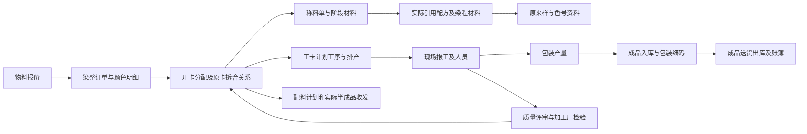

# 2025—2026染整订单报价金额前1000单业务路线分析

核查日期：2026-10-22。数据源：localhost / Textile_GXHFRS。订单范围为OrderMain.SheetDate ≥ 2025-01-01且＜2027-01-01；旧库2026年实际最晚订单日期为2026-08-15。全程只读查询并在本地计算，没有正式导入数据，也没有修改模型或添加旧erpID。

## 一、筛选结果与金额口径

|指标|结果|
|---|---|
|期间全部染整订单|13,915张；2025年8,829张、2026年5,086张|
|期间全部订单颜色明细|65,717行|
|现存染整报价|20张表头、847条明细；837条非零对客报价、10条NULL|
|可逐行完整计算金额的订单|12,768张|
|未能完整计价的订单|1,147张，逐单逐行另附，未当成0、未丢弃|
|本次选择|完整计价订单中金额最高的1,000张；2025年619张、2026年381张|
|前1000单金额合计|62,013,998.63元|
|前1000单订单重量合计|1,621,197.21KG|
|第1名|K#251118002，1,161,468.00元|
|第1000名|K#260702011，21,695.00元|
|入选订单颜色明细|11,399行|
|直接及拆合/回修关联工卡|15,014张；初始直接关联14,995张，按原卡关系补充19张|
|未找到工卡的入选订单|14张，仍保留在榜单和逐单明细中|

计价公式：每行金额＝OrderColor.OrderQty（KG重量）×匹配的FixedPriceDetail.CusPrice；订单金额＝所属全部颜色明细行金额相加。同物料的多行全部保留，不先去重。按完整精度排序，表内金额显示到分；金额相同按订单日期、原SheetSeries稳定排序。

这里使用下单重量，不以实际称料、包装产量或收发重量替换订单数量；这些执行数据在后面的业务链中分别追踪。

报价以订单客户CustomerID＋物料ProdID严格匹配，再按关联工卡的YarnCategory区分“本厂采购/客户来纱”。没有可用工卡供纱信息时，仅在可用报价价格唯一时计算；同价多条报价保留全部候选编号。没有按物料名称模糊匹配，没有擅自采用其他客户的报价或任取第一条多价记录。

报价采用物料价格的元/KG计算口径；原报价PriceUnit本批全部为空，因此这属于按本次指定算法折算的订单金额，不是从旧订单金额字段读取的历史实结金额。没有叠加分头费、最低消费、税费或财务结算，也没有以Price/Pricesum代替CusPrice。现存报价跨年用于同一计算口径，没有声称还原了2025年每一次价格变更。

**榜单范围必须明确：这是12,768张可完整匹配报价订单的前1000。其余1,147张完整保存在附录；缺价或单位不一致使它们的总额尚不能确定，不能据此断言它们都排在1000名以后。**

旧订单Price/Amount为空不阻止上述计算。本报告按订单物料匹配实际存在的报价，再乘订单重量。

### 前20单

|名次|订单号|日期|客户|重量KG|报价折算金额/元|关联工卡|
|---|---|---|---|---|---|---|
|1|K#251118002|2025-11-18|高州恒生|35,196.00|1,161,468.00|31|
|2|K#250905029|2025-09-05|高州恒生|23,679.20|722,444.80|52|
|3|K#250516020|2025-05-16|高州恒生|18,270.00|602,910.00|34|
|4|K#250301050|2025-03-01|高州恒生|19,336.00|590,058.00|42|
|5|K#260306011|2026-03-06|高州恒生|14,975.00|497,072.00|73|
|6|K#260507016|2026-05-07|高州恒生|13,463.00|444,279.00|13|
|7|K#250909011|2025-09-09|高州恒生|12,005.00|437,587.50|53|
|8|K#251204011|2025-12-04|东莞恒生|9,921.00|346,344.00|23|
|9|K#251222024|2025-12-22|东莞恒生|8,447.00|333,771.50|43|
|10|K#251120031|2025-11-20|高州恒生|9,192.00|321,720.00|31|
|11|K#251230032|2025-12-30|高州恒生|9,303.00|316,001.00|41|
|12|K#250910009|2025-09-10|东莞恒生|7,538.00|315,924.00|24|
|13|K#250418012|2025-04-18|东莞恒生|9,906.00|295,355.00|29|
|14|K#260606003|2026-06-06|高州恒生|8,608.88|294,504.76|76|
|15|K#250221005|2025-02-21|东莞恒生|7,593.00|292,959.00|13|
|16|K#260316017|2026-03-16|高州恒生|6,951.00|290,409.00|54|
|17|K#251202004|2025-12-02|东莞恒生|6,656.00|286,434.00|61|
|18|K#250826040|2025-08-26|东莞恒生|8,669.00|286,077.00|17|
|19|K#250807017|2025-08-07|东莞恒生|6,915.00|267,405.00|45|
|20|K#260608017|2026-06-08|高州恒生|5,767.00|247,981.00|16|

### 客户分布

|客户编码|客户|订单数|重量KG|金额/元|
|---|---|---|---|---|
|004|高州恒生|427|854,477.38|32,247,008.26|
|000|东莞恒生|507|686,203.20|26,891,502.50|
|042|健采立盟|30|30,807.00|1,291,303.90|
|045|富威|15|21,131.63|760,617.97|
|054|显全|15|20,950.00|461,790.00|
|051|富恩纺织|5|6,343.00|317,066.00|
|061|大兴隆|1|1,285.00|44,710.00|

## 二、追踪方法及覆盖边界

以选中订单的SheetSeries/SheetNo和颜色明细CheckNo起步，经JobSheet、JobCombineOrder关联工卡；再沿OriJobsheetNo、OriSourceJobNo、OriSourceJobNo2及JobCombine的明确原卡关系扩展。随后逐表读取直接关联记录，按旧主从配置、原联合主键和明确业务引用补齐父单、阶段、材料、包装、收发及打样来源。累计查询176张业务/数量来源表，样本命中58张，关联原行1,651,946条。不同类型原行不可相加解释为单据张数。

共享工卡和共享配方分别保留每个订单的关联；全样本按原主键只计一次，同一原行在逐单表中可出现在多个订单下，所以逐单行数之和可能大于全样本原行数。无主键原表保留原行及重复行，不按条码、物料或投影内容去重。

其中用于本次金额计算的报价来源为186条报价明细、12张报价头，列为计价上下文。这个链接由本次客户/物料/供纱匹配建立，不冒充旧订单已经保存了QuoteDetailNo或已按该价格成交。

只按订单日期筛选，不再用2025—2026截断后续记录或原卡回溯；因此可关联到更早的配方、原卡和较晚的收发。原表状态、审核标记、停用与使用频次均未用于排除业务。原配置入口与样本发生事实分开统计；报表聚合、已物理删除且未恢复的记录及外部系统未落表数据，不能由这些存量关联记录补造。

计价输入初次读取时间2026-10-22T21:30:54.5847026，末次复核2026-10-22T22:44:19.0921822；订单、颜色明细、报价头和报价明细逐字段比较一致。旧库快照隔离为OFF，未调整数据库设置；本报告没有把分批读取冒充同一事务时点的一致性切换快照。

## 三、涉及模块

|业务模块|涉及订单数（不互斥）|命中原表数|关联原行数|主要原表|
|---|---|---|---|---|
|仓储管理|985|20|660,029|CarryMaterial,CarryMaterialDetail,GrayMaterial,GrayMaterialDetail,ProdIn,ProdInPriceAtte,ProdInRecord,ProdLoading,ProdLoadingDetail,ProdOut,ProdOutDetail,ProdStockBook,SemiIn,SemiInDetail,SemiOut,SemiOutDetail,SemiStockBook,StuffOut,StuffOutDetail,SwipeLabelPrint|
|工艺设计|300|3|31,408|DyeRecipe,DyeRecipeDetail,DyeRecipePhase|
|打样管理|215|2|1,285|DyeLabColor,DyeLabMain|
|排产管理|986|6|128,138|JobAssign,JobAtte,JobCombineOrder,JobProcess,JobSheet,ProcessSchedule|
|数量/结算关联（只读）|8|3|69|FARDetail,FARMain,FARRecord|
|生产管理|985|15|788,277|DyeStartDateTime,GetJobSheetReceive,JobInWareEdit,JobOutWareEdit,JobSheetReceive,JobSheetRegister,JobShiftEmp,RecordYield,StuffCombineSheets,StuffWeight,StuffWeightDetail,StuffWeightPhase,TightTube,TightTubeDetail,WProcess|
|质量管理|975|2|17,501|WDefect,dyeCheckout|
|销售管理|1000|7|25,239|CustomerTS,CustomerTSDetail,FixedPrice,FixedPriceDetail,OrderAtte,OrderColor,OrderMain|

模块名称按当前项目职责归类，原表名保留。工艺设计、排产管理和生产管理分别统计；FAR原表只列为数量/结算关联的只读来源，不据此开展财务功能或采用结算金额排名。

GetJobSheetReceive原模型清单暂归erp_base，但旧表单名为“部门接收登记／部门接收查询”，旧功能030601为“工艺时长确认新增”。本次按实际业务归入生产管理，不把它当成基础资料；这一归类仅用于本次分析，没有修改应用代码或菜单。

### 在旧界面配置中对应的模块

|旧模块编号|旧模块名称|绑定的命中原表数|直接绑定数据集数|绑定功能配置数|
|---|---|---|---|---|
|1|销售管理|3|0|12|
|3|工卡管理|2|0|13|
|4|计划管理|1|0|1|
|5|胚纱管理|2|0|2|
|6|成品管理|1|0|12|
|7|半成品管理|2|0|15|
|9|机物料管理|1|0|1|
|10|染化料管理|1|0|5|
|12|车间管理|2|0|9|
|14|应付管理|1|0|1|
|15|应收管理|1|0|6|
|21|染色技术管理|2|0|13|
|22|工艺参数管理|1|0|4|
|26|设备管理|1|0|1|
|49|系统设定|1|0|2|
|60|刷卡程序|1|0|1|

这一表来自s_Module、s_DataTable、s_FormParam及s_Functions配置，包含停用/未注明启用状态的定义；它说明原表可在哪些旧模块办理，不能当作这些订单实际点击过多少次界面。

## 四、原工序路线、计划路线与实际报工路线

样本工卡有17种非空计划路线、364种非空实际报工序列；没有计划记录的工卡0张，没有报工记录的工卡159张。所有路线和每张工卡完整列在[路线及工卡清单](2026-10-22全部工卡及计划报工路线清单.md)，没有只列常见路线。

计划序列按JobProcess.ProcessNo；实际序列按WProcess.StartTime，缺少有效开始时间时用EndTime/CreateDate，最后用原流水稳定排列。重复报工和重复工序不合并。实际序列是落表记录的排序，不把同一时间的排序当作设备现场先后已被证明。

|工序码|原工序名称|计划工卡数|计划原行|实际工卡数|实际报工原行|实际涉及订单数|
|---|---|---|---|---|---|---|
|GX03|装缸|14998|14998|13648|13649|976|
|GX04|脱水|15006|15006|14479|14483|974|
|GX05|烘干1|337|337|0|0|0|
|GX06|烘干2|2|2|0|0|0|
|GX07|染色|15006|15006|14822|36663|976|
|GX08|络筒|15013|15013|9223|16985|759|
|GX09|加网花灰|338|338|92|120|49|
|GX11|加捻花灰|53|53|14|15|9|
|GX12|合股|53|53|27|46|12|
|GX15|翻松|5494|5494|113|172|94|
|GX98|包装|15013|15013|0|0|0|
|NULL|未找到名称|1|5|0|0|0|

### 旧基础资料的全部既定路线

|原路线编码|原路线名称|使用该ProductionID的样本工卡数|
|---|---|---|
|PT01|装缸→染色→脱水→络筒→翻松→包装|8839|
|PT02|装缸→染色→脱水→烘干1→络筒→翻松→包装|334|
|PT03|装缸→染色→烘干2→脱水→络筒→翻松→包装|1|
|PT04|装缸→染色→烘干2→脱水→烘干1→络筒→翻松→包装|1|
|PT05|松筒上机→松筒下机|0|
|PT06|加捻前分纱→加捻上机→加捻下机|0|
|PT07|装缸→染色→脱水→络筒→翻松→合股→加捻花灰→包装|54|
|PT08|装缸→染色→脱水→络筒→翻松→加网花灰→包装|338|
|PT09|装缸→染色→脱水→络筒→喷网→翻松→包装|14|
|PT10|络筒→包装|0|

上表是基础资料定义，不能替代实际JobProcess或WProcess。定义存在但本样本未使用的路线仍列出；实际序列中额外、重复、缺少的工序全部列入完整路线表。

本次按染整订单金额抽样，不能代替全ERP的业务验收全集。例如独立松筒、加捻既定路线PT05/PT06在这批样本中未命中，仍需另取相应业务样本；本报告保留它们，不据此删减新系统功能。

### 计划与落表记录的关键区别

- 有12,595张工卡计划包含GX98包装、没有GX98刷卡，但存在RecordYield包装产量记录。不能只因缺GX98报工就认定没有包装。
- 有14,807张工卡的实际序列包含重复工序码，原报工全部保留；是否回修还要结合JobKindID、原卡和质量记录，不单凭重复码认定异常。
- 报工开始/结束时间存在16,052条结束早于开始的原记录；未修正原时间。其中3,517条倒置不超过2秒，全部倒置不超过35.903秒。这里只记录时间字段现象，不能直接据此认定整条报工无效或计算为真实负工时。排序时间相同的同卡记录额外0条，保留原流水。
- 无法归到已识别工卡的报工为0条。

### 工卡类型及回修类型原值

|字段|值|原配置含义|工卡数|
|---|---|---|---|
|JobSheetType|0|染整|15013|
|JobSheetType|2|加捻|1|
|JobKindID|01|正常流程卡|12383|
|JobKindID|02|客退回修卡|255|
|JobKindID|03|本厂回修卡|2376|

JobSheetType的0/1/2来自原C047配置；JobKindID正常/客退/本厂回修来自B017。订单SheetKind=1/2在旧Sp_QueryDyeingOrder统计过程分别表示本厂订单/外厂来单；这与报价YarnCategory的本厂采购/客户来纱、工卡JobSheetType是不同业务维度，不合并解释成两套销售订单模型。

## 五、实际业务链及开发关注点

图中线条表示本次追踪使用的资料关联方向，不表示每张订单都顺次经过全部节点，也不代替过账、审核或自动触发的发生证据。配方→来样为来源回溯；质量→原卡为回修关系，不能据此推断所有质量记录都自动生成新卡。

1. **订单及报价**：以全部11,399条原颜色明细计算，不把同物料多行合并掉。逐单附录保留每行重量、价格、报价明细编号与供纱依据，便于以后验收前端录入和价格联动。

2. **工艺及打样来源**：通过称料RecipeSheetNo/工序RecipeSeries等明确引用取得配方，进一步查到837条原来样颜色记录、0条色号档案。旧配方可被多个订单复用，涉及打样来源不等于这些订单各自重新打样过一次；没有按同色号泛接全部历史版本。

3. **排产及现场执行**：工卡工序、旧染色排产记录、现场刷卡、班组人员分别保留。多数已发生业务不能只从ProcessSchedule表判断；工卡和实际报工记录也承担计划与执行依据。

4. **计划、实称与实际收发**：GrayMaterial/CarryMaterial等原计划、StuffWeight及其阶段材料、SemiOut/StuffOut等收发分开统计。材料有计划或称料记录，不直接等于已经实际出库；原库存账簿和单据明细需要一起核对。

5. **质量、包装与交付**：WDefect、加工厂检验/生产日报及包装产量、入库细码、送货明细分别呈现。不能把质量记录当作包装量，也不能把包装量当作出库量。

6. **拆合、回修与逆向**：全部原卡引用及重复工序保留；共享卡不把多个订单金额重复相加。空表或样本未命中的退回/逆向入口仍在覆盖表登记，不因为不常用删除。原表没有留下可识别撤销事件时，不把记录缺失说成已经证明撤销。

7. **采购和上游批次**：仅按原采购明细号、采购单号和收货/发料指针追踪。未命中的上游批次逐值列入待核实项，不用同客户/同物料把其他采购单强行归入本样本。

## 六、基础资料依赖

|资料|被引用编码数|在对应原资料找到编码数|未找到编码数|
|---|---|---|---|
|客户|11|11|0|
|物料|120|113|7|
|机台|110|109|1|
|工序|11|11|0|
|站别|8|8|0|
|部门|3|3|0|
|仓库|4|4|0|
|人员|103|99|4|
|染化料|166|166|0|

原独立p_WareHouse为空；仓库还需按p_FieldValid的WareHouseID分类核对。本表只是上述字段及明确原资料的引用核对，未匹配编码完整保存在待核实附录，不自动改为默认资料。

## 七、本次关联原表覆盖结果

|当前业务归属|原表|业务名称|样本原行数|其中来源/共享父单上下文|涉及订单数|
|---|---|---|---|---|---|
|仓储管理|CarryMaterial|染化料与称料库存相关表（CarryMaterial，待确认）|1,869|1869|976|
|仓储管理|CarryMaterialDetail|染化料与称料库存相关表（CarryMaterialDetail，待确认）|12,440|0|976|
|仓储管理|GrayMaterial|染化料与称料库存相关表（GrayMaterial，待确认）|2,976|2976|984|
|仓储管理|GrayMaterialDetail|染化料与称料库存相关表（GrayMaterialDetail，待确认）|13,358|0|984|
|仓储管理|ProdIn|成品入库单|18,728|0|982|
|仓储管理|ProdInPriceAtte|财务结算与成本相关表（ProdInPriceAtte，待确认）|639|0|60|
|仓储管理|ProdInRecord|成品入库卷记录|94,116|0|982|
|仓储管理|ProdLoading|坯布半成品成品与仓储相关表（ProdLoading，待确认）|7|7|32|
|仓储管理|ProdLoadingDetail|坯布半成品成品与仓储相关表（ProdLoadingDetail，待确认）|1,004|0|32|
|仓储管理|ProdOut|成品出库单|2,203|2203|982|
|仓储管理|ProdOutDetail|成品出库明细|93,839|0|982|
|仓储管理|ProdStockBook|成品库存流水|112,567|0|982|
|仓储管理|SemiIn|半成品入库单|149|149|148|
|仓储管理|SemiInDetail|半成品入库明细|179|2|148|
|仓储管理|SemiOut|半成品出库单|10,829|10829|984|
|仓储管理|SemiOutDetail|半成品出库明细|12,822|0|984|
|仓储管理|SemiStockBook|半成品库存流水|12,822|0|984|
|仓储管理|StuffOut|染化料出库单|44,505|0|959|
|仓储管理|StuffOutDetail|染化料出库明细|210,409|0|959|
|仓储管理|SwipeLabelPrint|染色工艺与配方相关表（SwipeLabelPrint，待确认）|14,568|0|498|
|工艺设计|DyeRecipe|染色配方|1,834|0|300|
|工艺设计|DyeRecipeDetail|染色配方明细表|20,034|0|300|
|工艺设计|DyeRecipePhase|染色配方染程表|9,540|0|300|
|打样管理|DyeLabColor|化验室颜色与打样|837|0|215|
|打样管理|DyeLabMain|化验室打样主表|448|448|215|
|排产管理|JobAssign|工卡预配信息|8|0|4|
|排产管理|JobAtte|加工要求表|14,238|0|967|
|排产管理|JobCombineOrder|工卡合染订单|17,524|0|986|
|排产管理|JobProcess|工卡工序表|81,318|0|986|
|排产管理|JobSheet|生产工卡|15,014|0|986|
|排产管理|ProcessSchedule|工序排产与染色排产|36|0|17|
|数量/结算关联（只读）|FARDetail|质量数量来源明细（原FARDetail）|11|0|8|
|数量/结算关联（只读）|FARMain|质量数量来源头（原FARMain）|3|3|8|
|数量/结算关联（只读）|FARRecord|质量数量来源细码（原FARRecord）|55|0|8|
|生产管理|DyeStartDateTime|资料（DyeStartDateTime）|14,798|0|976|
|生产管理|GetJobSheetReceive|部门接收登记／工艺时长确认|3,268|0|669|
|生产管理|JobInWareEdit|工卡进仓登记|408|0|271|
|生产管理|JobOutWareEdit|工卡出仓登记|479|0|246|
|生产管理|JobSheetReceive|染色出缸登记|12,072|0|852|
|生产管理|JobSheetRegister|染色登记|14,811|0|975|
|生产管理|JobShiftEmp|工卡班组员工表|130,070|0|976|
|生产管理|RecordYield|生产产量记录|102,599|0|982|
|生产管理|StuffCombineSheets|资料（StuffCombineSheets）|65,774|0|976|
|生产管理|StuffWeight|染料称料|45,656|0|976|
|生产管理|StuffWeightDetail|染料称料明细|216,970|0|976|
|生产管理|StuffWeightPhase|染料称料染程|98,449|0|976|
|生产管理|TightTube|资料（TightTube）|393|393|201|
|生产管理|TightTubeDetail|资料（TightTubeDetail）|397|0|201|
|生产管理|WProcess|实际工序执行|82,133|0|976|
|质量管理|WDefect|质量检验与异常相关表（WDefect，待确认）|2,679|0|749|
|质量管理|dyeCheckout|染色出缸质量与产量（dyeCheckout）|14,822|0|975|
|销售管理|CustomerTS|客户订单与销售相关表（CustomerTS，待确认）|80|80|141|
|销售管理|CustomerTSDetail|客户订单与销售相关表（CustomerTSDetail，待确认）|184|0|141|
|销售管理|FixedPrice|染整报价|12|12|1000|
|销售管理|FixedPriceDetail|染整报价明细|186|186|1000|
|销售管理|OrderAtte|染整订单要求|12,378|0|784|
|销售管理|OrderColor|染整订单颜色明细|11,399|0|1000|
|销售管理|OrderMain|染整订单|1,000|0|1000|

原表之间的关联原行数不等于唯一业务单数；同一笔实际业务可同时有表头、明细、包装细码和库存账簿记录。

## 八、交付文件与核验

- [前1000单逐单金额、采用报价及业务链明细](2026-10-22前1000单逐单金额与业务链明细.md)：全部1000单、全部计价行，不省略中间名次。
- [全部计划/实际路线及每张工卡清单](2026-10-22全部工卡及计划报工路线清单.md)：全部路线变体、全部关联工卡、原卡关系。
- [未完整计价订单及业务关联待核实项](2026-10-22未完整计价订单与业务关联待核实项.md)：全部1147单及每行原因、全部未命中引用值、零命中原表、未匹配基础编码。
- [核验汇总JSON](erp-top1000-order-route-verification-20261022.json)。

核验完成：1000单排序与金额复算、11,399行原重量/原报价核对、计价输入前后逐字段一致、全部关联工卡和路线覆盖检查。资料分析不等于已完成新系统正式导入、历史对账或现场验收。财务开发、打印功能与原35项查询继续按既定安排暂缓；本次没有连接外部现场设备。
