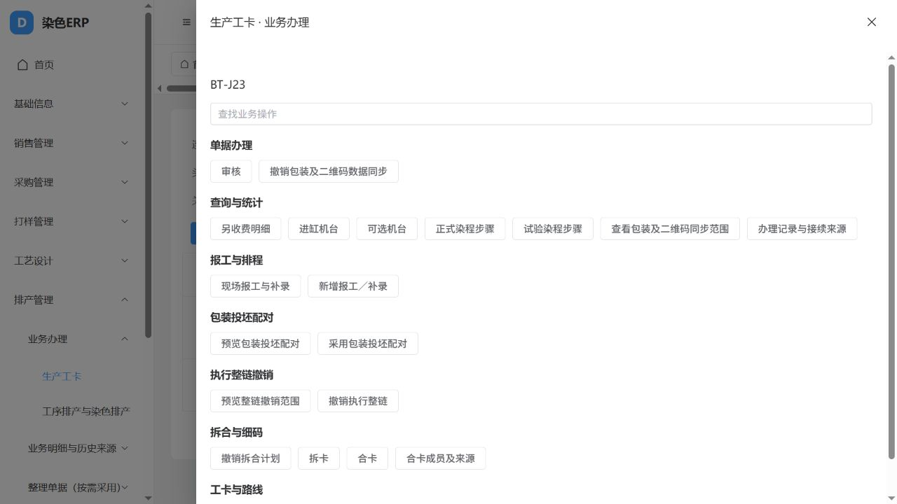

# 全模块按钮调整实施与验证

日期：2026-10-23。对应[原调整方案](2026-10-23全模块按钮核查与调整方案.md)。本轮已实施代码调整；财务、全部打印和原35项查询继续暂缓。

## 1. 使用上发生了什么变化

1. 列表行以查看、编辑、删除、必要的单据明细／订单选价及业务办理为主。各业务动作进入按流程分组的办理面板，可搜索；不是删除少用业务，也不是把所有接口原样放进一个“更多”。
2. 导入下集中上传xlsx、新增模板和更新模板；导出下集中当前筛选完整导出和后台导出。续行／复制在明确选中一行后办理，保留旧复制字段规则与权限。原本关闭通用复制的原表仍保持关闭。
3. 标准编辑在有整单权限时使用既有整单保存；只有表头修改权限时仍使用表头修改。明细与来源保留必要入口，不补造历史父记录。
4. 普通原表的通用确认移到维护兼容，不再要求所有表先确认再审核。有RightStatus的原表表头可直接审核；反审核继续调用原服务处理事件、回写和库存，未改成简单切换状态。
5. 报价由人员选择后直接保存。保存校验、金额计算及采用来源仍由计价服务执行；预览变成可选。取消选价、换物料和换供纱方式不会悄悄沿用上条选择，0、负数、NULL分别保留。
6. 预览、采用、撤销按同一业务主题组织，例如包装配对、打样变体和执行整链撤销。8种明确依赖本次办理事实的撤销按钮，仅在事实已生效时出现；后端原检查继续执行。历史拆合等原链恢复入口没有按“缺少新事实”统一隐藏。
7. 转单、开卡、拆卡等返回新单据身份时，提供“打开新单”，直接进入生成单据。刷卡删除后关闭当前办理面板，不再读取已删除的记录。
8. 通用过程、全库维护、来源修复、公式核验与补同步进入数据维护。业务页可切换，系统管理也提供可搜索的业务维护入口；权限仍按原接口控制。
9. 用户行的两种密码功能合并为“密码操作”；菜单按钮权限与字段权限通过“权限配置”进入页签；日志与任务结果的JSON并入查看。部门、角色、任务、附件等已有正确入口保留。

业务基础资料仍在对应业务模块，不放回平台字典。没有新增旧erpID或其他模型字段；模型迁移检查无变化。

## 2. 覆盖数量及其含义

|对象|结果|准确口径|
|---|---:|---|
|资源|792|767个ERP资源和25个系统／任务资源；通用交互与专用页面共同覆盖|
|ERP操作绑定|1457|原操作key、服务和权限身份全部保留；逐项策略已登记|
|日常业务绑定|744|按状态、权限及办理事实显示，进入业务办理／查询分组|
|维护绑定|662|含309条原通用确认、199条无RightStatus的通用审核及其他维护工具|
|自动联动绑定|49|本行／本链自动化；人工补算仍在维护，不表示49个全库任务自动执行|
|明确暂缓操作绑定|2|包装打印请求、打印结果确认；其他暂缓项还在选择器及来源工作台，不能仅按2理解暂缓范围|
|具备维护／补办动作的资源|378|系统管理汇集对应已授权菜单；普通用户不会因汇集而获得新权限|
|原选择器|107种／721项|保留全部原选项身份；逐资源展开为3558个绑定，逐值核对一致|
|其中暂缓绑定|32|只标记禁用和暂缓，不删除；没有漏标的已识别暂缓选项|

原方案“保留257、合并1022、自动49、维护127、暂缓2”是**建议主处理类别**。本表是**运行时实际呈现位置**；合并的通用确认和无原审核字段的通用审核现在归维护，因此两个统计口径不同，不能相减当作新增或遗漏业务。

[逐项清单](2026-10-23全模块按钮逐项处理清单.md)的B0001～B1457末列已列实际去向和名称。G01～G34保留或调整共用入口；G11明确保留必要明细入口，G18的专用xlsx历史对账适配仍单列E10。S项保留原选项，U项保留修改前源码基线。未把没有workflow的361个资源漏出核查。

旧功能1395条、导航687条、配置1682条保持审计身份；679条明确停用和5条NULL不被删除或统一补成停用。776条无workflow按钮候选的旧功能继续保留覆盖关系，不冒称776项缺失已全部实现，也不将其作为少用业务跳过。

## 3. 自动执行的实际范围

|原按钮职责|绑定数|日常处理及维护边界|
|---|---:|---|
|本单计算calculate|33|沿用已核实的入口公式、本行计算及父子汇总；显式录入值与历史原值保持原规则；主动补算放维护|
|班组确定resolve_shift|2|现场报工可选择按机台时间确定，日历及全部候选保留；不匹配不补默认，不同班组多候选由人决定|
|编号allocate_number|1|沿用编号管理和旧入口编号，在保存／新建生成|
|订单修改检查app_order_check|1|新订单编辑保存自动检查原SheetStatus，不要求人员先点校验工具|
|订单收费回写refresh_order_prices|1|沿用本链明确收费来源保存回写，全库范围仍在维护|
|报价触发核验quote_trigger_check|1|沿用启用的报价新增／修改／删除规则，重复原行照存；禁用旧触发器未启用|
|打样结果update_result|1|预确版保存或明确确版回复时回写；精确旧客户端时机无程序资料，按E15登记合理实现|
|复版参与人reprint_allocation|1|沿用保存事件，历史原行不回放事件|
|小样收发refresh_sample_book|3|沿用实际小样收发及生效／反向账，不把计划变成实际库存|
|自动合卡automatic_combine|1|沿用有配置的本链自动合卡，保留原选路和质量来源|
|合卡进度sync_combined_process|1|沿用报工／进度的合卡同步，手工补同步在维护|
|包装及二维码synchronize_package_labels|1|包装／投坯保存同步明确范围的数据；不是发打印命令或确认标签成功|
|报修保存核对fault_save_check|1|普通原表保存记录检查事实，异常原行照存；专用APP保存仍按其原规则执行|
|报修动作check_fault_action|1|受理、派工等实际动作内部执行检查，不需要单独先点校验|

没有自动选择报价、路线、配方、损耗、实际收发或逆向范围。没有增加全库定时任务，也没有把旧事件注释当有效调用。已登记的F004／F281／F273差异继续保留。

## 4. 独立验证库及数据保留核对

- 新库：`erp_buttons_verify_20261023`，PostgreSQL端口5440，从已有**验证基线库**`erp_master_xlsx_verify_20261021`克隆。自动测试另用`test_erp_buttons_verify_20261023`。
- 浏览器：`http://127.0.0.1:8081/` → 后端8003 → 本轮独立库；Redis6390。这里仍是验证环境，不是正式使用库。
- 只创建验证账号与BT开头的合成单据；没有正式导入旧数据。验证账号中有一个无可用密码、未激活、无岗位授权的界面测试对象。
- 对clone内有来源批次的全部原形模型，按原主键／新库记录主键、来源批次和全部SOURCE_FIELDS逐行计算摘要，并与基线比较。67个有来源行的表、109,971行全部相同；空表也参与遍历。既有染整报价来源20头、847明细保留。
- 上述是已有验证资料的完整保留核对，包含重复与NULL，不是从旧ERP重新抽取全历史，也不代表库存切换对账完成。
- Django检查通过，`makemigrations --check --dry-run`无变化。测试库通过当前模型同步建表，未重演全部历史迁移；本轮没有模型字段变化。

## 5. 验证证据与通过范围

|验证|结果|能证明什么|
|---|---|---|
|后端183项|通过|按钮全量登记、实际API权限、直接审核／旧确认后审核、审核与反向服务、打样、班组、设备、导入、报价、包装等回归|
|新增12项按钮专项（包含于183）|通过|1457绑定身份、无原审核字段的呈现、暂停打印不误伤印花／松筒／复版、状态摘要不暴露来源、无授权403／授权后200／撤权403、异常及重复不丢、班组多候选|
|前端button-presentation|通过|权限、状态、留档来源、办理事实、维护可达、暂缓、主题分组|
|前端button-pricing-save|通过|无须先预览才能保存、取消不重用、换物料／供纱失效、0／负数／NULL价格保留|
|前端button-action-run|通过|审核后刷新面板状态、刷卡删除后不再请求已删行、失败不伪装已保存|
|既有menu-state回归|通过|菜单与字段权限变更、标签、数据查询上下文、账号隔离和小屏布局；测试适配补入现有numberingUpdated依赖|
|Vue类型检查／Vite构建|通过|最终前端类型与产物可构建；保留已有大文件分块提示|
|浏览器23项|通过；见独立记录|真实页面入口和部分真实合成单据办理；不等同全部业务变体逐笔重放|

浏览器证据另存[验证记录](erp-button-browser-verification-20261023.json)。覆盖十个模块代表页，以及订单审核／反审、选价直接保存、拆卡→新单→逆向、导入菜单、维护入口和不常用打样变体等。打开表单或选项的记录明确标明“入口验证”，不把它计作整链办理完成。

## 6. 状态与后续顺序

|工作|开发完成|历史数据对账|现场验收|
|---|---|---|---|
|本轮按钮分类、共用入口及必要服务衔接|已实施并完成限定验证|不以按钮配置证明历史对账|未执行|
|本轮新增保存联动、直接审核及选价保存|专项和相关回归通过|历史不重放新办理事件；全量另验|未执行|
|已有验证来源保留|未改原模型结构，原行摘要一致|仅clone／基线109,971行，不是全历史|不适用|
|旧客户端精确交互、F004/F281/F273、xlsx专用历史对账适配、真实设备协议|按原异常清单保留缺口／合理替代|待对应专项|待对应资料与现场|
|财务、全部打印、原35项查询|暂缓|暂缓|暂缓|

后续先在验证环境按岗位试录实际单据，验证录入、选价、审核、转单和逆向的操作体验；再分别进行正式基础资料导入、完整历史对账和现场业务验收。正式导入仍由使用人操作。原客户端缺证和不等价项见[异常清单](2026-10-23按钮调整异常与待核实事项.md)，不因界面调整自动清零。

机器证据：[实际绑定、选择器与逐表摘要](erp-button-implementation-verification-20261023.json)。原审计证据仍见[审计基线](erp-button-audit-20261023.json)。本轮代码及验证记录同步至开发分支 `feature/erp-button-workflows-20261023`，具体提交以 Git 记录为准。
