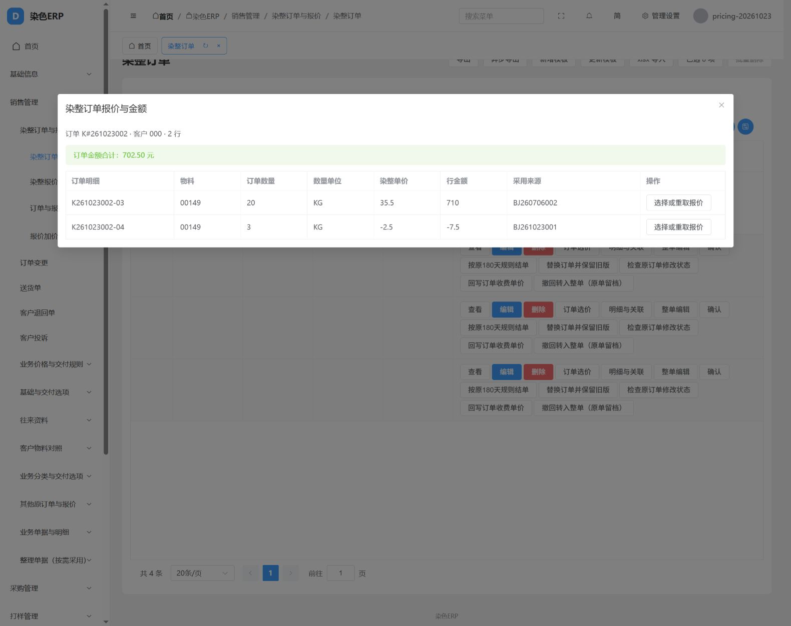

# 染整报价关联订单 Q01～Q12 实施及验证

日期：2026-10-23。对应[当前开发方案](染色ERP后续开发方案.md)第2批报价专项。

**结论：Q01～Q12限定开发及独立库、浏览器验证完成。正式历史业务全量对账未执行；现场验收未执行。** 本批完成报价采用链，不代表L01～L42、全部报价费用或第六阶段整体完成。

## 1. 现在如何操作

进入“销售管理 → 染整订单与报价 → 染整订单”。先保存订单表头并选择客户，再录入颜色行的物料、数量、单位。

三个入口共用同一服务：

1. 订单行“订单选价”：查看全单已计价小计/未计价行数，为已有颜色行选价或重新取价。
2. “整单编辑”：尚未保存的颜色行也有“染整报价”区域，选价后随表头、全部明细一次保存。
3. “明细与关联 → 染整订单颜色明细”：普通添加、编辑表单也可选价并查看已采用来源。

选供纱方式后“查找报价”，逐条“采用此条”，明确本单计价单位，点击“试算并采用到本行”，最后保存单据。尚未点采用的候选和试算不是已保存业务事实。修改待采用的口径会取消这次待保存选择，需要重新试算采用。

## 2. 固定业务规则

|事项|最终实现|
|---|---|
|实际对象|FixedPrice/FixedPriceDetail → OrderMain/OrderColor；Quote/QuoteDetail是前两者的入口名，不混接另两张同名物理表|
|匹配|订单客户CustomerID＋颜色行物料ProdID＋明确供纱YarnCategory；本厂采购/客户来纱分开|
|价格依据|默认CusPrice“对客报价”；可明确选Price“客确价格”或手工议价；不拿Pricesum、另一列或0填缺价|
|重复|所有匹配原行和原表头组合分别列出；同价、同明细号不合并，保存实际报价头及明细记录定位|
|原单位为空|原847行单位全部为空的事实保留；本单明确选单位，只写订单上下文；已有KG行可预选元/kg，新增行也可手选|
|计价|service以Decimal按OrderColor.Price两位单价计算Amount两位金额；元/吨且明确KG时除1000，其余长度/条/缸/码按对应单位或明确指定数量；元/缸可采用CardQty|
|不明数量|保留单价、原单位和未完整计价状态，允许明确指定数量；不将KG当米/码，不把订单粒数当条数|
|合计|全部行Amount明确才显示总额；有NULL行时只显示已计价小计和未完整计价行数；0和负金额照常参与|
|来源|现有SourceDocumentContext.effects.order_pricing保存报价原键、当前记录定位、来源批次/行号、价格列、报价各价原值、采用价、单位、数量依据和金额；BusinessAction保留每次前后快照|
|改数量|有效采用按已采用单价重算；原GrayQty→OrderQty保存事件保留，明确同时提供OrderQty优先；实称/包装/收发量不替代订单量|
|改备注|不重新取价；改数量也不重新读取报价价格|
|改客户/物料/数量单位|退出旧自动采用关系，清空本次未明确手填的派生价格/金额并提示重选，原采用和原值留在审计；整单内改客户后可同事务采用新客户报价|
|改报价/删除报价|不自动改订单；明确重新取价才更新。来源删除后保留快照并标明来源不存在|
|手工价格/金额|允许NULL、0、负值；明确手填金额采用人工方式，不被数量乘价覆盖；人工改价不继续冒称自动报价来源|
|历史|有来源批次的历史行不自动选价/补价；不能给其套用本次新采用动作；原NULL价格和原异常金额保留|
|Excel|普通业务录入明确Price/Amount按原值进入既有服务，不暗中套价；报价采用可在导入后明确办理；历史承接原值路径不改|
|事务/权限|普通保存和整单保存共用服务、锁和审计；来源使用原查询/字段/数据范围授权，采用使用订单原写权限；已确认/审核限制与既有外协动作保留|

没有新增模型字段、数据库迁移或额外旧erpID，没有修改旧取价函数confirmed_price的历史语义。

## 3. Q01～Q12逐项登记

本表“完成”均指本批开发及必要验证；每项正式历史全量对账、现场验收均未完成。

|编号|结果|实际证据|
|---|---|---|
|Q01 实际报价对象|开发验证完成|候选来自FixedPrice/Detail；独立资料库20头/847原明细全字段摘要前后一致|
|Q02 三维匹配|开发验证完成|接口测试客户/物料错配、两类供纱不串价；浏览器使用真实客户000、物料00149、本厂采购|
|Q03 多候选及异常|开发验证完成|重复明细号、同价、NULL、0、负价逐行可采用；无明确报价头的原多表头组合不任取；浏览器同时显示6条，普通入口实际保存负价|
|Q04 单价及来源|开发验证完成|数据库Price/Amount及上下文回查；原报价来源批次14/行188、DetailNo=BJ260706002-060正确保存|
|Q05 单位、金额、合计|开发验证完成|六类单位、KG→吨、明确数量、无法对应数量、部分合计均有接口验证；浏览器合计702.50包含正价710及负价-7.50|
|Q06 新行与事务|开发验证完成|浏览器新订单K#261023002，未保存行选价后整单保存710.00；接口后续一行错误时撤销整单前面各行和表头更改|
|Q07 数量与无关保存|开发验证完成|浏览器10×35.50=355.00，整单改12.50后443.75；普通编辑2×-2.50=-5.00改3后-7.50；接口备注、显式NULL、原坯料数量联动均通过|
|Q08 依赖变化|开发验证完成|改客户、物料、单位退出旧采用；整单改客户C1→C2并选择新报价得到70.00；供纱候选与待采用参数按明确选择重新验证|
|Q09 修改/删除/重价|开发验证完成|浏览器合成报价35.50改40.50后旧单仍443.75，明确重取才506.25；接口验证删除来源保留快照、手工负价和0金额|
|Q10 Excel与历史|开发验证完成|实际xlsx接口写入两条同物料明细，0与NULL保持，跳过0行；历史原NULL价格/-7金额保持，无新采用；既有历史Excel回归通过|
|Q11 权限状态隔离|开发验证完成|实际普通角色的数据范围/字段禁止写、来源禁止读、已确认单据限制、只读试算、金额溢出整单回滚、外协动作保留均通过|
|Q12 浏览器整链|开发验证完成|独立环境实际新建订单、选原报价、选合成重复报价、保存重看、改数量、改报价后重取、普通添加/编辑及数据库回查完成|

## 4. 验证环境与结果

- 后端61项测试通过：本批16项报价测试＋45项原表单、Excel/历史、销售联动回归。无跳过。测试数据库为5440的test_erp_numbering_regression_20261021。
- 浏览器连接5440的erp_master_xlsx_verify_20261021，前端8081代理独立后端8003；没有指向当前5439业务库。
- 浏览器新业务验证订单2张、颜色明细3行；合成报价头1张、明细5行。只在独立验证库留存。网页中创建其中1张订单及其2行，另1张由测试准备程序创建用于重价验证。
- 原数据样本来自前1000单中的K#250211045 / K250211045-01；选真实客户、物料和原报价构造新测试单，并未把这张历史订单当作新成交价回填。
- 原资料20头/847明细的全原字段SHA256：21381facf3f111ab0acdf4ed793aab6b540d0c45f50d08dfa8c579e3511f072d，测试前后相等；847行单位未补写。
- 前端类型检查、生产构建通过；业务计算放在service，页面只提交选择和展示试算。
- 本批没有访问或写入旧SQL Server，没有正式导入旧数据，没有执行当前5439业务库的导入或迁移。

机器可读证据见[验证汇总](erp-order-pricing-verification-20261023.json)。截图：

## 5. 后续边界

原F281、分头费/最低消费/另收费完整口径、原缺失联查视图不因这次关闭。财务、全部打印、原35项查询继续暂缓。L01仍有报价头公式差异，L09首次开卡等继续按方案B01～B08推进；42项基线及933项总盘点不重新冒报完成数量。

历史全量对账应在用户明确抽取范围后逐原键、原行、来源、上下游及数量比对；现场按真实岗位验收。独立资料库原报价未变的摘要检查不等于正式全量历史对账。
