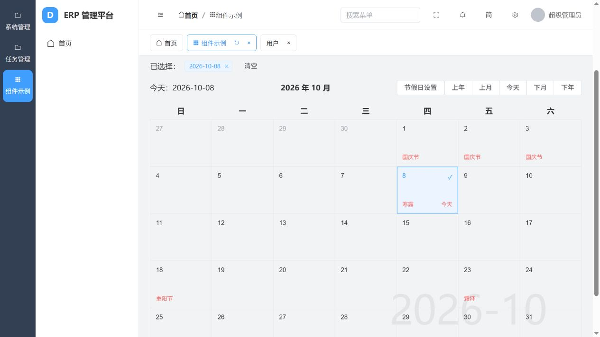

# 实施与验证记录

日期：2026-10-08。项目位于 `H:\Project_python\django-vue3-admin\djangovue3`，参考目录保持不变。

八批基础实现之后，本轮继续对照原项目补齐确认的 11 项功能缺口，以及配置、消息、字典、排序、附件与日志的实际业务细节。实现对应和验收边界见 [功能复刻差异核对](功能复刻差异核对.md)，不宣称像素级相同或全部交互组合均已人工验收。

## 已落地模块

| 批次 | 当前实现 |
| --- | --- |
| 1 环境 | Python 3.14.8、Django 5.2.18、SQLite 3.50.4、Node 26.11.1/npm11.20.0；项目内运行时、迁移、种子数据、完整锁文件 |
| 2 API/认证 | 审计模型、统一响应、分页/排序/条件/RESTQL、CRUD/批量、JWT 刷新、验证码、个人账户、默认/自定义密码、首次改密、OpenAPI |
| 3 界面 | 四种布局、完整主题配置、三种语言、动态菜单/路由、标签操作及缓存、面包屑/搜索、水印、锁屏/全屏、401/404、个人中心 |
| 4 组织权限 | 用户/部门/岗位/角色、角色用户、菜单按钮/字段及自动匹配；五类数据范围、多角色并集、字段读写、白名单、拖动/上移下移 |
| 5 系统数据 | 八类字典、3445 条区域、配置分组/公开状态/16 类输入/关联选择、分类附件/媒体预览、日历、富文本/裁剪、完整日志 |
| 6 异步能力 | Excel 模板/导入/同步与异步导出、下载与 MD5、初始化 JSON、四类消息目标及接收已读、SSE、任务规则/结果 |
| 7 扩展工具 | Django 应用注册、前端插件 install、菜单组件映射、模型 CRUD 生成器、Post 示例、组件示例页 |
| 8 本地交付 | 前后端构建/运行、Redis/worker/beat 脚本、PyQt6 启动器/托盘、重新构建的 PyInstaller Windows 包及文档 |

## 后端与构建验证

`system.tests` 最新共 **34 项业务测试通过**，使用独立测试数据库。原 24 项覆盖认证/密码、所有实体元数据、用户资料、五类范围和多角色并集、字段读写/RESTQL、批量及导出、角色授权及重复初始化、消息创建与四种目标/接收/已读、验证码/公开入口/JWT、附件上传替换删除、Crontab 时区、关联数据范围；Excel 重构另外增加 10 项测试，原往返用例改为下载中文新增模板再填写导入。详见 [Excel 实施记录](H:/Project_python/django-vue3-admin/djangovue3/docs/Excel实施记录与接入说明.md)。

本轮新增覆盖：自定义/默认/首次改密及确认输入、管理员重置权限和日志密码排除、运行时字段和按钮匹配幂等、创建者下载范围、同排序值上下移动、区域派生字段、八类字典、配置分组唯一性及后端私有配置、SSE Accept 协议。

`manage.py check`、`makemigrations --check --dry-run`、`pip check`、OpenAPI 校验通过。迁移到 `0010`，已有值按迁移保留并转换旧字段语义。最新版 schema 保存在 `docs/openapi-schema.yml`。

Vue 类型检查和 Vite 正式构建通过；生产依赖 `npm audit --omit=dev` 为 0 项已知漏洞。FastCrud 旧 SheetJS 依赖替换为官方发布的 0.20.3。富文本/文件/裁剪/组件示例按需加载；构建仍有大于 500 kB 的块提示，未提高阈值隐藏提示。

SQLite 实测发现默认 DEFERRED 在调度模型与 API/清理写入同时发生时产生锁升级冲突；改为 Django 原生 IMMEDIATE，保持 SQLite 和默认超时，没有加重试或吞错。独立数据库副本两线程各 20 次调度/API 事务通过，24 项测试再次通过。脚本为 `docs/verify_sqlite_concurrency.py`，依据见 [Django 官方事务说明](https://docs.djangoproject.com/en/5.2/ref/databases/#transactions-behavior)。

## 真实任务与 Windows 包验证

1. 项目内 Redis 6389、redis-py 8.1.0、Kombu 5.6.2+dvadmin.1 与 Celery solo 实际执行任务成功，没有同步替代通道。
2. 源码版真实异步 Excel 与数据库指定时间任务此前已通过。
3. 本轮重新完整构建 Windows 包，最终前端资源已同步；源与包内 index.html 的 SHA256 相同。
4. 无参数启动桌面程序后，自动初始化独立 SQLite、区域/菜单/配置，启动 Redis、ASGI 服务、worker、beat。
5. 包内登录、账户、任务元数据、区域、schema 和最新静态 JS 返回成功；新数据库首次改密为 true，前端实际显示首次修改密码及确认输入。
6. Excel 重构后重新更新包：保留现有数据库和附件，真实 worker 导出 8601 字节文件，与同步表格数据一致，大小和 MD5 均匹配；新增/更新模板中文表头、说明、选项和更新主键通过验证。记录见 `docs/package-verification.json`，脚本为 `docs/verify_package.py`。完整旧包保留在 `packaging/previous-excel-20261008`。
7. SQLite 修复后，包内数据库连续两次指定时间任务经 beat 分发并成功执行，调度日志未出现锁冲突，验证用任务/时钟/结果由脚本清理。脚本为 `docs/verify_periodic.py`；测试包时用 DJANGO_BASE_DIR 指向包的 backend。
8. SSE 使用 Accept: text/event-stream 返回 HTTP 200、正确媒体类型及实际 unread 数据。公开配置不包含基础默认密码。

本轮结束保留桌面包服务运行，访问 `http://127.0.0.1:8000`。首次账户为 superadmin / admin123456，页面要求首次改密；本轮没有代替用户修改该账户密码。

## 浏览器验证

此前已完成登录、首页、岗位新增修改、菜单切换、刷新权限按钮、角色权限读取、配置表单及附件上传闭环。源码开发库保留“浏览器验收岗位”和项目生成的 upload-example.txt。

本轮实际验证组件示例页、分栏布局、完整主题抽屉与英文切换、文件库/图片过滤、自定义重置密码表单入口、农历节日/节气、跨月保留选择。临时开启组件页缓存，确认切到用户页再返回保留日期，刷新当前标签清空日期；验证后恢复该菜单原缓存设置。首次注册路由与缓存的时序问题已经修复。

实时消息实际测试修复了 Accept 协商产生的 406 和注释心跳误解析问题。布尔搜索改为可清空的“是/否”选择，避免空搜索值被开关当成 false，类型检查与构建通过。

## 验收边界

- 页面组织及 API 路径重写，保持功能语义；不承诺旧客户端免修改兼容，也不宣称像素级复刻。
- 已接入的主题、配置输入、媒体编码、编辑/裁剪参数未穷尽每种组合。模型和业务标题以中文为主；框架通用及主题文案覆盖简体/繁体/英文。
- 太阳事件已接 ephem，未等待真实日出/日落；外部 IP 服务默认关闭、本轮未发送用户 IP。
- Qt 自动启动已实测，原生托盘、恢复/退出按钮没有通过浏览器工具人工点击。
- 本次排除扫码、OSS/COS、指定服务器部署、macOS 打包和具体 ERP 业务。

执行业务所需的字段类型、唯一性、确认密码和既有权限规则；没有新增自创密码强度、文件大小、登录次数、分页/批量数量上限，也没有静默失败兜底。疑问与选择见根目录疑问记录。

## 2026-10-08 第 9—13 批及最终运行包

46 项后端测试、前端构建和最终隔离包真实异步/定时任务通过；四布局及多视口、配置提交/文件上传/登录 redirect 已验证。现有运行包保留原数据库和附件后更新，8000 健康及静态内容一致。原目录只读。详细内容、证据和真实设备/原生交互未验项见 [本轮记录](H:/Project_python/django-vue3-admin/djangovue3/docs/第9至13批实施与验收.md)；最新逐项状态见全量审计清单。
