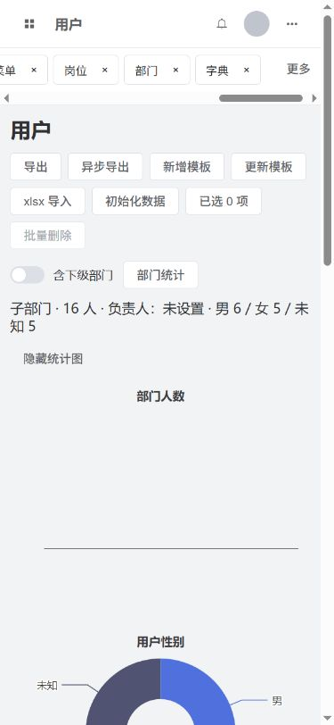
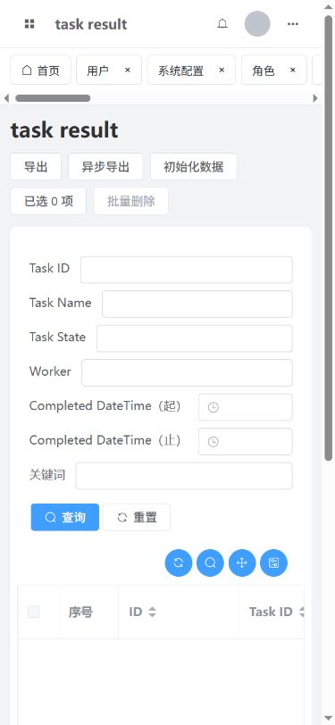

# 全盘对照审计与后续整改方案

更新：2026-10-09，第七轮审计。**仍有5类已确认问题，尚未整改。** 其中F37是原有效标签定位细节遗漏；F36是状态切换缺口；F32-R2/F38是既定菜单刷新链关联未闭环；E01-R1是通用扩展管线仍按内置类名误判。不能据此说上轮修复全部失败，也不能继续称所有功能、逻辑、关联已经完全复刻。

本次只审核和更新文档，没有改产品代码、依赖、正式数据库或8000程序。原399项、新139项基线源文件及正式程序/首页摘要核验见 [seventh-audit-final-verification.json](H:/Project_python/django-vue3-admin/djangovue3/docs/seventh-audit-final-verification.json)。正式发布仍为第35批。前次当前方案原文保存在 [第七轮审计前实施快照.md](H:/Project_python/django-vue3-admin/djangovue3/docs/第七轮审计前实施快照.md)，历史失败、修复和测试证据不覆盖。

399/139是基线选定的源码和配置文件数量，不是两个目录全部磁盘文件的总数；完整路径与摘要见 [seventh-audit-source-manifest.json](H:/Project_python/django-vue3-admin/djangovue3/docs/seventh-audit-source-manifest.json)。隔离测试8007/6395服务及临时浏览器标签已清理，默认浏览器尺寸已恢复，8000清理后健康检查正常。

## 审核范围和方法

稳定236条功能编号完整保留，重新对照15模块及它们的调用关系；原85个后台Python、264个前端代码/样式文件重新解析，153条模型字段声明（含继承字段）、157条活动CRUD列配置、45条显式CRUD规则及8个含规则的独立Vue文件重新核对。清册读取/AST索引覆盖这些文件，**不表示每个文件每一行已人工证明行为等价**。文件哈希仅固定审计对象，不是功能等价证明。

先核对入口/字段/关联/动作，再追调用者、状态转换、菜单和账户刷新、序列化与xlsx消费链；对疑点执行实际源函数或真实Django接口，并用成功对照排除错误假设。浏览器使用已发布前端和单独8007/6395测试环境，业务操作与数据不进入正式库。本轮没有实际启动旧项目做全部双端操作，不能称“两个项目全部实际测试过”。

现有测试：默认系统82项，80通过、2因扩展未加载跳过；扩展配置7项通过；前端类型检查通过。两配置有重复项，不相加为89个独立用例。上轮专项和8类前端回归复验通过；新增复现探针断言的是失败现象存在，不能混入“功能全部通过”。详见 [seventh-audit-validation.json](H:/Project_python/django-vue3-admin/djangovue3/docs/seventh-audit-validation.json)。

之前多轮仍能发现问题，具体原因是：字段目录身份与所有下游分支被错误地视作同一件事；同路径query更新样本没有覆盖共享开关双向转换；菜单标题/删除通过没有覆盖改地址和已挂载权限上下文；手机能够横滚没有检查自动定位和末端操作可达。这些是此前验收覆盖不足，本轮补入固定验收场景，不能以原有检查通过来淡化。

## 当前缺口（5类）

| 编号 | 优先级 | 当前问题 | 复现层级 | 后续批次 |
| --- | --- | --- | --- | --- |
| F36 | P1 | 标签共享开关切换后，当前标签身份和 query 不一致 | 已发布前端浏览器＋实际Vue | 第36批 |
| F32-R2 | P2 | 菜单改地址后保留旧标签，固定标签也重复 | 实际源函数/Vue＋调用链 | 第37批 |
| F38 | P2 | 已打开资源页的权限前缀没有随菜单重新加载 | 实际源函数/Vue＋调用链 | 第38批 |
| E01-R1 | P1 | 扩展模型与内置模型同名时，序列化及 xlsx 仍按类名误判 | 真实Django/API＋xlsx | 第39批 |
| F37 | P2 | 未自动滚动到当前标签，手机“更多”操作也滚出可视范围 | 浏览器几何＋原源码 | 第40批 |

### F36：标签共享开关切换后，当前标签身份和 query 不一致

**分类：标签状态转换未闭环。** 共享→非共享时旧 tab.path 仍是裸路径，current 已变为完整 query 地址，当前标签匹配不到。非共享→共享时去重保留第一条，当前 dept=4 却保留 dept=3 的 fullPath，刷新发往旧筛选。

原入口：`web/src/layout/navBars/tagsView/tagsView.vue:105/173/481`；当前入口：`web/src/components/TagsBar.vue:16/30/38/51`。

复现：实际 Vue 两方向探针；390px 已发布前端的隔离浏览器中，/system/user?dept=3 当前标签数为0，点击“更多→刷新当前”记录 TypeError: fullPath。

修改方案：统一两种模式的标签身份转换，合并时取当前路由或该路径最近实际访问的 fullPath，转换后补齐当前标签；刷新、关闭、缓存键使用同一身份规则。不要靠禁用开关、清空全部标签或限制标签数解决。

验收：双向切换，dept=3/4 两条标签、当前非第一条、缓存开/关、刷新和关闭后退均保留正确目标；320/390/768 下当前标签存在且刷新无异常。

证据：[seventh-audit-front-probe.json](H:/Project_python/django-vue3-admin/djangovue3/docs/seventh-audit-front-probe.json)、[seventh-audit-browser-verification.json](H:/Project_python/django-vue3-admin/djangovue3/docs/seventh-audit-browser-verification.json)、[seventh-mobile-tags.png](H:/Project_python/django-vue3-admin/djangovue3/docs/seventh-mobile-tags.png)。

### F32-R2：菜单改地址后保留旧标签，固定标签也重复

**分类：既定菜单刷新闭环的剩余分支。** 菜单 watcher 只按 menuId 是否存在过滤，再按旧 web_path 查元数据。同一菜单 id 地址变化后，旧路径标签没有迁移或删除，新路由又插入新标签。固定标签保留旧 affix，普通关闭无法去除旧项。标题/图标/删除菜单的上轮修复仍通过，不能说 F32 全部失效。

原入口：`web/src/layout/navBars/tagsView/tagsView.vue`；当前入口：`web/src/components/TagsBar.vue:24/30；web/src/stores/account.ts`。

复现：实际 Vue watcher 对普通/固定两种标签均复现 /system/user 与 /erp-users 同时存在，menuId 相同；与 account.load 当前路由跟随逻辑对照。没有冒充双端浏览器实测。

修改方案：以 menuId 对齐更新后的菜单，再迁移 path/fullPath 和固定标签集合；保留 query，处理既有新地址标签的合并；同步缓存和 iframe 键的实际关联。

验收：普通及固定菜单改地址、标题、cache、iframe 链接及删除后，只有一个有效标签，旧地址不残留，当前路由/query/缓存跟随；切换账户不继承旧标签。

证据：[seventh-audit-front-probe.json](H:/Project_python/django-vue3-admin/djangovue3/docs/seventh-audit-front-probe.json)、[seventh-audit-baseline-front-probe.json](H:/Project_python/django-vue3-admin/djangovue3/docs/seventh-audit-baseline-front-probe.json)。

### F38：已打开资源页的权限前缀没有随菜单重新加载

**分类：菜单刷新与按钮权限的关联缺口。** ResourceTable 初始化时用 const 取 pageMenu 和 permissionPrefix；菜单 component_name 更新后，can 仍读取旧前缀。同一资源复用或缓存的实例不会因 account.menus 替换自动重新计算。字段授权是否也存在同类陈旧状态尚未复现，列为整改验收维度，不写成已确认越权。

原入口：`web/src/views/system/user/crud.tsx`；当前入口：`web/src/components/ResourceTable.vue:38/39/40；web/src/App.vue；web/src/pages/Resource.vue`。

复现：执行实际 ResourceTable 声明，使用 Vue reactive 账户与正常 can：菜单/按钮由 before:add 改为 after:add 后，prefix 仍为 before、can(add)=false；当前账户按新前缀本应允许。此项是源函数执行证据，未用普通角色浏览器完成整个变更场景。

修改方案：权限上下文跟随当前菜单身份及组件前缀计算；若重新装载元数据，明确沿实际刷新链刷新对应页面，保留既定资源缓存行为。

验收：同资源两个菜单、不同前缀；缓存开关；普通角色授予/撤销按钮；菜单重载后按钮显示和请求上下文一致。同时验证字段 create/update/query 授权变化，不以页面按钮代替后端授权。

证据：[seventh-audit-front-probe.json](H:/Project_python/django-vue3-admin/djangovue3/docs/seventh-audit-front-probe.json)。

### E01-R1：扩展模型与内置模型同名时，序列化及 xlsx 仍按类名误判

**分类：模型身份修复未贯穿通用链路。** E01 已修复字段目录 app_label.ModelName 身份，但 serializer_for 仍把所有名为 Users 的模型排除 password/groups/user_permissions；xlsx 的用户专用列和四种只读模型判断也只按类名。其他应用的正常业务模型因此报错、漏导字段或不能获取导入模板。不是要求提前开发具体 ERP 业务。

原入口：`backend/dvadmin/system/views/user.py；backend/dvadmin/utils/viewset.py`；当前入口：`backend/core/api.py:64/65；backend/system/excel_fields.py:16/24/47`。

复现：真实 Django 扩展 AppConfig + SQLite 内存表：identity_a.Users 的元数据/列表/模板抛 AssertionError；显式合法序列化器后导出200但 quantity 列丢失。另四个同名业务模型 LoginLog/OperationLog/DownloadCenter/TaskResult 列表200、模板400；PlainEntry 对照组均200。既有 Twin 同名应用测试7项仍通过，说明旧测试不覆盖与内置类名碰撞。

修改方案：内置用户/只读模型的专用规则按实际模型身份或明确注册配置判断；通用扩展沿模型/序列化器声明工作。不要禁止同名模型、回退类名身份或再维护一套授权目录。

验收：五种冲突类名与普通对照模型分别验证 metadata/CRUD/普通角色字段授权/模板/导入更新/同步和异步导出；数量、外键、M2M 往返完整。内置用户不泄露密码且原专用列保持，日志/下载/任务内置只读行为不变。

证据：[seventh-audit-api-probe.json](H:/Project_python/django-vue3-admin/djangovue3/docs/seventh-audit-api-probe.json)；扩展测试日志见工作区runtime/seventh-audit-extension-tests.log。

### F37：未自动滚动到当前标签，手机“更多”操作也滚出可视范围

**分类：原有效交互细节遗漏及移动端关联。** 原 getTagsRefsIndex 调用 tagsViewmoveToCurrentTag，在进入/切换路由时定位当前标签。新组件只有桌面 wheel 横滚，无当前标签定位；手机“更多”与标签放在同一个横滚内容末端，也跟着滚出屏幕。手动横滚仍可用，不能描述成完全没有标签功能。

原入口：`web/src/layout/navBars/tagsView/tagsView.vue:429/481/493`；当前入口：`web/src/components/TagsBar.vue:50/57`。

复现：390px 实际浏览器：nav右边界374.67，当前任务结果标签左边界1228.5，更多按钮左边界1372.82，scrollLeft仍0；截图与DOM几何记录一致。

修改方案：渲染和路由/共享模式变化后将当前标签滚入可见区；手机操作入口保持可达。保留桌面拖拽、手机不拖拽、局部横滚；不要通过删标签、硬性数量限制或隐藏溢出来掩盖。

验收：长标签列表、恢复缓存、切换首/中/末标签、共享模式切换、固定标签、刷新/关闭后自动定位；320/390/768 的更多始终可操作，桌面滚轮和拖拽继续工作。

证据：[seventh-audit-browser-verification.json](H:/Project_python/django-vue3-admin/djangovue3/docs/seventh-audit-browser-verification.json)、[seventh-mobile-current-tag.png](H:/Project_python/django-vue3-admin/djangovue3/docs/seventh-mobile-current-tag.png)。

F32-R2/F38：旧项目也没有完整菜单热更新；这两项按当前已承诺的菜单刷新行为整改，不能包装成原项目已有成熟热更新而本次漏抄。F36 原共享开关曾重置首页；当前选择保留有效当前路由和最近query，不必复制重置首页副作用，须使已提供的开关正常工作。

## 分批修改顺序

第36批：F36统一标签身份和双向共享转换，补两方向/当前非第一标签/刷新目标回归。

第37批：F32-R2以菜单身份迁移普通、固定标签及相关缓存；在第36批身份规则上验证改地址、query和删除。

第38批：F38接通已挂载页权限上下文刷新，验证同资源多菜单、普通角色按钮变化；同时核验元数据/字段授权刷新，只有复现后才新增缺陷。

第39批：E01-R1贯穿实际模型身份；通用序列化、模板、导入、同步/异步导出均区分内置模型和同名扩展。保持已完成的字段目录迁移，按真实业务字段往返验收，不增加禁止同名等限制。

第40批：F37自动定位当前标签和移动端操作可达；再把36—39批受影响场景组合验收，包含320/390/768。产品修改完成后再按已有授权安排正式发布；本次审核不执行发布。

这些是业务状态/调用链修正，不新增保险性限制、备用协议或无用功能。若实施发现进一步问题，须给出明确源码和复现证据，不能把所有疑点自动扩成开发项。

## 15模块复核结论

| 模块 | 本轮核对结果 | 仍有的边界 |
| --- | --- | --- |
| 认证/个人账户 | 认证普通规则、密码、头像及重复刷新实测/源探针通过；无新增确认差异。 | 验证码/短信/OAuth2及失败锁定按原启用情况、排除和C03处理；改密组合与真机仍有U。 |
| 用户/部门/岗位/角色成员 | 部门默认父级、树业务键、成员跨页、排序等系统测试/前端复验通过。 | 岗位原路由未注册是既有C10；全部普通角色/手机成员组合未穷举。 |
| 菜单/布局/标签/iframe/主题 | 确认F36/F32-R2/F37；标题、图标、删除、iframe元数据及同路径query旧样本仍通过。 | F32-R2是当前热更新承诺剩余分支，原也未完整热更新；四布局和静态角色菜单仍U。 |
| 接口/数据/字段权限 | 确认F38；原字段目录E01已修，Twin专项通过；E01-R1另属通用管线。 | 不宣称已复现字段撤权越权；权限全动作组合和外置ERP范围保留。 |
| 系统配置/关联选择 | 树身份、类型配置、关联选择、数组空行/0、固定选项规则复验通过。 | 16类型全部手机及软键盘未全验，dictionary或data_options仍C25。 |
| 字典/区域 | 数字/布尔解析、名称/值必填与区域键等系统及前端基线通过。 | 类型转换及区域显示方案C12保留，不算同名字段未映射的遗漏。 |
| 文件/附件/选择/预览 | 头像接入、文件选择/预览源码对应与既有专项保留，本轮复验FieldInput选择分支。 | 视频/音频编码、手机媒体全流程仍U；云存储排除，本轮未上传生产文件。 |
| 消息/收件/未读推送 | 投递/阅读/目标关系实现及系统测试通过，25资源浏览器中包含消息。 | 测试Redis后来启动；首次环境连接错误不计缺陷，也不把正常连接计断网/休眠全验。 |
| 日志/审计/通用 CRUD/查询 | 正常CRUD、过滤、虚拟字段及关系等现有测试通过；确认E01-R1通用序列化类名冲突。 | 153声明逐字段映射只证明结构，实际删除/软删/权限完整组合仍依系统测试覆盖边界。 |
| openpyxl/xlsx/下载中心 | 确认E01-R1的专用用户列及只读类名分支；常规xlsx/示例测试通过。 | 本轮未重跑实际worker；历史异步证据保留，原生Excel/WPS、性能仍U。 |
| Celery/定时/任务结果 | 定时模型/管理页面源码对应，浏览器实际打开六种调度/任务页面。 | 原插件默认注释为C17；仅打开页面不等于调度执行，太阳时/DST/长期多worker仍U。 |
| 插件/开发工具/后端模型扩展 | 确认E01-R1；真实扩展配置7测试通过，动态同名内置模型反例失败。 | 字段身份PERM-22仍I；不禁止同名模型，不把示例当具体ERP业务已验。 |
| 组件/指令/日历/富文本/图表 | 组件/日历/富文本已有8类回归探针通过；公告措辞、锁屏计时和移动拖拽疑点已排除。 | 原静态home/演示图不扩写业务报表；所有参数/插槽/事件与原生媒体仍U/O。 |
| 本地环境/构建/Windows 发布 | 源码/正式摘要及8000健康只读核验；类型检查通过，固定版本保持。 | 不构建/迁移/替换/重启；运行环境不是功能全等证明。 |
| 移动端布局/流程 | 25资源390px实际进入；稳定320/390/768岗位页与320新增弹窗采样；确认标签两项问题。 | 进入页不是每个操作完成；动画帧短暂宽度不计稳定溢出，Android/iOS及全部布局仍U。 |

字段/规则的详细既有对应表仍见 [字段与关联逐项对照.md](H:/Project_python/django-vue3-admin/djangovue3/docs/字段与关联逐项对照.md)、[独立表单与条件规则对照.md](H:/Project_python/django-vue3-admin/djangovue3/docs/独立表单与条件规则对照.md)、[本轮源码入口与动作映射.md](H:/Project_python/django-vue3-admin/djangovue3/docs/本轮源码入口与动作映射.md)。本轮重新生成的后台声明与模型字段：[seventh-audit-backend-inventory.json](H:/Project_python/django-vue3-admin/djangovue3/docs/seventh-audit-backend-inventory.json)；前端声明、157列与活动规则：[seventh-audit-front-inventory.json](H:/Project_python/django-vue3-admin/djangovue3/docs/seventh-audit-front-inventory.json)；8个独立表单：[seventh-audit-independent-forms.json](H:/Project_python/django-vue3-admin/djangovue3/docs/seventh-audit-independent-forms.json)；当前25资源元数据：[seventh-audit-metadata.json](H:/Project_python/django-vue3-admin/djangovue3/docs/seventh-audit-metadata.json)。这些支持逐项追溯，不代替运行验收。

## 移动端证据与剩余工作

390px真实浏览器实际进入25个资源页（明细/URL/尺寸记录见 [seventh-audit-browser-verification.json](H:/Project_python/django-vue3-admin/djangovue3/docs/seventh-audit-browser-verification.json)）。320/390/768下岗位页在动画结束后的页面宽度等于clientWidth；320新增弹窗宽320，未提交数据。进入25页不等于逐页完成新增、修改、筛选、分页、删除、上传和权限验收。

确认两个标签问题：390px共享切换后无法匹配当前标签，刷新抛异常；长标签列表当前标签及更多按钮均在可视区外。页面过渡动画中短暂2—8px宽度变化已排除为稳定溢出问题，不写成新增缺陷。

MOBILE-09转D只确认上述分支，缓存/关闭/全屏/iframe/全部布局及真机组合仍待验。其他MOBILE的U保持；浏览器改宽度不替代Android/iOS、软键盘、触控惯性和真实编码支持。

## 已排除的疑点与措辞纠正

| 疑点 | 排除依据 / 正确解释 |
| --- | --- |
| 并发刷新会因令牌黑名单强制退出 | 当前未装token_blacklist且BLACKLIST_AFTER_ROTATION为false；真实后端重复刷新两次200。实际Axios并发适配器也两次成功、没有退出。此前黑名单模拟假设不适用，不计缺陷。 |
| 25资源页均有稳定横向溢出 | 快速测量捕获slide-right过渡帧。320/390/768稳定测量未复现该问题；不据动画帧要求改全局overflow。 |
| 公告少了悬停暂停 | 原公告仅图标cursor:pointer，未发现暂停代码。台账COMP-13改为指针提示和点击，不增暂停功能。 |
| 自动锁屏少了活动重置 | 原计时器同样未绑定活动事件；不凭主观预期新增此功能。 |
| 手机标签不能拖拽 | 原手机分支也销毁Sortable；这不是遗漏。桌面拖拽仍保留。 |
| 首页没有复刻一套业务报表 | 原有效首页为静态home图片；演示图表不等于ERP业务报表。既有首页选择保留，不凭演示组件增加业务功能。 |
| 153字段存在未映射项即遗漏 | 抽象CoreModel.id对应新具体模型自动主键；Users.login_error_count依C03不复制；云file_url/engine依排除/本地方案处理。不能把声明未同名映射直接算缺陷。 |

## 固定台账与待验清单

稳定编号236条未增删。当前计数：C=31, D=10, I=50, O=5, S=115, U=18, V=2, X=5。**10条台账涉及5类确认问题；18条U，加MOBILE-09中尚未覆盖的原U剩余范围。** 行数不是缺陷数，也不是复刻率。S仅表示源码对应，I仅表示已有专项实现，均不代表所有组合已验。当前机器清册 [seventh-audit-ledger.json](H:/Project_python/django-vue3-admin/djangovue3/docs/seventh-audit-ledger.json)；完整表 [固定功能复刻台账.md](H:/Project_python/django-vue3-admin/djangovue3/docs/固定功能复刻台账.md)。

| 待验编号 | 范围 | 后续需要的证据 |
| --- | --- | --- |
| NAV-02 | 可选静态角色菜单 | D092 已有源码，所有角色/布局联调未验 |
| FILE-14 | 视频/音频支持的真实编码 | 需浏览器/设备实测，源码支持标签不等于所有编码支持 |
| MSG-11 | SSE 断网/令牌刷新/休眠恢复 | 历史单连接证据不覆盖所有组合 |
| XLSX-18 | Excel/WPS 原生填写往返 | 未用两类原生应用验收；浏览器上传不代替 |
| XLSX-19 | 大量数据内存/速度/SQLite 并发 | 没有本轮基准数字，不能宣称比原更快 |
| TASK-04 | 太阳类型调度 | 库/页面有实现，真实日出等调度未验 |
| TASK-09 | 多 worker/夏令时/长期压力 | 不能以单任务测试结案 |
| COMP-18 | 组件所有参数/插槽/事件组合 | 台账与模板对应，不能标成浏览器全验 |
| CORE-15 | 真正独立 ERP app 完整流程 | 示例接入已验，不能替代后续具体 ERP |
| MOBILE-01 | 320/390/768 手机与平板宽度 | 本批配置抽屉与部门图表 320/390/768 实测；全部页面和布局宽度组合仍待验。 |
| MOBILE-02 | 登录/首次改密/条款与长页脚 | 登录页公开页脚已接通并浏览器检查；长内容/首次改密/条款全宽度组合仍待验。 |
| MOBILE-03 | 四布局偏好下手机导航/退出/搜索 | 不是只验默认布局无横向溢出 |
| MOBILE-04 | 主表卡片/局部横滚/分页/筛选 | 各资源及独立筛选需逐项操作 |
| MOBILE-05 | 角色成员两页选择及普通角色 | 桌面两页成员选择、普通只读成员与 320 权限抽屉已验；手机成员操作全组合仍待验。 |
| MOBILE-06 | 权限/配置/关联抽屉和键盘弹出 | 配置抽屉 320/390/768、只读权限 320 已验；全部关联与实际软键盘仍待验。 |
| MOBILE-07 | 16 配置类型/数组错误/消息目标 | content 日期/avatar 数字、数组空行拒绝与填写保存、消息三种目标已验；16 类型移动组合待验。 |
| MOBILE-10 | 富文本插入媒体/裁剪/音视频下载 | 网络图片/视频默认菜单与部门选择即时校验已验；文件/日历全部操作、真实编码和下载待验。 |
| MOBILE-11 | Android/iOS 真机及软键盘 | 未取得真机证据，不能写已通过 |
| MOBILE-09剩余 | 缓存/关闭/全屏/iframe/四布局/真机 | 现有D只覆盖F36/F37，不将未执行组合结案。 |

## 范围选择与历史修复

Python3.14.8、Django5.2.18、SQLite、openpyxl仅xlsx按既定约束保留。扫码、MySQL、云存储、指定服务器/macOS及具体新ERP业务按既定范围排除。C02—C25的24组方案选择、31条C功能行、原5条未闭环O继续保留；不能为了数字一致恢复已排除项目、复制原缺陷或改回旧第三方库。

第29—35批修复仍见实施记录；本轮前端基线和系统测试支持这些已有路径继续成立。F32和E01只新增明确剩余分支，不覆盖历史成功或失败证据。原历史19条待验不因重复测试自动消失。

本轮结论是“清册完整覆盖、指定调用链复核、确认5类问题、未验范围明确”，不是“所有可能输入和所有运行环境一次性证明零差异”。后续以固定台账和每项验收场景推进，避免把一次源码相似检查写成全量完成。
