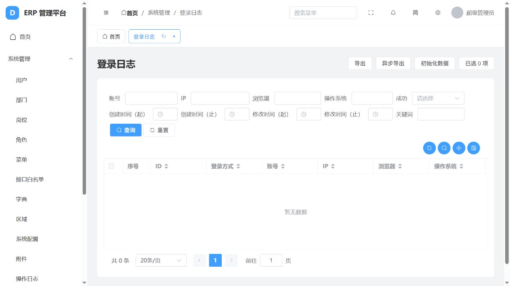

# 默认隐藏分栏导航与测试残留清理

完成时间：2026-10-11。正式服务：http://127.0.0.1:8000/；版本：1.0.0.1791688444185。

## 导航修改

`web/src/appearance.ts` 默认布局由 `classic` 调整为 `defaults`，经典布局拆分菜单仍为关闭状态。页面只保留一列普通侧栏，最左侧深色分栏导航默认不渲染。

仅修改默认值无法覆盖浏览器过去保存的 `columns` 偏好。因此使用一次性的 `appearance-layout-version=1` 偏好迁移：首次加载新版时切回默认布局并关闭经典拆分，保留颜色、深色模式及其他设置；迁移完成后，用户主动选择的布局继续正常保存。恢复默认同样回到单侧导航。没有删除分栏布局功能，没有每次刷新强制覆盖用户的新选择。

正常的系统管理、任务管理、组件示例、图表 CRUD 示例及菜单权限全部保留。组件和图表示例是现有功能入口，不归为偶然的测试残留。当前正式数据库本来就没有“本机 iframe 验收”菜单，本次没有伪称删除它。

## 已清理的正式数据

| 内容 | 数量 | 范围 |
| --- | ---: | --- |
| 测试异步导出记录 | 3 | 下载任务 ID 1、2、3；根据已确认的 task_id 选取 |
| 对应 xlsx 文件 | 3 | `media/downloads/2026/10/export-1.xlsx` 至 `export-3.xlsx` |
| 测试登录日志 | 6 | ID 1 至 6；根据管理员账号及原始创建时间选取 |
| 测试操作日志 | 4 | ID 1 至 3 为测试岗位异步导出，ID 4 为早期审计 `/api/account/` GET 记录 |
| 空的测试目录 | 2 个目录树 | `media/test-excel`、`media/test-platform`，逐级确认空目录后移除 |

清理后下载记录、登录日志、操作日志及 media 文件数均为 0。后续正常使用产生的新日志、附件和下载记录会继续保留，不添加自动清空机制。

清理前备份位于 `data-backups/navigation-cleanup-20261011-111316/`，包含 SQLite 完整快照、3 个原始导出文件和清理记录。该目录已忽略提交。不是大型打包目录，也没有重新引入打包功能。

## 保留与核对

SQLite `integrity_check` 通过。清理前后逐表比较，只有 `system_downloadcenter`、`system_loginlog`、`system_operationlog` 三张表改变，其他表完全相同，包括管理员全字段、部门、角色、菜单、按钮、字段权限和系统配置。

正常 `celery.backend_cleanup` 定时任务及其运行结果保留，Redis、worker、beat 未重启。仅重启正式网页服务以加载前端对应的版本号。管理员密码与 `pwd_change_count=0` 保持原样。

## 验证结果与范围

- Vue TypeScript 检查、Vite 构建和 collectstatic 通过。
- 直接执行外观状态逻辑，验证新浏览器默认、旧分栏偏好迁移、旧经典拆分偏好迁移、其他主题偏好保留、之后主动开启分栏的偏好保留、恢复默认，全部通过。
- 正式 8000 SQLite 就绪检查通过，25 个资源 metadata/list 接口全部返回成功；前后端版本一致。
- 正式浏览器仍在首次改密页面，本轮没有代改正式密码，也没有把该页面当成主界面验收。
- 使用正式数据库的隔离副本、独立签名密钥和 8008 临时服务，加载同一份实际前端构建。副本内预置旧 `columns` 偏好，并仅在副本中设置已完成首次改密状态。真实页面显示单侧栏；DOM 中 `.catalog-rail` 数量为 0，`.sidebar` 数量为 1。外观设置显示“默认”，登录日志显示“共 0 条”。
- 验证完成后关闭 8008 服务，删除临时数据库、静态文件副本及测试凭据；保留正式 8000 服务。

本轮未新增业务限制、通用兜底、重试或额外功能。外观迁移是用户要求的已有偏好更新，文件范围检查及备份只用于本次清理操作。

机器可读记录：`navigation-appearance-verification.json`、`navigation-cleanup-verification.json`、`navigation-service-verification.json`。之前 `source-only-verification.json` 记录的是清理前保留 3 个导出文件的历史状态，本文件及本轮清理记录为当前状态。

